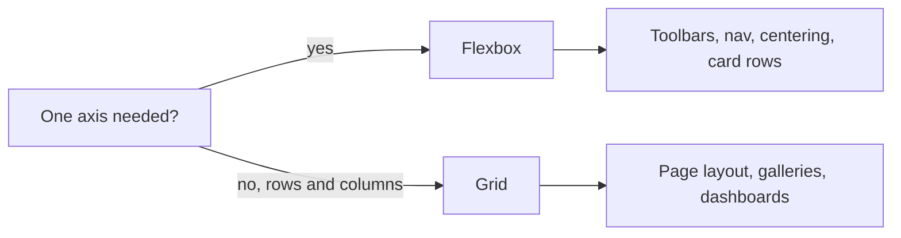

# How do Flexbox Grid and responsive design work

---

## 🟢 Junior Level

**Flexbox** is a CSS layout model for arranging items in **one dimension** (a row *or* a column). **CSS Grid** arranges items in **two dimensions** (rows *and* columns at once). **Responsive design** means one page adapts to any screen size, from a phone to a 4K monitor.

### Simple Real-World Analogy
Flexbox is a **bookshelf row**: books of different widths are lined up, you decide spacing and how they stretch. Grid is a **chessboard / spreadsheet**: you define rows and columns and place things into cells. Responsive design is a **rubber-band layout**: on a narrow shelf, books stack onto a second line.



### Minimal Flexbox example

```html
<nav class="bar">
  <a href="/">Home</a><a href="/docs">Docs</a><button>Login</button>
</nav>
```
```css
.bar {
  display: flex;
  gap: 1rem;
  align-items: center;          /* cross axis */
  justify-content: space-between; /* main axis */
}
```

### Minimal Grid example

```css
.gallery {
  display: grid;
  grid-template-columns: repeat(3, 1fr);
  gap: 16px;
}
```

### Centering anything (the classic question)

```css
.center { display: grid; place-items: center; min-height: 100vh; }
```

### Responsive basics
1. Add the viewport meta tag: `<meta name="viewport" content="width=device-width, initial-scale=1">`.
2. Use relative units (`%`, `rem`, `fr`, `vw`) rather than fixed pixels.
3. Use **media queries** to change layout at breakpoints.

```css
.sidebar { display: none; }
@media (min-width: 768px) {
  .sidebar { display: block; }
}
```

---

## 🟡 Middle Level

### Flexbox internals: main axis vs cross axis
`flex-direction` sets the main axis (`row` default). `justify-content` aligns along the main axis, `align-items` along the cross axis. The sizing of each item is governed by three properties, usually written as the `flex` shorthand:

| Property | Meaning |
|---|---|
| `flex-grow` | share of free space it takes |
| `flex-shrink` | how readily it shrinks when space is short |
| `flex-basis` | starting size before grow/shrink |

```css
.item-fixed { flex: 0 0 240px; }  /* never grow/shrink, 240px */
.item-fluid { flex: 1 1 0; min-width: 0; } /* fill the rest */
```

The notorious bug: flex items have `min-width: auto`, so long text/`pre` content will not shrink and overflows. Fix with `min-width: 0` and `overflow: hidden/auto`.

### Grid essentials

```css
.layout {
  display: grid;
  grid-template-columns: 240px minmax(0, 1fr);
  grid-template-areas:
    "header header"
    "nav    main"
    "footer footer";
  min-height: 100dvh;
}
.layout > header { grid-area: header; }
.layout > nav    { grid-area: nav; }
.layout > main   { grid-area: main; }
.layout > footer { grid-area: footer; }
```

Responsive card grid **without a single media query**:

```css
.cards {
  display: grid;
  grid-template-columns: repeat(auto-fill, minmax(260px, 1fr));
  gap: 1.5rem;
}
```
`auto-fill` keeps empty tracks; `auto-fit` collapses them so remaining items stretch.

### Flexbox vs Grid decision table
| Need | Choose |
|---|---|
| Content-driven row of items that wraps | Flexbox |
| Align items inside a component (icon + text) | Flexbox |
| Layout-driven two-dimensional structure | Grid |
| Overlapping elements | Grid (same cell) |
| Equal-height columns with aligned rows | Grid / subgrid |

They compose: a Grid page layout with Flexbox inside components.

### Responsive strategy
- **Mobile-first**: base styles for small screens, then `min-width` queries to enhance.
- **Fluid typography**: `font-size: clamp(1rem, 0.9rem + 1vw, 1.5rem);`
- **Responsive images**: `` or `<picture>`; always set `width`/`height` to prevent layout shift.
- **Logical properties**: `margin-inline`, `padding-block` for RTL support.

```html

```

### Common mistakes
- Using `100vh` on mobile (the address bar overlaps) — prefer `100dvh`.
- Desktop-first `max-width` cascades that become hard to override.
- Forgetting the viewport meta tag, so the phone renders a 980px page scaled down.
- Using fixed breakpoints for devices rather than for where the *content* breaks.

---

## 🔴 Senior Level

### Container queries: component-level responsiveness
Viewport media queries do not work for a card placed in a narrow sidebar on a wide screen. Container queries (baseline since 2023) solve it:

```css
.card-wrap { container: card / inline-size; }

.card { display: grid; gap: .75rem; }
@container card (min-width: 480px) {
  .card { grid-template-columns: 160px 1fr; }
}
```

This makes components truly reusable across a design system and is essential in micro-frontend layouts where the host page layout is unknown.

### Subgrid, aspect-ratio, and intrinsic design

```css
.product-list { display: grid; grid-template-columns: repeat(auto-fill, minmax(220px, 1fr)); gap: 1rem; }
.product {
  display: grid;
  grid-row: span 3;
  grid-template-rows: subgrid; /* title/price/button align across cards */
}
.thumb { aspect-ratio: 4 / 3; object-fit: cover; width: 100%; }
```

Intrinsic design (Jen Simmons): let `min-content`, `max-content`, `fr` and `clamp` do the work, using media queries only for large structural changes.

### Performance and robustness
- Grid and flex layout are cheap, but deeply nested flex with `flex-basis: auto` and text measurement can cause expensive multi-pass layout. Keep DOM depth sane.
- Large lists: use `content-visibility: auto` or virtualization (react-window, Angular CDK virtual scroll) instead of laying out 10,000 rows.
- Support `prefers-reduced-motion`, `prefers-contrast`, and print stylesheets (`@media print`) for enterprise apps where users print reports.
- Test with real devices or DevTools throttling + emulation; verify touch targets of at least 24x24 CSS px (WCAG 2.2) and ideally 44px.

### Dashboard example: holy-grail layout with graceful degradation

```css
.app {
  display: grid;
  grid-template-columns: 1fr;
  grid-template-rows: auto 1fr auto;
  min-height: 100dvh;
}
@media (min-width: 64rem) {
  .app { grid-template-columns: clamp(200px, 20vw, 300px) minmax(0, 1fr); }
  .app > header, .app > footer { grid-column: 1 / -1; }
}
@supports not (display: grid) {
  .app { display: flex; flex-direction: column; }
}
```

### Edge cases
- `gap` in flexbox is supported in all evergreen browsers; legacy margin hacks are no longer needed.
- `fr` units respect min-content: use `minmax(0, 1fr)` to allow shrinking.
- Percentage heights need a parent with an explicit height; grid/flex avoid this class of problem.
- Bidirectional text: prefer `start`/`end` and logical properties over `left`/`right`.

---

## 🎯 Interview Cheat Sheet

**30-second pitch:** Flexbox lays out in one dimension and is content-driven; Grid is two-dimensional and layout-driven. Build mobile-first with relative units, `clamp()`, `auto-fit/minmax` grids, responsive images, and container queries for reusable components.

**Must-know bullets**
- `justify-content` = main axis, `align-items` = cross axis.
- `flex: 1` = `1 1 0`; fix overflow with `min-width: 0`.
- `repeat(auto-fit, minmax(260px, 1fr))` is a query-free responsive grid.
- `100dvh` over `100vh`; the viewport meta tag is mandatory.
- Container queries > media queries for components.

**Common follow-up questions**
1. How would you center a div both ways?
2. `auto-fill` vs `auto-fit`?
3. Mobile-first vs desktop-first and why?
4. How do you avoid layout shift for images?

**Red flags**
- Using floats or tables for layout in new code.
- Device-specific breakpoints (iPhone, iPad) instead of content-driven.
- Fixed pixel widths everywhere.

**Related topics**
- [How do the CSS box model and specificity work](02.%20How%20do%20the%20CSS%20box%20model%20and%20specificity%20work.md)
- [How to optimize web performance](16.%20How%20to%20optimize%20web%20performance.md)
- [What are micro-frontends](20.%20What%20are%20micro-frontends.md)
