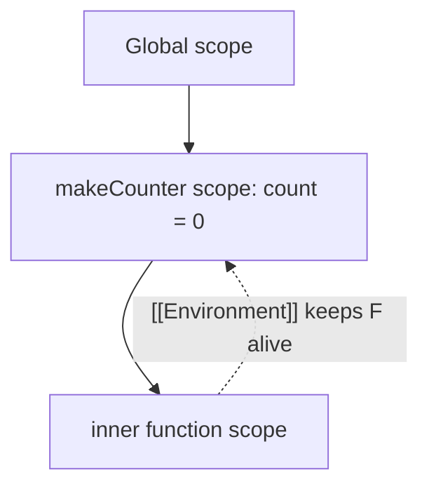

# What are closures and how does this work

---

## 🟢 Junior Level

A **closure** is a function that remembers the variables from the place where it was *created*, even after that outer code has finished running. The keyword **`this`** is a special value that refers to *who is calling* the function (the call-site), not where it was written (except in arrow functions).

### Simple Real-World Analogy
A closure is a **backpack**: when a function leaves the house (outer function) it takes along the variables it needs. `this` is a **name tag** that gets stuck on a function depending on who invokes it: `user.greet()` → the tag says "user".

### Closure example

```js
function makeCounter() {
  let count = 0;            // private variable
  return function () {
    count += 1;
    return count;
  };
}

const c1 = makeCounter();
const c2 = makeCounter();
console.log(c1(), c1(), c1()); // 1 2 3
console.log(c2());             // 1  (independent backpack)
```

`count` cannot be touched from outside — closures give JavaScript its way of creating **private state**.

### `this` example

```js
const user = {
  name: 'Ann',
  greet() { console.log('Hi, ' + this.name); }
};
user.greet();            // Hi, Ann  (this = user)

const g = user.greet;
g();                     // Hi, undefined  (this lost: undefined in strict mode / window otherwise)
```

### The four basic rules for `this`
1. **Method call** `obj.fn()` → `this` is `obj`.
2. **Plain call** `fn()` → `undefined` (strict/modules) or global object (sloppy).
3. **`new Fn()`** → `this` is the newly created object.
4. **`call/apply/bind`** → `this` is what you pass explicitly.

Arrow functions have **no own `this`**; they use the `this` of the surrounding code.

---

## 🟡 Middle Level

### How closures work
Every function carries a hidden reference ([[Environment]]) to the lexical environment where it was defined. When it runs, name lookup climbs this chain. Variables captured by an inner function are kept alive on the heap as long as that function is reachable.



### Practical uses

```js
// 1. Module pattern / encapsulation
const bank = (() => {
  let balance = 0;
  return {
    deposit: n => (balance += n),
    get balance() { return balance; }
  };
})();

// 2. Partial application / factories
const multiplyBy = factor => n => n * factor;
const double = multiplyBy(2);

// 3. Debounce - classic interview task
function debounce(fn, ms) {
  let timer;
  return (...args) => {
    clearTimeout(timer);
    timer = setTimeout(() => fn(...args), ms);
  };
}
const onSearch = debounce(q => fetch(`/api/search?q=${q}`), 300);

// 4. Memoize
const memo = fn => {
  const cache = new Map();
  return x => cache.has(x) ? cache.get(x) : (cache.set(x, fn(x)), cache.get(x));
};
```

### `this` in depth

```js
const timer = {
  seconds: 0,
  startBad()  { setInterval(function () { this.seconds++; }, 1000); }, // this != timer
  startGood() { setInterval(() => { this.seconds++; }, 1000); },       // lexical this
};
```

Binding functions explicitly:

```js
function show(greeting, punct) { return `${greeting}, ${this.name}${punct}`; }
show.call({ name: 'Ann' }, 'Hello', '!');     // call: args listed
show.apply({ name: 'Bob' }, ['Hi', '?']);     // apply: args array
const bound = show.bind({ name: 'Cy' }, 'Yo'); // bind: returns new function
bound('.');
```

`bind` creates a permanently bound function; `call`/`apply` on it cannot change `this`.

### Common mistakes
| Mistake | Fix |
|---|---|
| Passing a method as callback (`btn.onclick = obj.method`) loses `this` | `bind`, arrow wrapper, or class field arrow |
| `var` in loop with async callbacks | use `let` |
| Arrow function as object method needing `this` | use method shorthand |
| Using arrow as constructor | arrows can't be `new`-ed |
| Memory leak via closure retaining big objects | null out references; avoid capturing large scopes in long-lived listeners |

### Class fields and React history
In class components, handlers needed `this.handleClick = this.handleClick.bind(this)`, or arrow class fields. Function components with hooks eliminated `this` entirely — one reason closures (stale closure bugs!) became the main concept to master in React.

---

## 🔴 Senior Level

### Stale closures in React hooks
A function created in a render captures that render's props/state. If an effect or timer is created once and never refreshed, it keeps using old values.

```tsx
function Ticker() {
  const [n, setN] = useState(0);

  useEffect(() => {
    const id = setInterval(() => {
      console.log(n);          // always 0: stale closure
      setN(n + 1);             // stuck at 1
    }, 1000);
    return () => clearInterval(id);
  }, []);                      // empty deps freeze the closure

  // Fix 1: functional update, no dependency on n
  // setN(prev => prev + 1);
  // Fix 2: use a ref for the latest value
}
```

```tsx
const latest = useRef(n);
useEffect(() => { latest.current = n; });
```

### Memory and performance
- V8 builds a shared "context" per scope: *all* closures from the same scope share it, so one small closure can keep a large unrelated variable alive if another closure in the same scope references it. Heap snapshots in Chrome DevTools (Retained size) reveal this.
- Event listeners, timers, subscriptions and observables are the usual leak sources: always remove/unsubscribe (`AbortController` for fetch and listeners).

```js
const ac = new AbortController();
window.addEventListener('resize', onResize, { signal: ac.signal });
// later: ac.abort() removes the listener
```

### `this` resolution algorithm details
- Strict mode `this` stays `undefined` for plain calls; sloppy mode boxes primitives (`this` becomes a `String` object).
- `new.target`, `super` and `this` in derived constructors: `this` is unavailable until `super()` returns.
- Optional chaining call `obj.method?.()` preserves `this`; but `(0, obj.method)()` and destructured `const { method } = obj` do not.
- Event handlers via `addEventListener`: `this` is the element (non-arrow) — `event.currentTarget` is the safer reference.
- TypeScript: `noImplicitThis` and explicit `this` parameter types.

```ts
function area(this: { w: number; h: number }) { return this.w * this.h; }
area.call({ w: 2, h: 3 });  // OK
// area();                  // compile error
```

### Private state: closure vs `#private`
Closures were the only privacy mechanism; today `#field` (ES2022) is enforced by the engine, works with classes and is faster for many instances (methods shared on the prototype rather than per-instance closures).

```js
class Account {
  #balance = 0;
  deposit(n) { this.#balance += n; return this; }
  get balance() { return this.#balance; }
}
```

Closures remain ideal for functional factories, hooks, middleware and decorators.

### Interview task: implement `once`, `curry`, and `bind`

```js
const once = fn => { let done = false, r; return (...a) => done ? r : (done = true, r = fn(...a)); };

const curry = fn => function c(...args) {
  return args.length >= fn.length ? fn(...args) : (...next) => c(...args, ...next);
};

Function.prototype.myBind = function (ctx, ...pre) {
  const fn = this;
  return function (...rest) { return fn.apply(ctx, [...pre, ...rest]); };
};
```

---

## 🎯 Interview Cheat Sheet

**30-second pitch:** A closure is a function plus a reference to the lexical scope where it was created, enabling private state, factories and callbacks. `this` is determined by how a function is called (method, plain, `new`, `call/apply/bind`), except arrow functions which capture `this` lexically.

**Must-know bullets**
- Closures keep variables alive as long as the function is reachable.
- Four `this` rules + arrow exception.
- Losing `this` when extracting a method.
- Stale closures in `useEffect`/timers; use functional updates/refs.
- Closures can leak memory via listeners/timers.

**Common follow-up questions**
1. Output of `for (var i...) setTimeout` and three ways to fix it?
2. Write `debounce` and `throttle`.
3. `call` vs `apply` vs `bind`?
4. Why can't arrow functions be constructors?

**Red flags**
- "Closures are only for callbacks."
- Cannot predict `this` in a detached method.
- `.bind(this)` inside render loops without reason.

**Related topics**
- [What is the difference between var let and const](04.%20What%20is%20the%20difference%20between%20var%20let%20and%20const.md)
- [How does prototypal inheritance work in JavaScript](06.%20How%20does%20prototypal%20inheritance%20work%20in%20JavaScript.md)
- [What are React hooks and reconciliation](15.%20What%20are%20React%20hooks%20and%20reconciliation.md)
