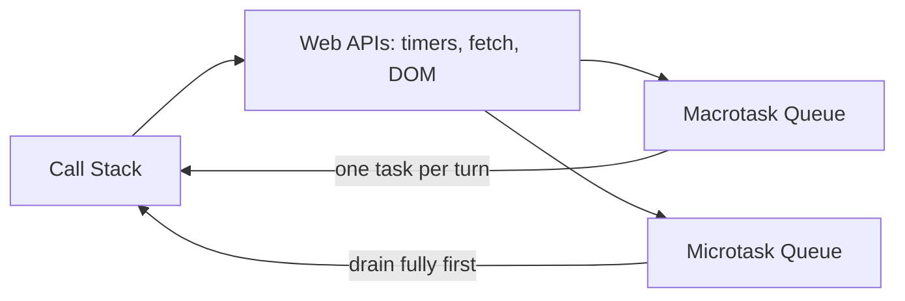

# How does the JavaScript event loop work

---

## 🟢 Junior Level

JavaScript runs your code on a **single thread**: it can do only one thing at a time. Yet pages stay responsive while waiting for network calls and timers. The secret is the **event loop**: a mechanism that takes finished asynchronous tasks from queues and runs them on the **call stack** when the stack is empty.

Key pieces:
- **Call stack** — where functions currently being executed are stacked (LIFO).
- **Web APIs / runtime** — browser (or Node/libuv) facilities doing slow work outside JS: timers, `fetch`, DOM events.
- **Task queue (macrotasks)** — callbacks like `setTimeout`, DOM events, I/O.
- **Microtask queue** — promise callbacks (`.then`, `await` continuation), `queueMicrotask`, `MutationObserver`.

### Simple Real-World Analogy
A single waiter (the thread) in a restaurant. He takes an order (runs a function), hands it to the kitchen (Web APIs) and immediately serves the next table. When the kitchen rings the bell, the dish waits on the counter (queue) until the waiter is free. Priority "VIP" dishes (microtasks) are served before any regular ones.



### Classic output question

```js
console.log('1 start');

setTimeout(() => console.log('2 timeout'), 0);

Promise.resolve().then(() => console.log('3 promise'));

console.log('4 end');
// Output: 1 start, 4 end, 3 promise, 2 timeout
```

Even with `0` ms, the timeout runs **after** the current code *and* after all microtasks.

### Why you should care
A long synchronous loop **blocks** the thread: no clicks, no rendering, a frozen page.

```js
button.onclick = () => {
  for (let i = 0; i < 5e9; i++) {}  // freezes the UI
};
```

---

## 🟡 Middle Level

### The exact loop turn (browser)
1. Pick the oldest **macrotask** (script, event callback, timer) and run it to completion.
2. **Drain the microtask queue completely** (including microtasks queued by microtasks).
3. If it's time, **render**: run `requestAnimationFrame` callbacks, style, layout, paint.
4. Optionally run idle callbacks (`requestIdleCallback`); repeat.

Therefore microtasks can **starve** rendering and other tasks if they keep re-queueing themselves.

```js
function loop() { Promise.resolve().then(loop); } // never yields: page freezes
```

### `async/await` ordering
`await x` is sugar for `Promise.resolve(x).then(continuation)`: code after `await` is a microtask.

```js
async function a() { console.log('a1'); await b(); console.log('a2'); }
async function b() { console.log('b'); }

console.log('start');
a();
Promise.resolve().then(() => console.log('p'));
console.log('end');
// start, a1, b, end, a2, p
```

### Task sources and priority

| Mechanism | Queue | Notes |
|---|---|---|
| `setTimeout/setInterval` | macrotask | min delay clamped (4ms nested), throttled in background tabs |
| DOM events, `postMessage`, `MessageChannel` | macrotask | `MessageChannel` is used by React scheduler |
| `Promise.then`, `await`, `queueMicrotask` | microtask | before next macrotask |
| `requestAnimationFrame` | before paint | ~60Hz, ideal for visual updates |
| `requestIdleCallback` | idle | low priority work |
| `scheduler.postTask` | prioritized | Chromium; `user-blocking`, `user-visible`, `background` |

### Node.js flavor
Node uses libuv phases: timers → pending callbacks → poll (I/O) → check (`setImmediate`) → close. Between each callback `process.nextTick` queue runs first, then promise microtasks.

```js
setTimeout(() => console.log('timeout'), 0);
setImmediate(() => console.log('immediate'));
process.nextTick(() => console.log('nextTick'));
Promise.resolve().then(() => console.log('promise'));
// nextTick, promise, then timeout/immediate (order of the last two varies from main module)
```

### Breaking up long tasks

```js
async function processChunks(items, chunk = 500) {
  for (let i = 0; i < items.length; i += chunk) {
    items.slice(i, i + chunk).forEach(heavy);
    await new Promise(r => setTimeout(r, 0)); // yield to the event loop so UI can paint
  }
}
```

Better: move CPU work to a **Web Worker**, which has its own event loop.

```js
const worker = new Worker(new URL('./hash.worker.js', import.meta.url), { type: 'module' });
worker.postMessage(bigPayload);
worker.onmessage = e => render(e.data);
```

### Common mistakes
- Assuming `setTimeout(fn, 100)` fires at exactly 100 ms — it is a *minimum*.
- Blocking with `alert`, sync XHR or heavy `JSON.parse`.
- Forgetting that unhandled rejections surface later.
- Thinking `async` functions run in parallel threads — they don't.

---

## 🔴 Senior Level

### Interaction to Next Paint and long tasks
Any task over **50 ms** is a "long task". INP (Core Web Vitals) measures the latency of user interactions; long tasks directly degrade it. Detect them:

```js
new PerformanceObserver(list => {
  for (const e of list.getEntries()) console.warn('Long task', Math.round(e.duration), 'ms');
}).observe({ type: 'longtask', buffered: true });
```

Yielding strategies: `scheduler.yield()` (where available), `await new Promise(r => setTimeout(r))`, chunking, `requestIdleCallback`, workers, and (in React) concurrent features: `useTransition`, `useDeferredValue` that let React time-slice rendering via the scheduler.

```tsx
const [isPending, startTransition] = useTransition();
function onChange(e: ChangeEvent<HTMLInputElement>) {
  setQuery(e.target.value);                       // urgent: keep typing smooth
  startTransition(() => setFiltered(filter(e.target.value))); // non-urgent
}
```

### Microtask checkpoint details
Microtasks run after each callback when the JS stack empties (not just between macrotasks): after an event listener returns, the queue drains before the next listener of the same event is dispatched, when the event is dispatched by the user. (If you call `el.click()` from script, the stack isn't empty, so listeners run nested before microtasks.) This causes subtle differences in tests that synthesize events.

### Backpressure and ordering bugs
Async code interleaves at every `await`: check-then-act races are possible in single-threaded JS.

```js
let busy = false;
async function save() {
  if (busy) return;       // guard
  busy = true;
  try { await fetch('/api/save', { method: 'POST' }); }
  finally { busy = false; }
}
```

Stale response race (typeahead): the slower older request may arrive last. Use `AbortController` or sequence IDs.

```js
let ctrl;
async function search(q) {
  ctrl?.abort();
  ctrl = new AbortController();
  try {
    const res = await fetch(`/api/search?q=${encodeURIComponent(q)}`, { signal: ctrl.signal });
    render(await res.json());
  } catch (e) { if (e.name !== 'AbortError') throw e; }
}
```

### Worker threads, SharedArrayBuffer, and Node servers
- Node: one event loop per process; CPU-heavy work in `worker_threads` or separate services. Compared with Java's thread-per-request (or virtual threads), a blocked Node loop stalls *every* request — blocking calls like `fs.readFileSync` or catastrophic regex (ReDoS) are production incidents.
- `SharedArrayBuffer` + `Atomics` need cross-origin isolation headers (COOP/COEP).
- `OffscreenCanvas` and `Worker` move rendering/computation off the main thread.

### Diagnosing
Chrome DevTools → Performance panel: Main thread flame chart, "Long Task" red corner markers, "Event: click" with handler duration. Node: `--inspect`, `clinic doctor`, `perf_hooks.monitorEventLoopDelay()`.

```js
import { monitorEventLoopDelay } from 'node:perf_hooks';
const h = monitorEventLoopDelay({ resolution: 20 }); h.enable();
setInterval(() => console.log('p99 lag ms', h.percentile(99) / 1e6), 5000);
```

---

## 🎯 Interview Cheat Sheet

**30-second pitch:** JS has one thread with a call stack. Async work is delegated to host APIs; completed callbacks wait in queues. After each macrotask the engine drains *all* microtasks (promises, `await`), then may render, then picks the next macrotask. Never block the loop; chunk or offload to workers.

**Must-know bullets**
- Order: sync code → microtasks → (render) → next macrotask.
- `await` continuation = microtask; `setTimeout(0)` = macrotask.
- Microtask starvation can freeze rendering.
- Long tasks (>50 ms) hurt INP; yield or use workers.
- Node: `nextTick` > promises > timers/immediate; a blocked loop stalls all requests.

**Common follow-up questions**
1. Predict the output of a mixed `setTimeout`/`Promise`/`async` snippet.
2. Difference between microtask and macrotask?
3. How does React avoid blocking the main thread?
4. How do you cancel an in-flight request?

**Red flags**
- "JavaScript is multithreaded because of async."
- Using sync I/O in a Node request handler.
- Not handling out-of-order responses.

**Related topics**
- [How do Promises and async await error handling work](09.%20How%20do%20Promises%20and%20async%20await%20error%20handling%20work.md)
- [What is the DOM and event delegation](10.%20What%20is%20the%20DOM%20and%20event%20delegation.md)
- [How to optimize web performance](16.%20How%20to%20optimize%20web%20performance.md)
