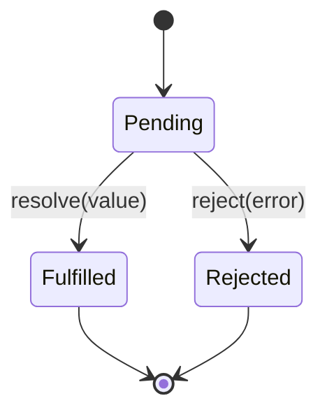

# How do Promises and async await error handling work

---

## 🟢 Junior Level

A **Promise** is an object representing a value that will be available *later* — the eventual result (or failure) of an asynchronous operation. A promise is in one of three states: **pending**, **fulfilled** (success with a value) or **rejected** (failure with a reason). **`async/await`** is syntax that lets you write promise-based code in a straight-line, synchronous-looking style.

### Simple Real-World Analogy
Ordering a pizza and getting a **buzzer**. The buzzer is the promise: the pizza isn't ready (pending). It later either lights up with your pizza (fulfilled) or says "we ran out of dough" (rejected). While waiting you are free to do other things.



### Minimal example

```js
const wait = (ms) => new Promise((resolve) => setTimeout(resolve, ms));

wait(500)
  .then(() => fetch('/api/orders'))
  .then((res) => res.json())
  .then((orders) => console.log(orders))
  .catch((err) => console.error('Something failed', err))
  .finally(() => console.log('done'));
```

### Same with async/await

```js
async function loadOrders() {
  try {
    await wait(500);
    const res = await fetch('/api/orders');
    return await res.json();
  } catch (err) {
    console.error('Something failed', err);
  } finally {
    console.log('done');
  }
}
```

Rules to remember:
1. An `async` function **always returns a promise**.
2. `await` can only be used inside an `async` function or at the top level of an ES module.
3. A thrown error inside an async function becomes a **rejected promise**.

---

## 🟡 Middle Level

### Chaining semantics
`.then(f)` returns a *new* promise. If `f` returns a value, the new promise fulfills with it; if `f` returns a promise, it adopts that promise; if `f` throws, the new promise rejects. `.catch(h)` is `.then(undefined, h)` and **recovers** the chain if `h` returns normally.

```js
fetchUser()
  .then(u => { throw new Error('boom'); })
  .then(() => console.log('skipped'))
  .catch(e => 'fallback')          // chain recovered
  .then(v => console.log(v));      // 'fallback'
```

### Combinators

| Method | Resolves when | Rejects when |
|---|---|---|
| `Promise.all([...])` | all fulfilled (array of values) | **first** rejection (fail-fast) |
| `Promise.allSettled([...])` | all settled, results `{status, value/reason}` | never |
| `Promise.race([...])` | first settles | first settles with rejection |
| `Promise.any([...])` | first **fulfilled** | all rejected (`AggregateError`) |

```js
// Parallel: total time = slowest request
const [user, orders] = await Promise.all([getUser(id), getOrders(id)]);

// Sequential by mistake: total time = sum
const u = await getUser(id);
const o = await getOrders(id);        // doesn't depend on u -> should be parallel

// Partial failures tolerated
const results = await Promise.allSettled(urls.map(u => fetch(u)));
const ok = results.filter(r => r.status === 'fulfilled').map(r => r.value);
```

### Error handling patterns
`fetch` **does not reject on HTTP 4xx/5xx** — only on network failure. You must check `res.ok`.

```js
class ApiError extends Error {
  constructor(status, body) { super(`HTTP ${status}`); this.status = status; this.body = body; }
}

async function http(url, init) {
  const res = await fetch(url, init);
  if (!res.ok) throw new ApiError(res.status, await res.text().catch(() => ''));
  return res.status === 204 ? null : res.json();
}
```

Retry with backoff:

```js
async function retry(fn, { retries = 3, base = 200 } = {}) {
  for (let attempt = 0; ; attempt++) {
    try { return await fn(); }
    catch (e) {
      if (attempt >= retries || (e instanceof ApiError && e.status < 500)) throw e;
      await new Promise(r => setTimeout(r, base * 2 ** attempt + Math.random() * 100));
    }
  }
}
```

Timeouts and cancellation:

```js
const res = await fetch('/api/slow', { signal: AbortSignal.timeout(5000) });
```

### Common mistakes
- **Forgetting `await`**: the promise is not awaited, so errors become unhandled rejections and `try/catch` doesn't catch them.
- `await` inside `forEach` (callback is not awaited); use `for...of` or `Promise.all(map(...))`.
- `return promise` vs `return await promise` inside `try/catch`: without `await` the catch won't catch rejections.
- The explicit-construction anti-pattern: wrapping an existing promise in `new Promise`.
- Swallowing errors with empty `catch {}`.

```js
// Bug: catch is never reached for a rejected promise
async function bad() {
  try { return fetchData(); } catch (e) { handle(e); }
}
// Fix
async function good() {
  try { return await fetchData(); } catch (e) { handle(e); }
}
```

---

## 🔴 Senior Level

### Unhandled rejections
A rejected promise with no handler by the end of the microtask checkpoint fires `unhandledrejection` in browsers; in Node 15+ it **terminates the process** by default. Always register a global safety net *and* handle errors locally.

```js
// browser
window.addEventListener('unhandledrejection', e => {
  reportToSentry(e.reason);
  e.preventDefault();
});
// node
process.on('unhandledRejection', (reason) => { logger.error(reason); process.exit(1); });
```

### Concurrency control
`Promise.all(10_000 requests)` will hammer the server and the browser's per-host connection limits (6 for HTTP/1.1). Throttle:

```js
async function mapLimit(items, limit, fn) {
  const results = new Array(items.length);
  let i = 0;
  const workers = Array.from({ length: limit }, async () => {
    while (i < items.length) {
      const idx = i++;
      results[idx] = await fn(items[idx], idx);
    }
  });
  await Promise.all(workers);
  return results;
}
```

### Idempotency and races in UI
- Double-submit: disable the button, or use an idempotency key header handled by the Spring Boot backend.
- Out-of-order responses: abort the previous request with `AbortController`, or ignore results whose request id is not the latest.
- React 18 StrictMode runs effects twice in dev: effects that fetch must be idempotent and clean up with abort.

```tsx
useEffect(() => {
  const ac = new AbortController();
  http(`/api/users/${id}`, { signal: ac.signal })
    .then(setUser)
    .catch(e => { if (e.name !== 'AbortError') setError(e); });
  return () => ac.abort();
}, [id]);
```

### Promise internals
- `then` callbacks always run asynchronously (as microtasks), even if the promise is already settled: guarantees consistent ordering ("no Zalgo").
- Thenables: any object with `.then` is assimilated; resolving a promise with a promise adds extra microtask ticks (`await` of a native promise costs 1 tick in modern V8).
- `Promise.withResolvers()` (ES2024) exposes `resolve`/`reject` without the constructor closure dance.
- `AggregateError` and `Error.cause` for rich error context:

```js
try { await loadProfile(); }
catch (e) { throw new Error('Cannot render dashboard', { cause: e }); }
```

### Async stack traces and observability
Modern V8 provides async stack traces across `await`. Tag errors with request IDs/`traceparent` (W3C Trace Context) so frontend errors correlate with Spring Boot logs (Micrometer Tracing).

### Structured concurrency analogy with Java
`Promise.all` ≈ `CompletableFuture.allOf`; `Promise.any` ≈ `anyOf`; `AbortController` ≈ `Future.cancel` / structured concurrency scopes (Java 21+ `StructuredTaskScope`). JavaScript promises are **eager** (they start immediately) and cannot be cancelled natively — cancellation is cooperative via signals.

---

## 🎯 Interview Cheat Sheet

**30-second pitch:** A Promise models a future value with pending/fulfilled/rejected states; `async/await` is syntax over promises. Errors travel down the chain until a `catch`; `fetch` only rejects on network errors, so check `res.ok`. Use `Promise.all` for parallelism, `allSettled` for tolerance, `AbortController` for cancellation and always handle rejections.

**Must-know bullets**
- Async functions return promises; throw → rejection.
- `all` fail-fast, `allSettled` never rejects, `any` first success, `race` first settle.
- `await` in `forEach` doesn't work; sequential vs parallel awaits.
- `return await` inside `try/catch`.
- Unhandled rejections crash Node and should be monitored in the browser.

**Common follow-up questions**
1. Implement `Promise.all` yourself.
2. How would you retry with exponential backoff?
3. How do you cancel a fetch?
4. Why does `fetch` resolve on a 500 response?

**Red flags**
- Mixing callbacks, `.then` and `await` randomly.
- Empty catch blocks.
- Unbounded parallelism over large arrays.

**Related topics**
- [How does the JavaScript event loop work](08.%20How%20does%20the%20JavaScript%20event%20loop%20work.md)
- [How do fetch and CORS work in the browser](11.%20How%20do%20fetch%20and%20CORS%20work%20in%20the%20browser.md)
- [How to manage state in React](16.%20How%20to%20manage%20state%20in%20React.md)
