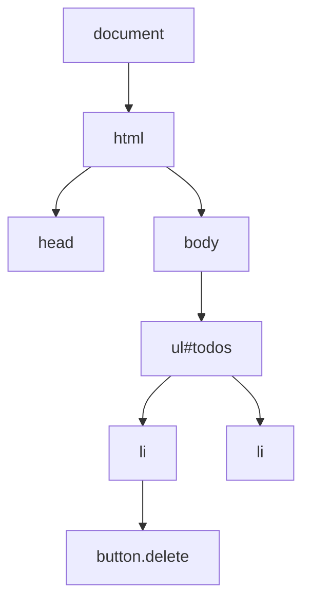

# What is the DOM and event delegation

---

## 🟢 Junior Level

The **DOM (Document Object Model)** is the browser's in-memory tree representation of your HTML page. Every tag becomes a **node** (object) that JavaScript can read and change: text, attributes, styles, children. When the DOM changes, the browser re-renders the page. **Events** (click, input, submit) travel through this tree, and **event delegation** is a technique where one listener on a parent handles events from many children.

### Simple Real-World Analogy
The DOM is a **family tree** of the page: the `<html>` grandparent, `<body>` parent, then many children. Event delegation is like a **receptionist for an office floor**: instead of installing a doorbell at every desk, visitors ring one bell at the reception, and the receptionist sees who they came for.



### Minimal example

```html
<ul id="todos">
  <li>Buy milk <button class="delete">x</button></li>
  <li>Write code <button class="delete">x</button></li>
</ul>
<button id="add">Add</button>

<script>
  // Select
  const list = document.querySelector('#todos');

  // Create + modify
  document.querySelector('#add').addEventListener('click', () => {
    const li = document.createElement('li');
    li.textContent = 'New task';          // safe: text, not HTML
    list.append(li);
  });

  // Event delegation: one listener for all current and future buttons
  list.addEventListener('click', (event) => {
    const btn = event.target.closest('button.delete');
    if (btn && list.contains(btn)) btn.parentElement.remove();
  });
</script>
```

### Essential DOM API
- Select: `querySelector`, `querySelectorAll`, `getElementById`.
- Modify: `textContent`, `classList.add/toggle`, `setAttribute`, `dataset`.
- Create: `createElement`, `append`, `prepend`, `remove`, `replaceWith`.
- Listen: `addEventListener('click', handler)`.

---

## 🟡 Middle Level

### Event propagation: three phases
When you click a nested element the event goes through:
1. **Capture phase** — from `window` down to the target.
2. **Target phase** — at the element itself.
3. **Bubble phase** — back up to `window`.

Listeners run in the bubble phase by default; pass `{ capture: true }` to listen on the way down.

```js
outer.addEventListener('click', () => console.log('outer bubble'));
outer.addEventListener('click', () => console.log('outer capture'), { capture: true });
inner.addEventListener('click', () => console.log('inner'));
// click inner: outer capture -> inner -> outer bubble
```

### `target` vs `currentTarget`
| Property | Meaning |
|---|---|
| `event.target` | the deepest element actually clicked |
| `event.currentTarget` | the element the listener is attached to |

With delegation, `target` can be a nested `<span>` inside the `<button>`, so use `closest()`.

### Controlling events
- `event.preventDefault()` cancels the default action (form submit, link navigation).
- `event.stopPropagation()` stops further propagation (use sparingly: it breaks delegation and analytics).
- `{ once: true }`, `{ passive: true }` (for scroll/touch listeners: promises not to call `preventDefault`, improves scrolling performance), `{ signal }` for removal.

```js
document.addEventListener('scroll', onScroll, { passive: true });
```

### Why delegate?
| Benefit | Explanation |
|---|---|
| Fewer listeners | 1 listener instead of 1000: less memory |
| Dynamic content | Elements added later work automatically |
| Simpler cleanup | One remove call |

Does not work for events that do not bubble: `focus`/`blur` (use `focusin`/`focusout`), `mouseenter/mouseleave`, `load`, `scroll` on elements.

```js
form.addEventListener('focusin', e => e.target.closest('.field')?.classList.add('active'));
```

### Data attributes for behavior routing

```html
<div id="toolbar">
  <button data-action="save">Save</button>
  <button data-action="export">Export</button>
</div>
```
```js
const actions = {
  save: () => saveDoc(),
  export: () => exportDoc(),
};
toolbar.addEventListener('click', e => {
  const action = e.target.closest('[data-action]')?.dataset.action;
  actions[action]?.();
});
```

### Common mistakes
- `innerHTML = userInput` — opens XSS ([see XSS](22.%20What%20are%20XSS%20CSRF%20CSP%20and%20same-origin%20policy.md)). Use `textContent` or sanitize.
- `querySelectorAll` returns a **static** `NodeList`; `getElementsByClassName` returns a **live** `HTMLCollection`.
- Anonymous function passed to `addEventListener` cannot be removed later.
- Manipulating the DOM in a loop causing repeated reflow.

---

## 🔴 Senior Level

### Rendering cost and layout thrashing
Reading layout properties (`offsetWidth`, `getBoundingClientRect`) forces a synchronous layout if styles are dirty. Interleaving reads and writes in a loop thrashes. Batch: read all, then write; or use `requestAnimationFrame`.

```js
requestAnimationFrame(() => {
  const heights = items.map(el => el.offsetHeight);          // reads
  items.forEach((el, i) => el.style.height = heights[i] + 8 + 'px'); // writes
});
```

Use `DocumentFragment` or `replaceChildren` to insert many nodes at once; `<template>` for cloning markup.

```js
const frag = document.createDocumentFragment();
rows.forEach(r => { const tr = document.createElement('tr'); tr.textContent = r.name; frag.append(tr); });
tbody.replaceChildren(frag);
```

### Observers instead of events/polling
- `IntersectionObserver` — lazy load, infinite scroll, visibility analytics.
- `ResizeObserver` — element-size reactions (no window resize hacks).
- `MutationObserver` — watch DOM changes (microtask-timed).

```js
const io = new IntersectionObserver((entries, obs) => {
  for (const e of entries) if (e.isIntersecting) { e.target.src = e.target.dataset.src; obs.unobserve(e.target); }
}, { rootMargin: '200px' });
document.querySelectorAll('img[data-src]').forEach(img => io.observe(img));
```

### Virtual DOM, Shadow DOM and Web Components
- Frameworks keep a virtual representation and patch the real DOM ([React reconciliation](15.%20What%20are%20React%20hooks%20and%20reconciliation.md)).
- **Shadow DOM** encapsulates markup and styles in a custom element; events crossing the boundary are **retargeted** (`event.target` becomes the host); `event.composedPath()` reveals the real path (for open roots). Delegation across shadow roots needs `composed: true` events.

```js
class UserCard extends HTMLElement {
  connectedCallback() {
    const root = this.attachShadow({ mode: 'open' });
    root.innerHTML = `<style>p{font-weight:600}</style><p><slot></slot></p>`;
    root.addEventListener('click', () => this.dispatchEvent(new CustomEvent('selected', { bubbles: true, composed: true })));
  }
}
customElements.define('user-card', UserCard);
```

### React and synthetic events
React 17+ attaches its own delegated listeners at the **root container** (not `document`) and dispatches synthetic events. Mixing native listeners on `document` with `stopPropagation` in React handlers can produce surprising results; use `e.nativeEvent` carefully.

### Memory leaks
Detached DOM nodes retained by closures, global maps or forgotten listeners keep subtrees alive. Chrome DevTools → Memory → Heap snapshot → filter "Detached". In SPAs always remove listeners in cleanup (`useEffect` return, Angular `DestroyRef`/`takeUntilDestroyed`).

### Security and sanitization
Use `Trusted Types` (CSP `require-trusted-types-for 'script'`) to forbid raw string sinks (`innerHTML`, `eval`), and DOMPurify when HTML must be rendered. `element.setHTML()` (Sanitizer API) is arriving in browsers.

---

## 🎯 Interview Cheat Sheet

**30-second pitch:** The DOM is the live tree of nodes the browser builds from HTML; JS manipulates it and listens to events. Events capture down and bubble up, so a single listener on a parent (event delegation, using `event.target.closest`) can serve many present and future children with less memory.

**Must-know bullets**
- Capture → target → bubble; `target` vs `currentTarget`.
- Delegation limits: non-bubbling events (`focus`, `mouseenter`).
- `textContent` vs `innerHTML` (XSS).
- `passive` listeners, `AbortController` signals for cleanup.
- Batch DOM reads/writes; use observers.

**Common follow-up questions**
1. How do you handle a click on dynamically added elements?
2. `stopPropagation` vs `preventDefault` vs `stopImmediatePropagation`?
3. What is a live vs static NodeList?
4. How does React handle events internally?

**Red flags**
- Attaching listeners inside loops to thousands of elements.
- Using `innerHTML` with user data.
- Relying on `stopPropagation` for logic.

**Related topics**
- [How does the JavaScript event loop work](08.%20How%20does%20the%20JavaScript%20event%20loop%20work.md)
- [What are React hooks and reconciliation](15.%20What%20are%20React%20hooks%20and%20reconciliation.md)
- [What are XSS CSRF CSP and same-origin policy](22.%20What%20are%20XSS%20CSRF%20CSP%20and%20same-origin%20policy.md)
