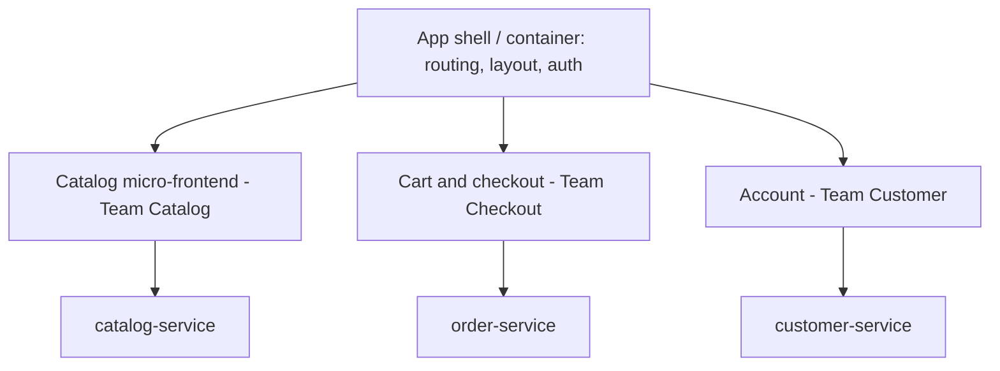

# What are micro-frontends

---

## 🟢 Junior Level

**Micro-frontends** apply the microservices idea to the frontend: a large web application is split into **independently developed and deployed pieces**, each owned by a team responsible for a business area end to end (e.g. "search team owns search UI + search service").



### Why teams do it
* Many teams working on one frontend monolith block each other (one build, one release train, merge conflicts).
* Teams can deploy their part independently and choose upgrade timing.
* Ownership aligns with business domains (and with backend services).

### Why it's often a bad idea
It adds significant complexity: duplicated dependencies, inconsistent UX, harder performance optimization, integration and versioning problems. For small/medium teams, a **well-modularized single frontend** (monorepo with clear module boundaries) is usually better.

---

## 🟡 Middle Level

### Integration approaches

| Approach | How | Pros | Cons |
| --- | --- | --- | --- |
| **Build-time** composition | Each MF is an npm package bundled by the shell | Simple, optimized bundle | Not independently deployable (shell must rebuild) |
| **Server-side** composition | Server/edge assembles HTML fragments (SSI/ESI, Podium, Next.js multi-zones) | Fast first load, SEO | Infrastructure complexity |
| **Run-time via Module Federation** | Shell loads remote JS modules at run time (webpack/Rspack/Vite plugins) | Independent deploys, shared dependencies | Version coordination, runtime failures |
| **Web Components** | Each MF exposes custom elements (`<checkout-cart>`) | Framework-agnostic boundaries | Styling/state integration effort |
| **iframes** | Each MF in an iframe | Strong isolation | Poor UX integration, performance, accessibility |
| **Route-based split** | Different routes served by different apps behind a proxy | Simplest independent deploy | Full page loads between areas |

### Module Federation sketch

```javascript
// shell (host) config
new ModuleFederationPlugin({
  name: 'shell',
  remotes: { checkout: 'checkout@https://cdn.shop.com/checkout/remoteEntry.js' },
  shared: { react: { singleton: true, requiredVersion: '^18.3.0' },
            'react-dom': { singleton: true, requiredVersion: '^18.3.0' } },
});

// shell code
const CheckoutPage = React.lazy(() => import('checkout/CheckoutPage'));
```

`shared` singletons avoid loading React twice; version mismatches must be managed carefully.

---

## 🔴 Senior Level

### Hard problems you must solve
* **Consistent UX**: a shared **design system** (component library + design tokens) versioned and published; otherwise every team's buttons look different.
* **Shared dependencies**: duplicate framework copies bloat bundles; singleton sharing requires coordinated upgrades — the "independent deployment" promise weakens when React majors must align.
* **Cross-MF communication**: keep it minimal and explicit — URL state, custom DOM events, a small event bus, or backend state; avoid shared global stores coupling teams.
* **Authentication/session**: handled once by the shell or a BFF; MFs receive user context through well-defined APIs.
* **Routing**: shell owns top-level routes; MFs own sub-routes.
* **Performance**: multiple bundles, runtime loading and waterfalls hurt LCP/INP; set per-MF budgets, preload critical remotes, and monitor real-user metrics per area.
* **Resilience**: a failed remote must not blank the whole page — error boundaries and fallbacks per MF; version pinning and rollback for remotes.
* **Testing**: contract tests between shell and MFs (exposed module interfaces), E2E for cross-MF journeys.

### Decision checklist
Micro-frontends make sense when:
* there are **many teams** (often 5+ frontend-heavy teams) blocking each other on one codebase,
* business areas are **clearly separable** in the UI,
* the organization can fund a **platform/design-system team**,
* independent release cadence is a real business need.

Otherwise, achieve most benefits with a **modular monolith frontend**: monorepo (Nx/Turborepo), enforced module boundaries (lint rules for imports), code owners, route-based lazy loading, and a single deployment pipeline with fast CI.

### Relation to backend architecture
Micro-frontends work best when vertical slices match backend boundaries (each team owns UI + BFF + services for its domain). Splitting the frontend without aligned team ownership produces distributed coupling — the frontend version of a distributed monolith.

---

## 🎯 Interview Cheat Sheet

**30-second pitch:** Micro-frontends split a web app into independently developed and deployed parts owned by domain teams, integrated at build time, on the server, or at run time via Module Federation, Web Components or route splits. They solve team-scaling problems but add complexity — design consistency, shared dependency versions, communication, performance and resilience — so I'd only use them with many teams and clear domain boundaries, and otherwise prefer a modular monolith frontend.

**Must know:**
* Motivation: team autonomy and independent deploys.
* Integration options and trade-offs.
* Module Federation shared singletons.
* Design system, communication, auth, routing, performance, error boundaries.
* Modular monolith frontend as the default alternative.

**Common follow-ups:**
* How do micro-frontends share state?
* How do you prevent loading React three times?
* Would you use micro-frontends for a team of 8?

**Red flags:** micro-frontends for a small team; shared global stores between MFs; no design system.

**Related:**
* [Modular monolith vs microservices vs serverless](../37.%20Architecture%20and%20Technical%20Leadership/07.%20Modular%20monolith%20vs%20microservices%20vs%20serverless.md)
* [API composition and BFF](../25.%20Spring%20Cloud%20and%20Resilience/17.%20API%20composition%20and%20BFF.md)
* [What are npm Vite and Webpack](13.%20What%20are%20npm%20Vite%20and%20Webpack.md)
* [How Conways law shapes API and contract ownership](../37.%20Architecture%20and%20Technical%20Leadership/13.%20How%20Conways%20law%20shapes%20API%20and%20contract%20ownership.md)
