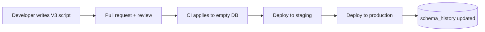

# Why database schema migrations are needed

---

## 🟢 Junior Level

### 1. What is a schema migration?

A **schema migration** is a small, versioned, ordered script that moves a database from one structure to the next (create a table, add a column, add an index, backfill data). Instead of someone logging into production and typing `ALTER TABLE` by hand, the change lives in the repository next to the code, is reviewed in a pull request and is applied automatically by a tool (Flyway, Liquibase) during deployment.

**Analogy:** Think of Git for your database structure. Application code has commits; the database needs the same history, so that every environment (laptop, CI, staging, production) can be rebuilt to the exact same state.

### 2. The problem migrations solve

Without migrations you typically get:

- "It works on my machine" — the developer's local DB has a column that production lacks.
- A `schema.sql` that nobody updates, or a wiki page with manual steps.
- Hibernate `ddl-auto=update` silently changing production, with no review and no history.
- Deployments that fail at 2 a.m. because someone forgot to run a script.

### 3. A minimal example

Two files in `src/main/resources/db/migration`:

```sql
-- V1__create_customer.sql
CREATE TABLE customer (
    id         BIGINT GENERATED ALWAYS AS IDENTITY PRIMARY KEY,
    email      VARCHAR(255) NOT NULL UNIQUE,
    created_at TIMESTAMPTZ  NOT NULL DEFAULT now()
);
```

```sql
-- V2__add_customer_phone.sql
ALTER TABLE customer ADD COLUMN phone VARCHAR(32);
```

With `spring-boot-starter` and `flyway-core` on the classpath, Spring Boot runs them on startup, in order, exactly once per database. The tool records what ran in a history table (`flyway_schema_history`).

### 4. How it looks over time



> [!IMPORTANT]
> **Golden rule:** once a migration has been applied anywhere beyond your laptop, never edit it. Add a new migration instead.

---

## 🟡 Middle Level

### 1. Core guarantees of a migration tool

| Guarantee | How it is achieved |
| :--- | :--- |
| **Ordering** | Version numbers (`V1`, `V1.1`, `V2`) or changelog order. |
| **Exactly-once** | A history table stores every applied script. |
| **Tamper detection** | A checksum of each script is compared on every startup. |
| **Reproducibility** | An empty database + all scripts = the production schema. |
| **Concurrency safety** | The tool takes a lock (advisory lock / lock table) so two app instances do not migrate at once. |

### 2. Schema versioning vs. state-based vs. migration-based

There are two philosophies:

- **Migration-based (Flyway, Liquibase):** you write the *transitions*. Precise control over data backfills, index options, lock behaviour. This is the industry standard for application databases.
- **State-based (declarative, e.g. Atlas, SQL Server DACPAC):** you describe the *desired* end state and the tool computes the diff. Convenient, but diffs can pick unsafe strategies (drop + recreate column) and cannot express data transformations.

### 3. Why `hibernate.ddl-auto` is not a migration tool

```yaml
spring:
  jpa:
    hibernate:
      ddl-auto: validate   # production-safe: verify, never mutate
```

- `update` never drops columns, never renames, cannot backfill data, and produces non-deterministic results.
- `create` / `create-drop` destroy data.
- Use `validate` (or `none`) in production and let migrations own the schema; Hibernate only checks that entities match. (Mapping details are covered in the Hibernate/JPA section.)

### 4. Schema and data migrations

Migrations are not only DDL. Typical content:

```sql
-- V7__split_full_name.sql
ALTER TABLE person ADD COLUMN first_name TEXT, ADD COLUMN last_name TEXT;

UPDATE person
SET first_name = split_part(full_name, ' ', 1),
    last_name  = NULLIF(substr(full_name, strpos(full_name, ' ') + 1), '');

ALTER TABLE person ALTER COLUMN first_name SET NOT NULL;
```

Keep **reference data** (roles, countries) in migrations too if the application depends on it; keep **test data** out of production migration paths (use a separate `db/testdata` location activated by a profile).

### 4a. Common mistakes

- Editing an already-applied script → checksum failure on the next deployment.
- Mixing huge data fixes and DDL in one transaction → long locks (see the large-table question).
- Writing scripts that depend on the order of a developer's local data.
- Using environment-specific SQL in the main folder (hard-coded schema names, tablespaces).
- Forgetting that merges of two branches can create two `V5` scripts (version collision) — use timestamps or CI checks.

### 5. Team workflow

```yaml
# application.yml
spring:
  flyway:
    enabled: true
    locations: classpath:db/migration
    validate-on-migrate: true
```

Typical pipeline: PR → CI spins up a fresh PostgreSQL, runs all migrations → runs integration tests → deploy. A second CI job can restore a sanitized production snapshot and run only the *new* migrations to measure time and locks.

---

## 🔴 Senior Level

### 1. Migrations as part of the release contract

In a rolling deployment, **old and new application versions run simultaneously** against one schema. Therefore every migration must be compatible with the previous *and* the next code version. This pushes you towards the expand/contract pattern (separate question) and away from "rename column + deploy" in one step.

### 2. Who runs the migration?

| Option | Pros | Cons |
| :--- | :--- | :--- |
| **App startup (Spring Boot auto-run)** | Simple, nothing extra to deploy | Slow migration blocks readiness; every replica races for the lock; app needs DDL privileges |
| **Separate CI/CD step or Kubernetes Job / init container** | Least-privilege runtime account; migration failure stops the rollout before new pods start | More pipeline plumbing |
| **Manual DBA execution** | Control over windows | Drift, human error, slow |

Mature teams use two database roles: a **migration role** (owner, DDL) and an **application role** (DML only).

```sql
CREATE ROLE app_migrator LOGIN PASSWORD '***';
CREATE ROLE app_runtime  LOGIN PASSWORD '***';
GRANT USAGE ON SCHEMA public TO app_runtime;
ALTER DEFAULT PRIVILEGES FOR ROLE app_migrator IN SCHEMA public
    GRANT SELECT, INSERT, UPDATE, DELETE ON TABLES TO app_runtime;
ALTER DEFAULT PRIVILEGES FOR ROLE app_migrator IN SCHEMA public
    GRANT USAGE, SELECT ON SEQUENCES TO app_runtime;
```

### 3. PostgreSQL specifics worth knowing

- **Transactional DDL:** PostgreSQL can roll back `CREATE TABLE`, `ALTER TABLE` etc. A failed migration leaves no half-applied state (MySQL and Oracle auto-commit DDL, so failures there need manual repair).
- Exceptions: `CREATE INDEX CONCURRENTLY`, `VACUUM`, `ALTER TYPE ... ADD VALUE` (before PG 12) cannot run inside a transaction block — tools need a "non-transactional" flag.
- Even "fast" DDL takes an `ACCESS EXCLUSIVE` lock briefly; if it queues behind a long-running query, **every other query queues behind it** (lock queue amplification). Always set a lock timeout:

```sql
SET lock_timeout = '3s';
SET statement_timeout = '15min';
ALTER TABLE orders ADD COLUMN channel TEXT;
```

Retry on `lock_timeout` rather than blocking production traffic.

### 4. Drift detection and governance

- **Drift** = the real schema differs from what migrations produce (hot-fix made by hand). Detect with `flyway validate`, `liquibase diff`, or by comparing `pg_dump --schema-only` against a freshly migrated database in CI.
- Enforce naming conventions, require review by a DBA for `DROP`, `ALTER TYPE`, large rewrites.
- Lint migrations automatically (e.g. squawk for PostgreSQL, or custom regex checks) to reject `CREATE INDEX` without `CONCURRENTLY` or `ADD COLUMN ... NOT NULL DEFAULT volatile()`.

### 5. Verifying in Java

```java
@SpringBootTest
@Testcontainers
class SchemaMatchesEntitiesTest {

    @Container
    static PostgreSQLContainer<?> pg = new PostgreSQLContainer<>("postgres:16-alpine");

    @DynamicPropertySource
    static void props(DynamicPropertyRegistry r) {
        r.add("spring.datasource.url", pg::getJdbcUrl);
        r.add("spring.datasource.username", pg::getUsername);
        r.add("spring.datasource.password", pg::getPassword);
        r.add("spring.jpa.hibernate.ddl-auto", () -> "validate");
    }

    @Test
    void contextLoads() { /* Flyway ran, Hibernate validated the entities */ }
}
```

### 6. Edge cases

- **Squashing / baselining** old history once hundreds of scripts accumulate: dump the schema as a new baseline and keep old versions only for environments that still need them.
- **Multiple services, one database** is an anti-pattern; each service must own its schema and migration history.
- **Long-running migrations during deploy** can exceed Kubernetes probe timeouts; run them as a Job.

---

## 🎯 Interview Cheat Sheet

**30-second pitch:** Schema migrations are versioned, reviewed, automatically applied scripts that evolve the database exactly like code evolves. They give reproducible environments, an audit trail, tamper detection and safe rollouts. In production, the key discipline is: never edit applied scripts, keep each change backward-compatible with the previous app version, and guard DDL with lock timeouts.

**Must-know bullets:**
- Migration-based tools (Flyway, Liquibase) record applied scripts in a history table with checksums.
- Never use `ddl-auto=update` in production; use `validate` or `none`.
- PostgreSQL has transactional DDL; MySQL/Oracle do not.
- Separate migration and runtime DB roles.
- Always set `lock_timeout` for DDL against busy tables.

**Common follow-up questions:**
- What happens if two instances start at the same time? (Tool lock in the DB.)
- What if a script was already applied and needs fixing? (New corrective migration, or `repair` for checksum only after understanding why.)
- Why not let Hibernate generate the schema?

**Red flags:**
- "We just run SQL manually on production."
- Editing old migration files.
- Migration role = application role with superuser rights.

**Related topics:**
- [How Flyway works with versioned and repeatable migrations](02.%20How%20Flyway%20works%20with%20versioned%20and%20repeatable%20migrations.md)
- [How to do zero-downtime database migrations](04.%20How%20to%20do%20zero-downtime%20database%20migrations.md)
- [What rollback strategies exist for database migrations](06.%20What%20rollback%20strategies%20exist%20for%20database%20migrations.md)
- [How to test migrations with Testcontainers](22.%20How%20to%20test%20migrations%20with%20Testcontainers.md)
