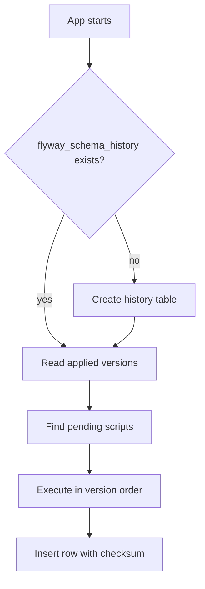

# How Flyway works with versioned and repeatable migrations

---

## 🟢 Junior Level

### 1. What is Flyway?

**Flyway** is a database migration tool. You put SQL (or Java) files in a folder with a special naming convention; Flyway applies the ones the database has not seen yet, in version order, and remembers them in a table called `flyway_schema_history`.

**Analogy:** A numbered stack of instruction cards for building a house. Flyway keeps a checklist of which cards were already executed, and only performs the new ones.

### 2. Naming convention

| Type | Pattern | Example | Runs |
| :--- | :--- | :--- | :--- |
| **Versioned** | `V<version>__<description>.sql` | `V2__add_orders.sql` | Exactly once, in version order |
| **Repeatable** | `R__<description>.sql` | `R__refresh_views.sql` | Every time its content (checksum) changes, after all versioned ones |
| **Undo** (Teams edition) | `U<version>__<description>.sql` | `U2__add_orders.sql` | On demand |

Note the **double underscore** between version and description.

### 3. Minimal Spring Boot setup

```xml
<dependency>
    <groupId>org.flywaydb</groupId>
    <artifactId>flyway-core</artifactId>
</dependency>
<dependency>
    <groupId>org.flywaydb</groupId>
    <artifactId>flyway-database-postgresql</artifactId>
</dependency>
```

```sql
-- src/main/resources/db/migration/V1__init.sql
CREATE TABLE product (
    id    BIGINT GENERATED ALWAYS AS IDENTITY PRIMARY KEY,
    name  TEXT           NOT NULL,
    price NUMERIC(12, 2) NOT NULL CHECK (price >= 0)
);
```

Start the application — Spring Boot detects Flyway and runs `migrate` before the `EntityManagerFactory` is created. Nothing else is needed.



---

## 🟡 Middle Level

### 1. The history table

```sql
SELECT installed_rank, version, description, type, checksum, success
FROM flyway_schema_history
ORDER BY installed_rank;
```

Each row stores version, description, script name, **CRC32 checksum**, execution time and a `success` flag. Flyway compares the checksum of every applied script on disk with the stored value on each `migrate`/`validate`.

### 2. Checksums and the "validate failed" error

If you edit `V2__add_orders.sql` after it ran, startup fails with `Migration checksum mismatch`. This is a feature: it prevents environments from silently diverging.

What to do:

1. **Preferred:** revert the edit; put the change in `V3__...`.
2. If the change was whitespace/comment only and you are sure, `flyway repair` updates the stored checksum.
3. Never use `repair` to "make errors go away" without understanding drift.

`spring.flyway.validate-on-migrate=true` is the default and should stay on.

### 3. Repeatable migrations

Repeatable scripts are for objects that are fully re-creatable: views, functions, stored procedures, materialized view definitions.

```sql
-- R__order_summary_view.sql
CREATE OR REPLACE VIEW order_summary AS
SELECT o.id, o.customer_id, SUM(i.quantity * i.unit_price) AS total
FROM orders o
JOIN order_item i ON i.order_id = o.id
GROUP BY o.id, o.customer_id;
```

Rules: must be **idempotent** (`CREATE OR REPLACE`), run after all pending versioned migrations, executed in alphabetical order of description. A change in content → new checksum → re-run.

### 4. Baseline on an existing database

When adopting Flyway on a database that already has tables:

```bash
flyway -baselineVersion=1 -baselineDescription="Existing prod schema" baseline
```

Or in Spring Boot:

```yaml
spring:
  flyway:
    baseline-on-migrate: true
    baseline-version: 1
```

Flyway inserts a baseline row; versions `<=` baseline are ignored, `V2+` are applied. Pitfall: `baseline-on-migrate: true` on a *wrongly pointed empty* database silently skips `V1`. Use it deliberately, not as a permanent default.

### 5. Out-of-order and missing migrations

Two developers create `V5` and `V6` in different branches; `V6` is deployed first, then `V5` is merged. By default Flyway **rejects** `V5` ("detected resolved migration not applied"). Options:

- `outOfOrder=true` — allows applying it (risk: scripts depend on order).
- Better: use a CI check or timestamp-based versions (`V20260514_1530__...`) to avoid collisions.

### 6. Java-based migrations

For complex backfills that need logic:

```java
public class V8__Normalize_phone_numbers extends BaseJavaMigration {
    @Override
    public void migrate(Context context) throws Exception {
        try (var select = context.getConnection().createStatement();
             var rs = select.executeQuery("SELECT id, phone FROM customer WHERE phone IS NOT NULL");
             var update = context.getConnection()
                     .prepareStatement("UPDATE customer SET phone = ? WHERE id = ?")) {
            while (rs.next()) {
                update.setString(1, rs.getString("phone").replaceAll("[^0-9+]", ""));
                update.setLong(2, rs.getLong("id"));
                update.addBatch();
            }
            update.executeBatch();
        }
    }
}
```

The class is discovered in `db/migration` package path (`classpath:db/migration`) and gets a checksum only if you override `getChecksum()`.

### 7. Common configuration

```yaml
spring:
  flyway:
    locations: classpath:db/migration,classpath:db/migration/{vendor}
    schemas: public
    table: flyway_schema_history
    placeholders:
      app_schema: public
    clean-disabled: true        # NEVER allow clean in prod
    connect-retries: 10
```

---

## 🔴 Senior Level

### 1. Execution model

- Each versioned migration runs in **its own transaction** by default (`group=false`). On PostgreSQL a failure rolls back that script and leaves the history untouched; the next start re-attempts it.
- On databases without transactional DDL, a failing script can leave a partial change plus a `success=false` history row, requiring manual repair.
- Statements that cannot run in a transaction (`CREATE INDEX CONCURRENTLY`) are detected by Flyway on PostgreSQL and the script is executed non-transactionally; keep such scripts to **one statement each**, otherwise a partial failure leaves an inconsistent state.

```sql
-- V12__orders_created_at_idx.sql   (single statement, non-transactional)
CREATE INDEX CONCURRENTLY IF NOT EXISTS idx_orders_created_at ON orders (created_at);
```

If a concurrent build fails it leaves an `INVALID` index; the retry with `IF NOT EXISTS` would see it and skip. Detect with:

```sql
SELECT indexrelid::regclass FROM pg_index WHERE NOT indisvalid;
```

and drop it in a corrective migration first.

### 2. Concurrency control

On PostgreSQL Flyway takes a **session-level advisory lock** (`pg_advisory_lock`) so only one instance migrates; others wait. With 20 pods starting together, 19 wait and then find nothing to do. Long migrations plus readiness probes can cause restarts — run migrations as a pre-deploy Job:

```java
@SpringBootApplication
public class MigrateOnlyApp {
    public static void main(String[] args) {
        SpringApplication app = new SpringApplication(MigrateOnlyApp.class);
        app.setWebApplicationType(WebApplicationType.NONE);
        app.run(args);   // Flyway runs, process exits
    }
}
```

Alternatively disable at runtime (`spring.flyway.enabled=false`) and use the Flyway CLI/Maven plugin in the pipeline.

### 3. Custom control with `FlywayMigrationStrategy`

```java
@Configuration
class FlywayConfig {

    @Bean
    FlywayMigrationStrategy strategy() {
        return flyway -> {
            flyway.validate();   // fail fast on drift
            flyway.migrate();
        };
    }

    @Bean
    FlywayConfigurationCustomizer customizer() {
        return cfg -> cfg
                .cleanDisabled(true)
                .lockRetryCount(50)
                .ignoreMigrationPatterns("*:missing"); // tolerate scripts deleted after squash
    }
}
```

### 4. `flyway migrate` with Hibernate and multiple data sources

Spring Boot orders Flyway before JPA via `FlywayMigrationInitializer` dependencies. With a custom `EntityManagerFactory` you must declare `@DependsOn("flywayInitializer")`, otherwise Hibernate validation can run against an unmigrated schema.

For multi-tenant schema-per-tenant (see the multi-tenancy question), run Flyway once per schema in a loop with `Flyway.configure().schemas(tenant).load().migrate()`.

### 5. Strategies for long histories

- **Squash:** produce `V100__baseline.sql` from `pg_dump --schema-only`, delete older scripts, mark existing databases with `baseline`/`ignoreMigrationPatterns`. Do it only when *all* environments are past that version.
- **Callbacks:** `beforeMigrate.sql`, `afterMigrate.sql` for e.g. `SET lock_timeout`, reindex, `ANALYZE`:

```sql
-- afterMigrate.sql (db/migration)
ANALYZE;
```

- **Placeholders** for tablespace or schema differences; avoid for logic differences between environments — that is drift in disguise.

### 6. Safety checklist for pull requests

1. Is the change backward-compatible with the *currently deployed* application version?
2. Is `lock_timeout` set / is DDL lock-light?
3. Is a data backfill batched and outside the DDL transaction?
4. Is there an index for new foreign keys?
5. Was it tested on production-sized data?
6. Is the version number unique and in order?

---

## 🎯 Interview Cheat Sheet

**30-second pitch:** Flyway applies `V<version>__name.sql` scripts in order exactly once, recording each in `flyway_schema_history` with a checksum, and re-runs `R__` repeatable scripts whenever their content changes. Spring Boot runs it automatically at startup. Edited applied scripts fail validation; existing databases are adopted with `baseline`.

**Must-know bullets:**
- Versioned = once; repeatable = every change, after versioned ones, must be idempotent.
- Checksum mismatch protects against drift; `repair` is the last resort.
- Double underscore in file names.
- `clean` must be disabled in production.
- `CREATE INDEX CONCURRENTLY` needs a non-transactional, single-statement script.
- Advisory lock prevents concurrent migrators.

**Common follow-up questions:**
- What is baseline and when would you use it?
- How do you handle two branches creating the same version?
- How would you run migrations outside the application?
- What happens when a migration fails halfway on MySQL vs PostgreSQL?

**Red flags:**
- Recommending `repair` or `outOfOrder` as routine fixes.
- Enabling `clean` in production.
- Non-idempotent repeatable scripts.

**Related topics:**
- [Why database schema migrations are needed](01.%20Why%20database%20schema%20migrations%20are%20needed.md)
- [How Liquibase works and how it compares with Flyway](03.%20How%20Liquibase%20works%20and%20how%20it%20compares%20with%20Flyway.md)
- [How to migrate large tables safely](05.%20How%20to%20migrate%20large%20tables%20safely.md)
- [How to test migrations with Testcontainers](18.%20How%20to%20test%20migrations%20with%20Testcontainers.md)
