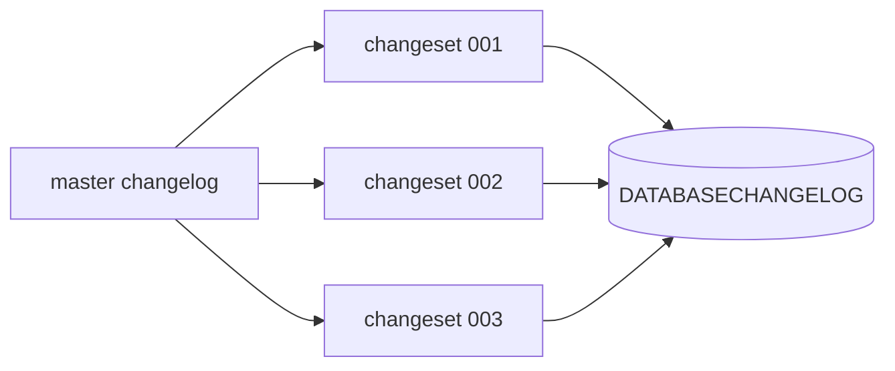

# How Liquibase works and how it compares with Flyway

---

## 🟢 Junior Level

### 1. What is Liquibase?

**Liquibase** is a database migration tool like Flyway, but instead of numbered SQL files it uses a **changelog** — a file listing **changesets**. A changeset is one atomic, uniquely identified change ("add column X to table Y"). Liquibase keeps a table `DATABASECHANGELOG` with the changesets already applied and runs only the new ones.

**Analogy:** Flyway is a folder of numbered recipes; Liquibase is one ledger book where each entry is signed with *author + id* and can optionally contain the "undo" entry.

### 2. Changelog structure

```yaml
# db/changelog/db.changelog-master.yaml
databaseChangeLog:
  - include:
      file: db/changelog/changes/001-create-customer.yaml
  - include:
      file: db/changelog/changes/002-add-phone.sql
```

A changeset in YAML:

```yaml
databaseChangeLog:
  - changeSet:
      id: 001-create-customer
      author: anna
      changes:
        - createTable:
            tableName: customer
            columns:
              - column:
                  name: id
                  type: BIGINT
                  autoIncrement: true
                  constraints: { primaryKey: true, nullable: false }
              - column:
                  name: email
                  type: VARCHAR(255)
                  constraints: { nullable: false, unique: true }
```

Changelogs can be XML, YAML, JSON or **formatted SQL**:

```sql
--liquibase formatted sql

--changeset anna:002-add-phone
ALTER TABLE customer ADD COLUMN phone VARCHAR(32);
--rollback ALTER TABLE customer DROP COLUMN phone;
```

### 3. Spring Boot integration

```xml
<dependency>
    <groupId>org.liquibase</groupId>
    <artifactId>liquibase-core</artifactId>
</dependency>
```

```yaml
spring:
  liquibase:
    change-log: classpath:db/changelog/db.changelog-master.yaml
```

On startup Spring Boot runs `update`: every changeset whose `(id, author, file path)` is not in `DATABASECHANGELOG` is executed.



---

## 🟡 Middle Level

### 1. Changeset identity and checksums

A changeset is identified by **`id + author + file path`**. Liquibase stores an **MD5SUM** of the changeset contents. If an applied changeset changes, `update` fails with a validation error unless the changeset has `runOnChange: true` (re-run on change — similar to Flyway repeatable) or you clear checksums (`clear-checksums`).

Important consequence: **moving or renaming a changelog file changes the identity** (because the path is part of it) → Liquibase would run everything again. Use `logicalFilePath` to keep stable identity.

### 2. Useful changeset attributes

| Attribute | Purpose |
| :--- | :--- |
| `runOnChange` | Re-run whenever the changeset content changes (views, procedures) |
| `runAlways` | Run on every update (rare, e.g. refresh) |
| `context` | Run only in some environments (`context: test`) |
| `labels` | Free-form filtering expressions |
| `preConditions` | Skip/fail/mark ran based on DB state |
| `runInTransaction` | Set `false` for `CREATE INDEX CONCURRENTLY` |
| `failOnError` | Continue even if the changeset fails |

```yaml
- changeSet:
    id: 010-orders-created-at-idx
    author: pavel
    runInTransaction: false
    preConditions:
      - onFail: MARK_RAN
      - not:
          - indexExists:
              indexName: idx_orders_created_at
    changes:
      - sql:
          sql: CREATE INDEX CONCURRENTLY idx_orders_created_at ON orders (created_at)
    rollback:
      - sql:
          sql: DROP INDEX CONCURRENTLY IF EXISTS idx_orders_created_at
```

### 3. Rollback

For many built-in change types (`createTable`, `addColumn`, `createIndex`, `renameColumn`) Liquibase **auto-generates** the inverse. For raw `sql`, `update`-style data changes or `dropTable` you must write an explicit `rollback` block. Commands:

```bash
liquibase rollback-count 1          # undo the last changeset
liquibase rollback --tag=release-4.2
liquibase rollback-to-date 2026-05-01
liquibase update-sql                # preview SQL without executing
liquibase rollback-sql --tag=v1
```

Use `tag` after each release so you can roll back to a named point. Note that rolling back DDL does not restore *data* deleted by a destructive change — see the rollback strategies question.

### 4. Preconditions and diff tools

```yaml
preConditions:
  - onFail: HALT
  - dbms: { type: postgresql }
  - tableExists: { tableName: orders }
```

`liquibase diff` / `generate-changelog` can reverse engineer a changelog from an existing database — handy for adopting it (Flyway's equivalent is just `baseline`).

### 5. Flyway vs Liquibase

| Aspect | Flyway | Liquibase |
| :--- | :--- | :--- |
| **Primary format** | Plain SQL (Java optional) | XML/YAML/JSON/SQL |
| **Learning curve** | Very low | Moderate |
| **Ordering** | Version number in file name | Order in changelog |
| **Identity** | Version | id + author + path |
| **DB portability** | Write vendor SQL yourself | Abstracted change types generate per-DB SQL |
| **Rollback** | Undo scripts (paid) or write forward fix | Built in (auto + custom `rollback`) |
| **Conditional logic** | Callbacks, placeholders | Preconditions, contexts, labels |
| **Repeatable objects** | `R__` scripts | `runOnChange` changesets |
| **Drift diff** | Limited (paid editions) | `diff`, `diff-changelog` |
| **Typical fit** | One DB vendor, SQL-fluent team | Multi-DB products, strict governance, rollbacks |

---

## 🔴 Senior Level

### 1. Locking and concurrency

Liquibase uses a `DATABASECHANGELOGLOCK` table with a single row. A crashed process can leave `LOCKED=true`, blocking all deployments ("Waiting for changelog lock..."). Fix with `liquibase release-locks` or:

```sql
UPDATE databasechangeloglock SET locked = FALSE, lockgranted = NULL, lockedby = NULL WHERE id = 1;
```

Only do this after verifying no migration is really running. (Flyway's PostgreSQL advisory lock disappears automatically with the session, so it has no stale lock problem.)

### 2. Using Liquibase in Spring Boot with control

```java
@Configuration
class LiquibaseConfig {

    @Bean
    SpringLiquibase liquibase(DataSource ds) {
        SpringLiquibase l = new SpringLiquibase();
        l.setDataSource(ds);
        l.setChangeLog("classpath:db/changelog/db.changelog-master.yaml");
        l.setContexts("prod");
        l.setDefaultSchema("public");
        l.setTestRollbackOnUpdate(false);
        return l;
    }
}
```

In production prefer running the CLI/Maven plugin as a pipeline step with `update-sql` output attached to the change request for DBA review.

### 3. Design patterns for maintainable changelogs

- One file per change under `changes/`, included from a master file using `includeAll` with alphabetical sorting (`001-...`, `002-...`) — avoids merge conflicts in a single huge file.
- Prefer **formatted SQL** for PostgreSQL-specific features (partial indexes, `CONCURRENTLY`, JSONB operators); Liquibase's abstract change types cannot express them. Using abstraction while targeting one DB buys little.
- Always specify `rollback` on destructive or `sql` changesets, and test it in CI (`update` → `rollback` → `update` ensures re-applicability — Liquibase's `updateTestingRollback`).
- Be careful with `runOnChange` for non-idempotent SQL; with `CREATE OR REPLACE` it is fine.

### 4. Decision framework: which tool?

Choose **Flyway** when: single database vendor (PostgreSQL), team is comfortable with SQL, desire to read the exact SQL that runs, simple mental model (the history is a straight line), forward-only fixes are your culture.

Choose **Liquibase** when: product ships to customers on multiple DB engines, you need first-class rollback/`rollback-sql` for audit, conditional execution per environment/context is common, compliance requires diff reports.

Either way, the *discipline* — immutable applied changes, backward-compatible steps, tested on production-size data — matters more than the tool. Migrating between the two later is possible: baseline the new tool at the current schema and keep the old history as archive.

### 5. Performance and pitfalls

- Large changelogs slow startup (checksum validation of thousands of rows is small, but parsing XML is not) → run in pipeline, not in each pod.
- `generate-changelog` output is a starting point; review type mapping (e.g. `timestamp` vs `timestamptz`).
- Auto-rollback of `addColumn` drops data; on production "rollback" typically means rolling the *application* back and leaving the schema (expand/contract makes this safe).
- Different line endings (CRLF vs LF) change MD5 of SQL changesets in some versions → configure `.gitattributes`:

```text
*.sql text eol=lf
*.yaml text eol=lf
```

### 6. Testing the changelog

```java
@Test
void updateRollbackUpdate() throws Exception {
    try (var conn = DriverManager.getConnection(pg.getJdbcUrl(), pg.getUsername(), pg.getPassword())) {
        Database db = DatabaseFactory.getInstance()
                .findCorrectDatabaseImplementation(new JdbcConnection(conn));
        try (Liquibase lb = new Liquibase("db/changelog/db.changelog-master.yaml",
                new ClassLoaderResourceAccessor(), db)) {
            lb.update(new Contexts());
            lb.rollback(100, "");
            lb.update(new Contexts());
        }
    }
}
```

---

## 🎯 Interview Cheat Sheet

**30-second pitch:** Liquibase manages schema changes as changesets (id + author + path) in a changelog, recorded in `DATABASECHANGELOG` with MD5 checksums. It supports XML/YAML/JSON/SQL, preconditions, contexts, built-in rollback and diff. Compared with Flyway's simple versioned-SQL model, it is more feature-rich and DB-agnostic but heavier; Flyway wins on simplicity for single-vendor SQL-first teams.

**Must-know bullets:**
- Identity = id + author + file path; moving files re-runs them unless `logicalFilePath` is set.
- `runOnChange` for views/functions; `runInTransaction: false` for concurrent index builds.
- Auto-rollback exists for structured change types; raw SQL needs explicit `rollback`.
- Stale `DATABASECHANGELOGLOCK` can block deployments.
- Formatted SQL is a pragmatic choice for PostgreSQL.

**Common follow-up questions:**
- How do contexts and labels differ?
- How would you roll back to the previous release?
- When would you migrate from Liquibase to Flyway, or vice versa?
- How do you preview what a deployment will do?

**Red flags:**
- Claiming rollback restores deleted data.
- Using XML abstractions when only PostgreSQL is supported, then fighting the abstraction.
- Releasing locks blindly.

**Related topics:**
- [How Flyway works with versioned and repeatable migrations](02.%20How%20Flyway%20works%20with%20versioned%20and%20repeatable%20migrations.md)
- [What rollback strategies exist for database migrations](06.%20What%20rollback%20strategies%20exist%20for%20database%20migrations.md)
- [How to test migrations with Testcontainers](22.%20How%20to%20test%20migrations%20with%20Testcontainers.md)
