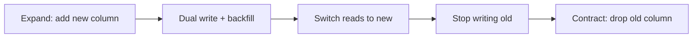

# How to do zero-downtime database migrations

---

## 🟢 Junior Level

### 1. The problem

When you deploy a new version of an application, the old version does not disappear instantly. With **rolling deployments** (Kubernetes, blue-green, canary) the old and new versions run **at the same time** and share **one database**. If the migration renames a column that the old version still reads, the old instances start failing — that is **downtime**.

**Analogy:** Replacing the engine of a car while it is driving on the highway. You cannot remove the old engine before the new one is already running — you add the new one, switch over, and only then remove the old.

### 2. The rule

> [!IMPORTANT]
> Every schema change must be **backward compatible**: the *previous* application version must keep working after the migration runs.

Safe changes (generally): add a nullable column, add a new table, add an index (concurrently). Unsafe on their own: rename a column, drop a column, change a column type, add `NOT NULL` without default, drop a table.

### 3. Rename column the safe way — in steps

Goal: rename `customer.name` to `customer.full_name`.

```sql
-- Release 1 (expand): add new column
ALTER TABLE customer ADD COLUMN full_name TEXT;
```

Application release 1 writes to **both** columns, reads from the old one.

```sql
-- Backfill existing rows (in batches on big tables)
UPDATE customer SET full_name = name WHERE full_name IS NULL;
```

Release 2: application reads from the new column (still writes both).

```sql
-- Release 3 (contract): after no old version is running
ALTER TABLE customer DROP COLUMN name;
```



---

## 🟡 Middle Level

### 1. Expand / Contract (parallel change) pattern

| Phase | Database | Application |
| :--- | :--- | :--- |
| **Expand** | Add new structure, nullable / with default | Old code unaware, still works |
| **Migrate** | Backfill data | New code writes both, reads old (or new) |
| **Switch** | — | New code reads new, writes both |
| **Contract** | Drop old structure | Old code gone, new code writes only new |

Each arrow is a **separate deployment**. It costs more releases but you can stop or roll back at any step.

### 2. Classifying changes

| Change | Safe in one step? | How to do safely |
| :--- | :--- | :--- |
| `ADD COLUMN` nullable | ✅ | Direct |
| `ADD COLUMN ... DEFAULT const` | ✅ PG 11+ (metadata-only) | Direct |
| `ADD COLUMN ... NOT NULL` without default | ❌ | Add nullable → backfill → `CHECK ... NOT VALID` → `VALIDATE` → `SET NOT NULL` |
| `DROP COLUMN` | ❌ (old code may select it) | Stop using it in code first, then drop |
| `RENAME COLUMN/TABLE` | ❌ | Expand/contract, or a compatibility view |
| Change type `INT → BIGINT` | ❌ rewrites table | New column + dual write + swap |
| Add `FOREIGN KEY` | ⚠️ locks | `NOT VALID` then `VALIDATE CONSTRAINT` |
| Add index | ⚠️ locks writes | `CREATE INDEX CONCURRENTLY` |
| Add `UNIQUE` | ⚠️ | Build unique index concurrently, then attach as constraint |

### 4. Making a column NOT NULL without a long lock

```sql
-- 1) Cheap: only takes a brief lock, does not scan existing rows
ALTER TABLE orders ADD CONSTRAINT orders_channel_nn CHECK (channel IS NOT NULL) NOT VALID;

-- 2) Scans the table but only takes SHARE UPDATE EXCLUSIVE (reads and writes continue)
ALTER TABLE orders VALIDATE CONSTRAINT orders_channel_nn;

-- 3) PG 12+: uses the validated CHECK to skip the scan
ALTER TABLE orders ALTER COLUMN channel SET NOT NULL;
ALTER TABLE orders DROP CONSTRAINT orders_channel_nn;
```

### 5. Foreign keys without blocking

```sql
ALTER TABLE order_item
    ADD CONSTRAINT fk_item_order FOREIGN KEY (order_id) REFERENCES orders (id) NOT VALID;
ALTER TABLE order_item VALIDATE CONSTRAINT fk_item_order;
```

### 6. Application side: tolerate both shapes

With JPA, the old and new version of the entity must both map onto the *current* schema. During the transition, map both columns:

```java
@Entity
@Table(name = "customer")
public class Customer {
    @Id @GeneratedValue(strategy = GenerationType.IDENTITY)
    private Long id;

    @Column(name = "name")        // old column, kept in sync during expand phase
    private String legacyName;

    @Column(name = "full_name")   // new column
    private String fullName;

    public void setFullName(String value) {
        this.fullName = value;
        this.legacyName = value;  // dual write until contract phase
    }
}
```

Alternatively keep the sync in the database with a trigger during the transition (see the trigger trade-offs question) so old versions that write only `name` still populate `full_name`.

---

## 🔴 Senior Level

### 1. Lock queue amplification

Even a metadata-only `ALTER TABLE` needs `ACCESS EXCLUSIVE`. If a long transaction holds a conflicting lock, the ALTER waits — and **all new queries on that table queue behind the ALTER**. A 50 ms DDL can cause a minute-long outage.

Mitigation: lock timeout + retry loop.

```sql
SET lock_timeout = '2s';
ALTER TABLE orders ADD COLUMN channel TEXT;
```

```java
void runDdlWithRetry(JdbcTemplate jdbc, String ddl) throws InterruptedException {
    for (int attempt = 1; attempt <= 10; attempt++) {
        try {
            jdbc.execute("SET lock_timeout = '2s'");
            jdbc.execute(ddl);
            return;
        } catch (DataAccessException e) {
            if (!e.getMessage().contains("lock timeout") || attempt == 10) throw e;
            Thread.sleep(ThreadLocalRandom.current().nextLong(500, 3000)); // jittered backoff
        }
    }
}
```

Also watch for idle-in-transaction sessions (`pg_stat_activity`) that hold locks for hours; set `idle_in_transaction_session_timeout`.

### 2. Changing a column type without rewrite

`ALTER COLUMN id TYPE BIGINT` rewrites the table under `ACCESS EXCLUSIVE`. Zero-downtime recipe:

1. `ADD COLUMN id_new BIGINT`.
2. Trigger or dual write to keep `id_new = id`.
3. Backfill in batches by primary key range.
4. Build a unique index concurrently on `id_new`.
5. In one short transaction: swap (`DROP` old PK, `ADD PRIMARY KEY USING INDEX`, rename columns). Fix sequences/FKs.

Tools: `pg_repack`, `pgroll` (automated expand/contract with views), gh-ost / pt-online-schema-change on MySQL.

### 3. Versioned schema views (pgroll style)

Expose each application version through a view schema so old and new code see their own shape:

```sql
CREATE SCHEMA app_v1;
CREATE VIEW app_v1.customer AS SELECT id, name AS full_name FROM public.customer;
```

Application sets `search_path` per release. Simple views over one table are auto-updatable, so inserts through them work.

### 4. Release ordering with CI enforcement

Pipeline for each change:

1. Deploy migration (expand) — app still on version N.
2. Deploy app N+1 (works with both shapes).
3. Run backfill job; monitor.
4. Deploy app N+2 (no longer touches old structure).
5. Deploy contract migration, only after confirming via logs/metrics that no queries reference the old object (`pg_stat_statements`, query logs).

Enforce automatically: a linter that rejects `DROP COLUMN`, `RENAME`, `SET NOT NULL`, non-concurrent `CREATE INDEX` in the "regular" migration folder, requiring a labelled `contract/` folder released later.

### 5. Data correctness during dual write

- Writes through two paths can diverge (bugs, bulk SQL scripts, other services). Add a **verification query** before contract:

```sql
SELECT count(*) FROM customer WHERE full_name IS DISTINCT FROM name;
```

- Make the backfill idempotent and restartable (`WHERE full_name IS NULL`, keyset batches).
- For multi-service systems, a column is consumed by many deployables; the contract phase must wait for *every* consumer. Prefer an API/ view contract over direct table sharing.

### 6. Rollback story

Expand/contract makes rollback trivial at every step: the old application version still works against the expanded schema. Only the contract step is irreversible; so run it last, after a bake period, and take a logical backup of the dropped column's data if it matters.

### 7. Edge cases

- Hibernate caches column metadata only at startup, but prepared statements cached by the driver can fail after `ALTER` of a result-set shape (`cached plan must not change result type`) — happens on `SELECT *`; use explicit column lists.
- Enum additions: `ALTER TYPE ... ADD VALUE` is fine in PG 12+ inside a transaction as long as the new value is not used in the same transaction; removing enum values is not supported — prefer `TEXT + CHECK`.
- Replication: logical replication/CDC consumers (Debezium) must tolerate new columns; coordinate with downstream teams.

---

## 🎯 Interview Cheat Sheet

**30-second pitch:** Zero-downtime migration means old and new app versions both work against the schema at every moment. Use expand/contract: add the new structure, dual-write and backfill, switch reads, then drop the old structure in a later release. Use lock timeouts, `CONCURRENTLY`, `NOT VALID` + `VALIDATE` to avoid long locks.

**Must-know bullets:**
- Rolling deploys mean two app versions share one schema.
- Never rename/drop/retype in one deploy.
- `ADD COLUMN` with constant default is metadata-only in PG 11+.
- `NOT VALID` constraints + `VALIDATE` avoid blocking writes.
- Lock queue amplification: use `lock_timeout` and retry.
- Contract step is the only irreversible one.

**Common follow-up questions:**
- How do you change a column type on a 500M-row table?
- How do you add a NOT NULL constraint safely?
- How do you know it is safe to drop a column?
- What happens if the migration runs while a long query is active?

**Red flags:**
- "We take a maintenance window" as the first answer for a simple change.
- Renaming a column in a single migration with a rolling deploy.
- Not mentioning lock behaviour.

**Related topics:**
- [How to migrate large tables safely](05.%20How%20to%20migrate%20large%20tables%20safely.md)
- [What rollback strategies exist for database migrations](06.%20What%20rollback%20strategies%20exist%20for%20database%20migrations.md)
- [How deadlocks and lock types work in SQL](14.%20How%20deadlocks%20and%20lock%20types%20work%20in%20SQL.md)
- [Trade-offs of stored procedures triggers views and materialized views](16.%20Trade-offs%20of%20stored%20procedures%20triggers%20views%20and%20materialized%20views.md)
