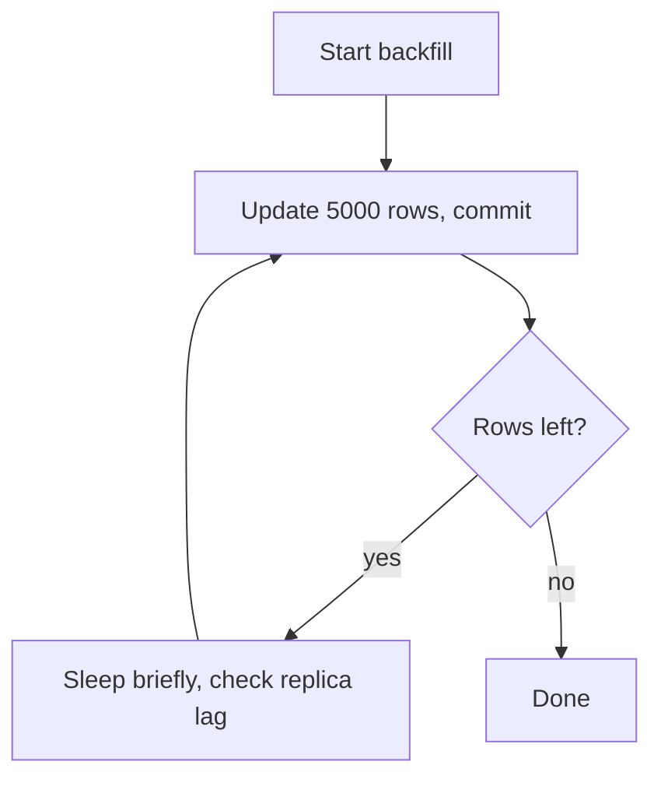

# How to migrate large tables safely

---

## 🟢 Junior Level

### 1. Why big tables are special

On a table with 10 rows, `ALTER TABLE` or `UPDATE` finishes instantly. On a table with 200 million rows the same statement can run for hours, hold **locks** that block every other query, fill the disk with WAL and cause replicas to lag. "Safe" migration means doing the work in a way that normal traffic keeps flowing.

**Analogy:** Repainting a busy road. You do not close the whole road for a week; you paint one lane at a time and let cars use the other.

### 2. Three golden rules

1. **Avoid long exclusive locks** — prefer operations that do not block reads/writes.
2. **Do big data changes in small batches**, each in its own short transaction.
3. **Build indexes concurrently.**

### 3. Index creation: the simplest example

```sql
-- Blocks all writes to orders until finished. BAD on a busy table.
CREATE INDEX idx_orders_customer ON orders (customer_id);

-- Allows reads and writes during the build. GOOD.
CREATE INDEX CONCURRENTLY idx_orders_customer ON orders (customer_id);
```

### 4. Batch update example

```sql
-- BAD: one giant transaction, millions of row locks, huge WAL spike
UPDATE orders SET status = 'NEW' WHERE status IS NULL;

-- GOOD: repeat this until it updates 0 rows
UPDATE orders
SET status = 'NEW'
WHERE id IN (SELECT id FROM orders WHERE status IS NULL ORDER BY id LIMIT 5000);
```



---

## 🟡 Middle Level

### 1. What each DDL does to locks (PostgreSQL)

| Statement | Lock | Blocks |
| :--- | :--- | :--- |
| `CREATE INDEX` | `SHARE` | writes (reads OK) |
| `CREATE INDEX CONCURRENTLY` | `SHARE UPDATE EXCLUSIVE` | other DDL/vacuum only |
| `ALTER TABLE ADD COLUMN` (nullable / const default PG11+) | `ACCESS EXCLUSIVE`, very brief | everything, but for milliseconds |
| `ALTER COLUMN TYPE` (rewrite) | `ACCESS EXCLUSIVE` for the whole rewrite | everything |
| `ADD CONSTRAINT ... FOREIGN KEY` | `SHARE ROW EXCLUSIVE` on both tables during validation | writes |
| `VALIDATE CONSTRAINT` | `SHARE UPDATE EXCLUSIVE` | nothing significant |
| `VACUUM FULL`, `CLUSTER` | `ACCESS EXCLUSIVE` | everything |

Check what a statement will lock via the docs table "Table-Level Lock Modes" and verify live with:

```sql
SELECT l.pid, l.mode, l.granted, c.relname, a.query
FROM pg_locks l
JOIN pg_class c ON c.oid = l.relation
JOIN pg_stat_activity a ON a.pid = l.pid
WHERE c.relname = 'orders';
```

### 2. Concurrent index build details

- It scans the table **twice** and waits for all older transactions; it takes longer and uses more I/O.
- It cannot run in a transaction block (Flyway/Liquibase need non-transactional mode).
- On failure or cancel it leaves an `INVALID` index; drop it and retry.
- Unique concurrent builds can fail on duplicates after hours; check duplicates beforehand.

```sql
SELECT indexrelid::regclass, indisvalid FROM pg_index WHERE indrelid = 'orders'::regclass;
DROP INDEX CONCURRENTLY IF EXISTS idx_orders_customer;
```

### 3. Batched backfill with keyset ranges

`WHERE id IN (SELECT ... LIMIT)` is simple, but when the filter column is not indexed every batch rescans. Better: walk the primary key range.

```sql
UPDATE orders
SET status = 'NEW'
WHERE id >= :from AND id < :to AND status IS NULL;
```

Java driver for it (outside the DDL migration — a Spring Batch job, `ApplicationRunner` or a Kubernetes Job):

```java
@Component
class StatusBackfill {
    private final JdbcTemplate jdbc;
    StatusBackfill(JdbcTemplate jdbc) { this.jdbc = jdbc; }

    void run() throws InterruptedException {
        Long max = jdbc.queryForObject("SELECT max(id) FROM orders", Long.class);
        long batch = 10_000;
        for (long from = 0; max != null && from <= max; from += batch) {
            int updated = jdbc.update(
                "UPDATE orders SET status = 'NEW' WHERE id >= ? AND id < ? AND status IS NULL",
                from, from + batch);
            if (updated > 0) Thread.sleep(50); // let autovacuum and replicas breathe
        }
    }
}
```

Each `jdbc.update` autocommits (no surrounding `@Transactional`), so locks are held for milliseconds.

### 4. Adding a column with a default

- PG 11+: `ADD COLUMN x INT NOT NULL DEFAULT 0` is metadata-only (constant default stored in the catalog) — instant.
- Volatile defaults (`DEFAULT now()` is stable → fine; `DEFAULT random()` or `gen_random_uuid()` → rewrite!). Add as nullable, set default for new rows, backfill old rows in batches.

### 5. Common mistakes

- Running `UPDATE` of the whole table in the Flyway transaction.
- Forgetting that every `UPDATE` creates new row versions → **bloat** and an autovacuum storm; table can double in size.
- Ignoring replica lag: an unbatched write floods the WAL, replicas fall behind, read traffic gets stale data.
- Creating a foreign key without an index on the referencing column.

---

## 🔴 Senior Level

### 1. Bloat, WAL, and vacuum

Updating all rows of a big table roughly doubles it until vacuum reclaims space. Mitigations:

- Throttle batches; monitor `pg_stat_user_tables.n_dead_tup`.
- Use `HOT` updates when possible (don't update indexed columns; keep `fillfactor` < 100).
- Do a rewrite through a **new table** if you need to change most rows:

```sql
CREATE TABLE orders_new (LIKE orders INCLUDING ALL);
-- copy in key-ranges with INSERT ... SELECT, transform on the fly
INSERT INTO orders_new SELECT id, customer_id, COALESCE(status,'NEW'), created_at
FROM orders WHERE id >= 0 AND id < 1000000;
-- keep in sync with a trigger, then swap in one short transaction:
BEGIN;
LOCK TABLE orders IN ACCESS EXCLUSIVE MODE;
ALTER TABLE orders RENAME TO orders_old;
ALTER TABLE orders_new RENAME TO orders;
COMMIT;
```

- Tools: **pg_repack** (online rewrite using a log table and triggers), **pgroll**, **pg_squeeze**.

### 2. Monitor progress of long operations

```sql
SELECT pid, phase, blocks_done, blocks_total, tuples_done, tuples_total
FROM pg_stat_progress_create_index;

SELECT application_name, state, replay_lag, write_lag
FROM pg_stat_replication;
```

Add a **circuit breaker** to batch jobs: pause when replay lag > N seconds or when active connections/lock waits spike.

### 3. Detect and survive lock contention

```sql
SET lock_timeout = '2s';             -- DDL fails rather than queuing everyone
SET statement_timeout = 0;           -- but allow long data steps when in batches
SET idle_in_transaction_session_timeout = '60s';
```

Before running DDL, check for long transactions:

```sql
SELECT pid, now() - xact_start AS age, state, left(query, 80)
FROM pg_stat_activity
WHERE xact_start IS NOT NULL
ORDER BY age DESC LIMIT 5;
```

### 4. Changing the type of a huge primary key

`INT → BIGINT` on a 2-billion-row table (a real production emergency when sequences approach 2^31−1):

1. Add `id_big BIGINT`, a trigger `NEW.id_big := NEW.id`.
2. Batch backfill by id range.
3. `CREATE UNIQUE INDEX CONCURRENTLY ... ON t(id_big)`.
4. Add `CHECK (id_big IS NOT NULL) NOT VALID`, validate.
5. Short swap transaction: drop old PK, `ADD CONSTRAINT pk PRIMARY KEY USING INDEX`, rename, alter sequence ownership, repoint foreign keys (each `NOT VALID` then `VALIDATE`).

Monitor sequence headroom early:

```sql
SELECT sequencename, last_value, max_value, round(100.0 * last_value / max_value, 1) AS pct
FROM pg_sequences ORDER BY pct DESC NULLS LAST;
```

### 5. Partitioned tables help

For tables that are naturally time-bound, partitioning (see the partitioning question) turns "delete 6 months of data" into `DROP PARTITION`, and lets you create indexes per partition concurrently, then attach. Converting an existing huge table to partitioned is itself a staged migration: create the partitioned table, attach the old table as a partition with a `CHECK` constraint (to skip validation scan), then split going forward.

### 6. Java-side safeguards

- Use a **separate DataSource/user** for migrations with `statement_timeout` and `lock_timeout` configured on the role:

```sql
ALTER ROLE app_migrator SET lock_timeout = '3s';
ALTER ROLE app_migrator SET idle_in_transaction_session_timeout = '30s';
```

- Make the batch job **resumable** (persist last processed id in a table) and **idempotent**.
- Make migration time a CI metric: restore an anonymized production snapshot and run migrations there; fail the build if it exceeds a threshold or takes locks above a limit.

### 7. MySQL note

On MySQL 8, many `ALTER`s are `ALGORITHM=INPLACE, LOCK=NONE` or `INSTANT`; for those that are not, use gh-ost or pt-online-schema-change, which copy rows into a shadow table and apply binlog changes.

---

## 🎯 Interview Cheat Sheet

**30-second pitch:** For large tables I avoid exclusive locks and giant transactions. Indexes are built `CONCURRENTLY`, constraints are added `NOT VALID` then validated, data is backfilled in small committed batches with throttling and replica-lag checks, and DDL uses `lock_timeout` with retries. For total rewrites I use shadow tables or tools like pg_repack and swap in a short transaction.

**Must-know bullets:**
- `CREATE INDEX` blocks writes; `CONCURRENTLY` does not but cannot run in a transaction.
- Failed concurrent build leaves an INVALID index.
- Batch updates → short transactions, less bloat, less replica lag.
- Constant defaults are instant in PG 11+; volatile defaults rewrite the table.
- Type change = new column + dual write + swap.
- Watch `pg_stat_progress_*`, replication lag, dead tuples.

**Common follow-up questions:**
- How do you add a NOT NULL column with a default to a 1B-row table?
- What if your batch job overloads replicas?
- How do you avoid blocking when a long-running transaction exists?

**Red flags:**
- One-shot `UPDATE` of an entire large table.
- Not knowing what locks an `ALTER` takes.
- Ignoring bloat and vacuum.

**Related topics:**
- [How to do zero-downtime database migrations](04.%20How%20to%20do%20zero-downtime%20database%20migrations.md)
- [How table partitioning works in PostgreSQL](11.%20How%20table%20partitioning%20works%20in%20PostgreSQL.md)
- [Which index types does PostgreSQL offer](13.%20Which%20index%20types%20does%20PostgreSQL%20offer.md)
- [How deadlocks and lock types work in SQL](14.%20How%20deadlocks%20and%20lock%20types%20work%20in%20SQL.md)
