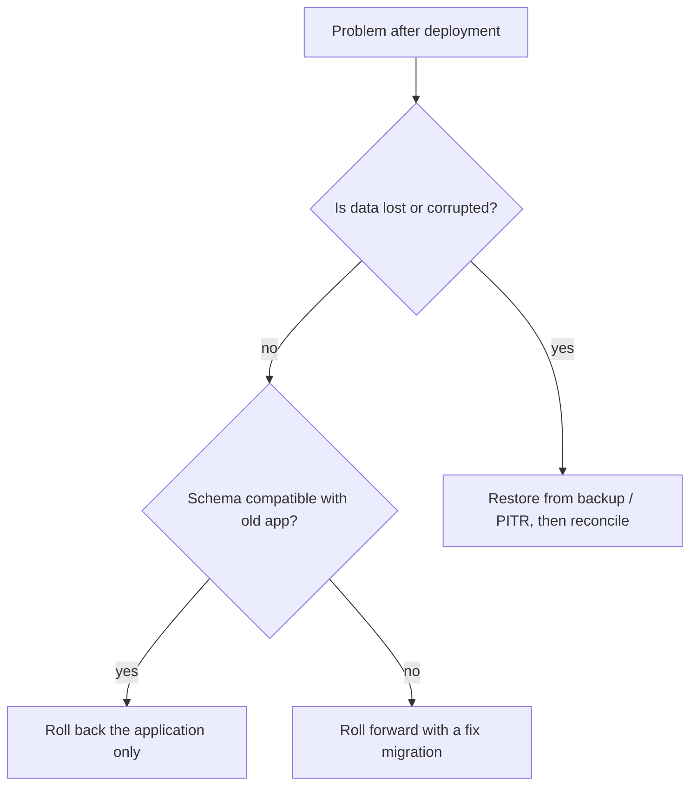

# What rollback strategies exist for database migrations

---

## 🟢 Junior Level

### 1. What does "rollback" mean for a database?

Application rollback is easy: redeploy the previous version. Database rollback is harder because the database holds **state**. If a migration deleted a column or transformed data, going "back" means restoring something that may be gone. So teams use several strategies instead of one magic undo button.

**Analogy:** Undoing a text edit is easy, but you cannot un-bake a cake. You either keep the ingredients (backup) or make the recipe such that you never throw ingredients away until you are sure.

### 2. The main strategies

| Strategy | Idea |
| :--- | :--- |
| **Roll forward (fix forward)** | Write a new migration that corrects the problem |
| **Down / undo scripts** | Each migration has an inverse script (`U2__...`, Liquibase `rollback`) |
| **Backward-compatible changes** | Make the schema work with the previous app version so only the app is rolled back |
| **Backup / point-in-time recovery** | Restore data from a snapshot or WAL archive |
| **Feature flags** | Switch behaviour off without touching the schema |

### 3. Example: an undo pair

```sql
-- V5__add_discount_column.sql
ALTER TABLE orders ADD COLUMN discount NUMERIC(5,2);
```

```sql
-- U5__add_discount_column.sql  (undo)
ALTER TABLE orders DROP COLUMN discount;
```

Fine for a new, empty column. Dangerous if the column already holds customer data.



---

## 🟡 Middle Level

### 1. Why down-migrations are often avoided

- Many changes are **irreversible**: `DROP COLUMN`, `DROP TABLE`, lossy type change, data merge, `DELETE`.
- Down scripts are rarely tested; they rot, and are used for the first time during an incident.
- Between deploy and rollback new data has been written; a down script may delete or corrupt it (e.g. dropping the new column that now contains orders' discounts).
- Flyway Community has no undo; Liquibase supports it, but the same caveats apply.

Most mature teams adopt **forward-only migrations + expand/contract**, and keep rollback of the *application* trivial.

### 2. Roll-forward example

A migration `V9` wrongly set all `status` to `'CLOSED'`:

```sql
-- V10__fix_status_after_v9.sql
UPDATE orders o
SET status = a.previous_status
FROM orders_audit a
WHERE a.order_id = o.id AND a.changed_by_migration = 'V9';
```

This depends on having an **audit trail** — which is why destructive data migrations should first copy the old data.

### 3. Safety-net pattern for destructive changes

```sql
-- V11: contract step, but keep a copy of the data
CREATE TABLE customer_name_backup AS SELECT id, name FROM customer;
ALTER TABLE customer DROP COLUMN name;
```

Keep the backup table for a retention period (e.g. 30 days) and drop it in a later migration.

### 4. Liquibase rollback

```sql
--liquibase formatted sql

--changeset anna:011-add-discount
ALTER TABLE orders ADD COLUMN discount NUMERIC(5,2);
--rollback ALTER TABLE orders DROP COLUMN discount;
```

```bash
liquibase tag release-5.0
liquibase update
liquibase rollback release-5.0   # undo everything after the tag
liquibase rollback-sql release-5.0   # preview
```

### 5. Transactions as the first line of defence

PostgreSQL supports transactional DDL, so a migration that fails halfway **rolls back automatically**; the problem is a migration that *succeeds* and is wrong. Wrap multi-step scripts in one transaction when possible, and put assertions inside:

```sql
BEGIN;
UPDATE accounts SET balance = balance * 100;   -- convert to cents
DO $$
BEGIN
  IF (SELECT count(*) FROM accounts WHERE balance < 0) > 0 THEN
    RAISE EXCEPTION 'negative balances after conversion';
  END IF;
END $$;
COMMIT;
```

### 6. Application rollback compatibility matrix

| Schema change | Previous app version works? | Rollback plan |
| :--- | :--- | :--- |
| Add nullable column | ✅ | Roll back app only |
| Add table | ✅ | Roll back app only |
| Rename column | ❌ | Avoid; use expand/contract |
| Drop column | ❌ | Do only after N releases of not using it |
| Add NOT NULL | ❌ (old inserts fail) | Add after code always sets it |

---

## 🔴 Senior Level

### 1. Choose a strategy per change type

- **Additive** (expand): roll back app only. No DB action.
- **Data backfill**: idempotent, resumable; keep `before` values in an audit/backup table; the "rollback" is a reverse update from that table.
- **Contract** (destructive): gate behind a bake period, take a verified backup (logical dump of affected table/columns) *before* running, and treat as one-way door with explicit approval.
- **Large rewrites**: shadow-table swap — rollback is swapping the names back while old table still exists.

### 2. Point-in-time recovery (PITR)

With WAL archiving (`archive_mode=on`, pgBackRest / Barman / cloud snapshots) you can restore to a timestamp just before the bad migration:

```bash
# recovery.conf values (PG 12+ in postgresql.conf + recovery.signal)
restore_command = 'pgbackrest --stanza=main archive-get %f "%p"'
recovery_target_time = '2026-05-14 02:59:30+00'
recovery_target_action = 'promote'
```

Caveats: it restores the *whole cluster* to that time; everything written after is lost unless you replay it from another source (event log, Kafka, replica) — so PITR is a disaster tool, usually executed on a **new instance** then data is extracted selectively and reconciled.

Cloud variants (RDS PITR, Cloud SQL, Aurora backtrack/clone) create a new instance; plan for DNS/secret switch time.

### 3. Rehearse with a clone

Before a risky migration:

1. Clone production (snapshot restore or Aurora fast clone).
2. Run migrations, measure time, locks, and verify with business checks.
3. Run the rollback/roll-forward plan on the clone too.

### 4. Migration state-machine for backfills

```java
@Entity
@Table(name = "migration_job")
class MigrationJob {
    @Id String name;            // e.g. "order-status-backfill"
    long lastProcessedId;
    String state;               // RUNNING, PAUSED, DONE, ABORTED
    Instant updatedAt;
}
```

A job runner reads `lastProcessedId`, processes the next batch, persists progress and checks a kill switch (`state = 'PAUSED'`). Abort is safe at any batch boundary; reverse job uses the `*_backup` table.

### 5. Feature flags and shadow reads

Decouple the DB change from user-visible behaviour: deploy schema (expand), deploy code behind a flag, enable gradually. If something is wrong, disable the flag — no schema rollback needed. For data-model migrations, add **shadow reads**: read from both old and new structures, compare, log mismatches, and only then switch.

```java
Customer c = repo.findById(id);
if (flags.isEnabled("read-full-name")) {
    return c.getFullName();
}
String legacy = c.getLegacyName();
if (!Objects.equals(legacy, c.getFullName())) {
    metrics.counter("migration.mismatch.full_name").increment();
}
return legacy;
```

### 6. Governance

- Document in each pull request: *reversible? how? data loss risk? tested?*
- Distinguish "two-way door" changes (additive) from "one-way door" changes (destructive) in code review.
- Ensure backups are actually **restorable** — schedule restore drills; an untested backup is not a backup.
- Keep migration scripts and the application artifact versioned together so that an app rollback uses the matching schema range (the schema may be *newer* than the app, never older).

### 7. Edge cases

- Sequence values are **not** rolled back by transaction rollback; gaps are normal.
- Truncate + restore from dump does not restore sequences unless `setval` is part of it.
- Replication slots/CDC consumers see changes made by the failed attempt only if committed; PITR to a new timeline breaks downstream consumers — plan to re-snapshot them.

---

## 🎯 Interview Cheat Sheet

**30-second pitch:** I treat database rollback as a design problem, not a script. Prefer forward-only migrations made backward compatible via expand/contract, so rollback means redeploying the old app. For destructive steps keep a backup copy and bake time; for data fixes, roll forward with audit data. PITR and cloned rehearsals cover disaster cases. Down scripts exist but are rarely trusted on production data.

**Must-know bullets:**
- Roll back app, roll forward schema.
- Down scripts can't restore deleted data and rot untested.
- Transactional DDL in PostgreSQL gives automatic undo of failed migrations only.
- Keep `before` data (backup tables/audit) for data migrations.
- PITR = new instance, reconcile after.
- Feature flags decouple deploy from release.

**Common follow-up questions:**
- Flyway has no free undo; how do you handle rollbacks?
- How would you recover from a migration that corrupted data at 3 a.m.?
- How do you make a data migration reversible?

**Red flags:**
- "We just run the down script."
- No tested backup strategy.
- Dropping columns in the same release that stops using them.

**Related topics:**
- [How to do zero-downtime database migrations](04.%20How%20to%20do%20zero-downtime%20database%20migrations.md)
- [How Liquibase works and how it compares with Flyway](03.%20How%20Liquibase%20works%20and%20how%20it%20compares%20with%20Flyway.md)
- [Soft delete and data archiving strategies](17.%20Soft%20delete%20and%20data%20archiving%20strategies.md)
- [How to test migrations with Testcontainers](18.%20How%20to%20test%20migrations%20with%20Testcontainers.md)
