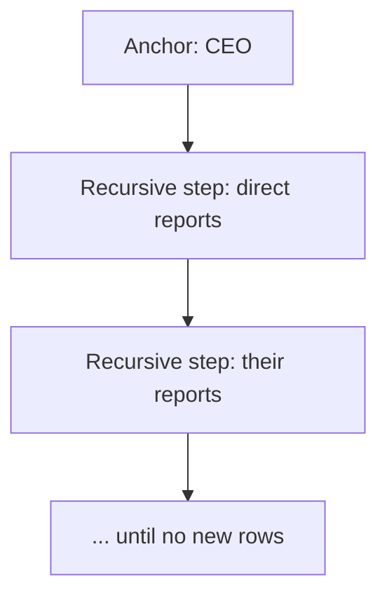

# What are CTEs and recursive CTEs

---

## 🟢 Junior Level

### 1. What is a CTE?

A **CTE (Common Table Expression)** is a named temporary result set defined with `WITH` at the top of a query. You can then use the name like a table in the main query. It makes long queries readable by splitting them into named steps.

**Analogy:** Naming intermediate results in a recipe: "prepare the sauce (step A)", "cook the pasta (step B)", then "combine A and B".

### 2. Basic example

```sql
WITH big_orders AS (
    SELECT customer_id, SUM(total) AS spent
    FROM orders
    WHERE created_at >= date_trunc('year', now())
    GROUP BY customer_id
    HAVING SUM(total) > 10000
)
SELECT c.name, b.spent
FROM big_orders b
JOIN customer c ON c.id = b.customer_id
ORDER BY b.spent DESC;
```

### 3. Multiple CTEs

```sql
WITH
paid AS    (SELECT * FROM orders WHERE status = 'PAID'),
refunded AS(SELECT * FROM orders WHERE status = 'REFUNDED')
SELECT (SELECT count(*) FROM paid)     AS paid_cnt,
       (SELECT count(*) FROM refunded) AS refunded_cnt;
```

### 4. Recursive CTE in one picture

A **recursive CTE** refers to itself and is the SQL way to walk hierarchies (org charts, categories, folder trees).

```sql
WITH RECURSIVE subordinates AS (
    SELECT id, name, manager_id, 0 AS depth        -- anchor member
    FROM employee WHERE id = 1
    UNION ALL
    SELECT e.id, e.name, e.manager_id, s.depth + 1 -- recursive member
    FROM employee e
    JOIN subordinates s ON e.manager_id = s.id
)
SELECT * FROM subordinates;
```



---

## 🟡 Middle Level

### 1. How a recursive CTE executes

1. Run the **anchor** (non-recursive) query → working table.
2. Run the **recursive** term, replacing the CTE reference with the *rows produced by the previous iteration only*.
3. Append results; repeat until an iteration yields zero rows.
4. `UNION ALL` keeps everything; `UNION` removes duplicates (useful to stop cycles in graphs, slower).

It is iterative, not truly recursive; each loop adds one "level".

### 2. Typical use cases

**Category tree with path:**

```sql
WITH RECURSIVE tree AS (
    SELECT id, parent_id, name, name::text AS path, 1 AS level
    FROM category WHERE parent_id IS NULL
    UNION ALL
    SELECT c.id, c.parent_id, c.name, t.path || ' > ' || c.name, t.level + 1
    FROM category c
    JOIN tree t ON c.parent_id = t.id
)
SELECT * FROM tree ORDER BY path;
```

**Generate a series / calendar:**

```sql
WITH RECURSIVE days(d) AS (
    SELECT DATE '2026-01-01'
    UNION ALL
    SELECT d + 1 FROM days WHERE d < DATE '2026-01-31'
)
SELECT d FROM days;
```

(PostgreSQL's `generate_series` is simpler for this.)

### 3. Cycle protection

Graph data with cycles produces infinite loops. Protect using a visited array, a depth limit, or the SQL-standard `CYCLE` clause (PostgreSQL 14+):

```sql
WITH RECURSIVE walk AS (
    SELECT id, parent_id, ARRAY[id] AS visited
    FROM node WHERE id = 1
    UNION ALL
    SELECT n.id, n.parent_id, w.visited || n.id
    FROM node n JOIN walk w ON n.parent_id = w.id
    WHERE n.id <> ALL (w.visited)
)
SELECT * FROM walk;
```

```sql
WITH RECURSIVE walk AS (...)
CYCLE id SET is_cycle USING path
SELECT * FROM walk WHERE NOT is_cycle;
```

### 4. Data-modifying CTEs

PostgreSQL allows `INSERT/UPDATE/DELETE ... RETURNING` inside CTEs — great for atomic move/archive operations:

```sql
WITH moved AS (
    DELETE FROM orders
    WHERE created_at < now() - INTERVAL '2 years'
    RETURNING *
)
INSERT INTO orders_archive SELECT * FROM moved;
```

Everything is one statement and one snapshot. (See the archiving question.)

### 5. Common mistakes

- Assuming a CTE is always a temp table. It is not; see materialization below.
- Forgetting `RECURSIVE` keyword in PostgreSQL (required, even when the CTE is recursive).
- Type mismatch between anchor and recursive columns (e.g. `varchar(10)` vs longer concatenated text) → cast in the anchor: `name::text`.
- Missing termination condition → runaway query; set `statement_timeout`.

### 6. Using in Spring

```java
@Query(value = """
    WITH RECURSIVE tree AS (
        SELECT id, parent_id, name, 1 AS level FROM category WHERE id = :rootId
        UNION ALL
        SELECT c.id, c.parent_id, c.name, t.level + 1
        FROM category c JOIN tree t ON c.parent_id = t.id
    )
    SELECT id, parent_id, name, level FROM tree ORDER BY level, name
    """, nativeQuery = true)
List<CategoryNode> subtree(@Param("rootId") long rootId);
```

One query replaces N+1 lazy loads of children.

---

## 🔴 Senior Level

### 1. Materialization semantics (PostgreSQL 12+)

- Before PG 12 every CTE was an **optimization fence** — always materialized, predicates not pushed in.
- Since PG 12, a **non-recursive, side-effect-free CTE referenced once** is inlined like a subquery. Referenced **more than once**, or containing `INSERT/UPDATE/DELETE`, or recursive → materialized.
- You can force the choice:

```sql
WITH recent AS MATERIALIZED     (SELECT * FROM orders WHERE created_at > now() - interval '7 days'),
     cheap  AS NOT MATERIALIZED (SELECT id FROM customer WHERE active)
SELECT ...;
```

Use `MATERIALIZED` when the CTE is expensive and reused (compute once), or deliberately to fence the planner when it estimates badly. Use `NOT MATERIALIZED` to allow predicate pushdown. Other databases differ (MySQL 8 merges non-recursive CTEs; SQL Server inlines them always) — never assume.

### 2. Performance of recursive queries

- Each iteration should be an **indexed lookup**: index `employee(manager_id)` so the join of the working table to the base table is an index scan, not a hash join over the whole table each loop.
- Depth × fan-out can explode; add depth limits and monitor row counts in `EXPLAIN ANALYZE` (`Recursive Union`, `WorkTable Scan`).
- `ORDER BY` / `LIMIT` in the recursive term is not allowed; use search ordering:

```sql
WITH RECURSIVE t AS (...)
SEARCH DEPTH FIRST BY id SET ordercol     -- PG 14+
SELECT * FROM t ORDER BY ordercol;
```

- For read-heavy hierarchies consider alternatives: **materialized path** (`path text` + `LIKE 'a/b/%'` with `text_pattern_ops` index), **`ltree`** extension (GiST indexed ancestor/descendant queries), **closure table** (`ancestor, descendant, depth`), or nested sets. Recursive CTEs are best for moderate depth and write-heavy trees.

```sql
CREATE EXTENSION IF NOT EXISTS ltree;
CREATE TABLE category_lt (id int PRIMARY KEY, path ltree NOT NULL);
CREATE INDEX ON category_lt USING gist (path);
SELECT * FROM category_lt WHERE path <@ 'electronics.phones';
```

### 3. Graph and bill-of-materials queries

Bill of materials with quantity roll-up:

```sql
WITH RECURSIVE bom AS (
    SELECT part_id, component_id, qty::numeric AS total_qty
    FROM assembly WHERE part_id = :root
    UNION ALL
    SELECT a.part_id, a.component_id, b.total_qty * a.qty
    FROM assembly a JOIN bom b ON a.part_id = b.component_id
)
SELECT component_id, SUM(total_qty) AS needed FROM bom GROUP BY component_id;
```

Shortest-path style search can be expressed with a path array and `min(depth)`, but for large graphs use a graph database / pgRouting; recursive CTE BFS has no early termination across branches.

### 4. Data-modifying CTE patterns

**Queue pop** (concurrent workers):

```sql
WITH job AS (
    SELECT id FROM job_queue
    WHERE status = 'PENDING'
    ORDER BY id
    LIMIT 10
    FOR UPDATE SKIP LOCKED
)
UPDATE job_queue q SET status = 'RUNNING', started_at = now()
FROM job WHERE q.id = job.id
RETURNING q.*;
```

**Upsert + dependent insert** returning generated ids in one round trip:

```sql
WITH o AS (
    INSERT INTO orders (customer_id, total) VALUES (:c, :t) RETURNING id
)
INSERT INTO order_item (order_id, sku, qty)
SELECT o.id, v.sku, v.qty FROM o, (VALUES ('A1', 2), ('B7', 1)) AS v(sku, qty);
```

All sub-statements see the **same snapshot** — a data-modifying CTE does not see the effect of its siblings except via `RETURNING`.

### 5. Edge cases

- A CTE is scoped to one statement; use views or temp tables when you need reuse or want an index on the intermediate result (a `CREATE TEMP TABLE ... ; ANALYZE` gives the planner statistics, CTEs have none beyond estimates).
- Hibernate: HQL 6 supports CTEs (`with ... as`), but recursive ones need native queries.
- Unreferenced data-modifying CTEs still execute; referenced SELECT CTEs not referenced are skipped.
- Stack/memory: recursive CTE working tables spill to disk beyond `work_mem`; `temp_file_limit` protects the cluster.

---

## 🎯 Interview Cheat Sheet

**30-second pitch:** A CTE names an intermediate query with `WITH` for readability; recursive CTEs (`WITH RECURSIVE`) combine an anchor and a recursive member with `UNION ALL` to traverse hierarchies. In PostgreSQL 12+ single-use non-recursive CTEs are inlined, multi-use ones materialized, controllable with `MATERIALIZED`/`NOT MATERIALIZED`. Guard against cycles and index the join column.

**Must-know bullets:**
- Anchor + recursive term + termination by empty iteration.
- `UNION ALL` vs `UNION` (cycle safety, cost).
- PG ≥ 12 inlining rules; older versions always materialized.
- Data-modifying CTEs are atomic and useful for archive/queue patterns.
- Alternatives to recursion: `ltree`, closure table, materialized path.
- Index `parent_id`.

**Common follow-up questions:**
- Is a CTE faster than a subquery?
- How to prevent infinite recursion?
- How would you fetch all ancestors of a node?
- Recursive CTE vs. closure table trade-offs?

**Red flags:**
- Saying CTEs always improve performance.
- Walking trees by issuing queries in a Java loop (N+1).
- Not handling cycles in graph data.

**Related topics:**
- [Subqueries versus joins and advanced join scenarios](09.%20Subqueries%20versus%20joins%20and%20advanced%20join%20scenarios.md)
- [How window functions work in SQL](07.%20How%20window%20functions%20work%20in%20SQL.md)
- [Soft delete and data archiving strategies](17.%20Soft%20delete%20and%20data%20archiving%20strategies.md)
- [How to read EXPLAIN ANALYZE output](12.%20How%20to%20read%20EXPLAIN%20ANALYZE%20output.md)
