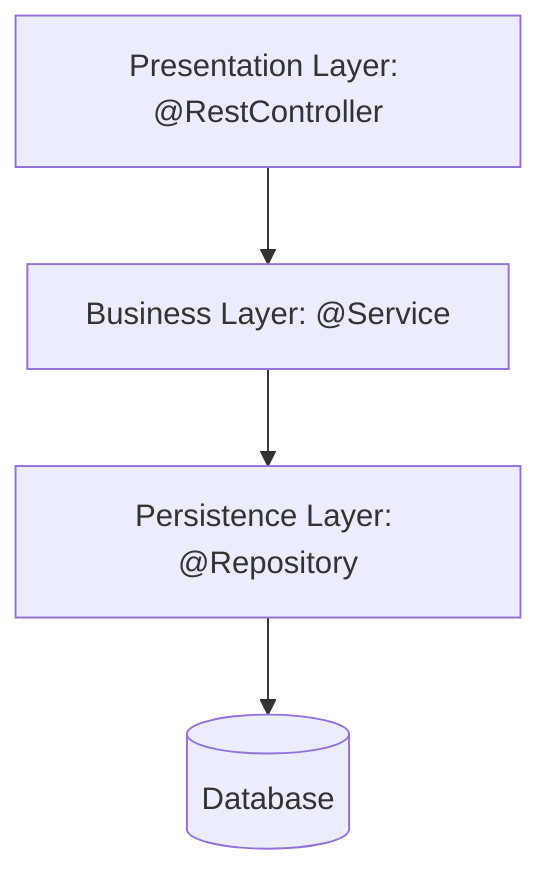

# What is layered architecture

---

## 🟢 Junior Level

**Layered (n-tier) architecture** organizes an application into horizontal layers, where each layer has one responsibility and may only talk to the layer directly below it. In a typical Spring Boot service the layers are **presentation (controllers)**, **business (services)**, and **persistence (repositories)**.



### Real-World Analogy
A restaurant: the **waiter** (controller) takes the order and never cooks; the **chef** (service) applies the recipe and rules; the **pantry** (repository) stores ingredients. A waiter does not walk into the pantry, and the pantry knows nothing about customers.

### Why It Matters
1. **Separation of concerns:** HTTP details do not leak into business rules.
2. **Replaceability:** you can swap the database without touching controllers.
3. **Team-friendly:** everybody immediately knows where code lives.

### Minimal Example

```java
@RestController
@RequestMapping("/orders")
class OrderController {
    private final OrderService service;
    OrderController(OrderService service) { this.service = service; }

    @GetMapping("/{id}")
    OrderDto get(@PathVariable long id) {
        return OrderDto.from(service.findById(id));
    }
}

@Service
class OrderService {
    private final OrderRepository repository;
    OrderService(OrderRepository repository) { this.repository = repository; }

    Order findById(long id) {
        return repository.findById(id)
                .orElseThrow(() -> new OrderNotFoundException(id));
    }
}

interface OrderRepository extends JpaRepository<Order, Long> { }
```

### Typical Package Structure (package-by-layer)

```text
com.shop
 ├── controller   OrderController
 ├── service      OrderService
 ├── repository   OrderRepository
 └── model        Order, OrderItem
```

### Golden Rules for Beginners
- Controllers **only** translate HTTP to Java calls (validation, status codes, DTO mapping).
- Services hold business logic and transaction boundaries.
- Repositories hold queries only; no business decisions.
- Never call a controller from a service, and never skip a layer "just this once".

---

## 🟡 Middle Level

### Strict vs. Relaxed Layering
- **Strict (closed) layers:** a layer may call only the one immediately below. Maximum isolation, but you get boring "pass-through" methods.
- **Relaxed (open) layers:** a layer may call any lower layer. Fewer wrappers, higher coupling.

Choose strict for the core (controller → service → repository) and be explicit when you open a layer (for example, a shared `util` layer).

### Package-by-Layer vs. Package-by-Feature

| Aspect | Package-by-layer | Package-by-feature |
|---|---|---|
| Navigation | Files of one feature are scattered | One feature, one folder |
| Visibility | Everything must be `public` | Package-private works |
| Extraction to a service | Painful | Straightforward |
| Cognitive load at 50+ classes | High | Lower |

```text
com.shop.order
 ├── OrderController   (package-private)
 ├── OrderService      (public API of the module)
 ├── OrderRepository   (package-private)
 └── Order
com.shop.catalog
 └── ...
```

Layers still exist **inside** each feature package; you simply stop using layers as the top-level cut.

### Common Mistakes
1. **Anemic domain model:** entities are bags of getters/setters; all logic sits in `*Service` classes, producing 2,000-line services.
2. **Leaking entities to the API:** returning JPA entities from controllers couples the contract to the schema and triggers `LazyInitializationException`.
3. **Business logic in controllers or repositories** (e.g., giant `@Query` with business rules).
4. **Transactions in the wrong layer:** `@Transactional` on controllers or repositories instead of service methods that represent a use case.
5. **Circular dependencies** between services at the same layer (`OrderService` ↔ `CustomerService`).

### Transaction Boundary Example

```java
@Service
class CheckoutService {
    private final OrderRepository orders;
    private final StockService stock;

    @Transactional // one use case = one transaction
    public OrderId checkout(Cart cart) {
        stock.reserve(cart.items());
        Order order = Order.place(cart);
        return orders.save(order).getId();
    }
}
```

### Enforcing Layers Automatically
Rules that live only in a wiki erode. Use ArchUnit:

```java
@AnalyzeClasses(packages = "com.shop")
class LayerRulesTest {
    @ArchTest
    static final ArchRule layers = layeredArchitecture().consideringAllDependencies()
        .layer("Controller").definedBy("..controller..")
        .layer("Service").definedBy("..service..")
        .layer("Repository").definedBy("..repository..")
        .whereLayer("Controller").mayNotBeAccessedByAnyLayer()
        .whereLayer("Service").mayOnlyBeAccessedByLayers("Controller")
        .whereLayer("Repository").mayOnlyBeAccessedByLayers("Service");
}
```

### Trade-offs
- **Pros:** familiar, quick onboarding, simple deployment, good for CRUD-heavy systems.
- **Cons:** the database becomes the center of the design (everything depends downward on persistence), "sinkhole" requests that pass through layers doing nothing, and a tendency toward big-ball-of-mud as the domain grows.

---

## 🔴 Senior Level

### The Dependency Direction Problem
In classic layering the **business layer depends on the persistence layer**. Business rules become coupled to JPA annotations, SQL dialects, and lazy-loading semantics. This is the main reason Hexagonal and Clean Architecture invert the dependency (see [What is hexagonal architecture](05.%20What%20is%20hexagonal%20architecture.md)). A pragmatic senior asks: *is the domain complex enough to pay for the inversion?* For an admin CRUD app, no.

### The Sinkhole Anti-Pattern
If more than ~80% of requests are pure pass-through (controller → service → repository with no logic), layers add ceremony without value. Options: allow controllers to read directly through a query side (a light CQRS split), or generate the plumbing.

```java
// Read side bypasses the domain on purpose: projection straight to a DTO
interface OrderSummaryQuery extends Repository<OrderEntity, Long> {
    @Query("select new com.shop.order.OrderSummary(o.id, o.status, o.total) from OrderEntity o where o.customerId = :cid")
    List<OrderSummary> forCustomer(@Param("cid") long customerId);
}
```

### Layering Beyond the Code
- **Horizontal layers across teams** produce hand-offs: a "frontend team", "backend team", "DBA team" must all coordinate for one feature. Vertical slices aligned to business capabilities reduce lead time (see [How Conways law shapes API and contract ownership](13.%20How%20Conways%20law%20shapes%20API%20and%20contract%20ownership.md)).
- **Physical tiers vs. logical layers:** layers are a code-structure concept; tiers are deployment units. Do not split layers into separate services "for cleanliness" - you pay network latency and distributed failure modes for no business benefit.

### Cross-Cutting Concerns
Security, logging, tracing, and transactions cut across layers. Handle them with AOP, servlet filters, or `HandlerInterceptor`, not by sprinkling code in each layer.

```java
@Aspect
@Component
class TimingAspect {
    @Around("within(com.shop..service..*)")
    Object time(ProceedingJoinPoint pjp) throws Throwable {
        long t0 = System.nanoTime();
        try { return pjp.proceed(); }
        finally { Metrics.timer(pjp.getSignature().toShortString()).record(System.nanoTime() - t0, NANOSECONDS); }
    }
}
```

### Mapping Strategy Between Layers
Each boundary should have its own model: `RequestDto` → domain object → `Entity` → `ResponseDto`. Mapping is tedious but prevents a schema change from breaking mobile clients. Use MapStruct to remove boilerplate, and accept duplication as a deliberate cost of decoupling.

### Evolution Path
1. Start layered, package-by-feature.
2. Introduce ArchUnit rules on day one.
3. When domain logic grows, move entities toward rich models and place repository **interfaces** in the domain package.
4. Extract modules (see [What is Spring Modulith](09.%20What%20is%20Spring%20Modulith.md)) before considering microservices.

### Production Scenario
A team had `OrderService` with 3,400 lines and 17 injected dependencies; every release collided in merge conflicts. Diagnosis: layered by technical role only, no feature boundaries. Fix: package-by-feature split into `order`, `payment`, `shipping`, with public APIs exposed as one interface per module and ArchUnit blocking cross-module internals. Merge conflicts dropped roughly 70% and the largest service shrank below 600 lines.

---

## 🎯 Interview Cheat Sheet

**30-second pitch:** Layered architecture separates presentation, business, and persistence so each changes for its own reason. It is the simplest, most familiar structure and ideal for CRUD systems, but its downward dependency on the database and its tendency to produce anemic models mean complex domains should move to hexagonal/clean designs.

**Must-know bullets**
- Controller = HTTP translation, Service = use case + transaction, Repository = data access.
- Prefer package-by-feature; layers live inside features.
- Never expose entities in the API; map to DTOs.
- Enforce rules with ArchUnit, not documentation.
- Layers are logical; tiers are physical deployment.

**Common follow-ups**
- Strict vs relaxed layering?
- Where does `@Transactional` belong and why?
- What is the sinkhole anti-pattern?
- How do you move from layered to hexagonal incrementally?

**Red flags**
- Business logic in controllers or SQL.
- "We use layers so we are clean" with 3,000-line services.
- Splitting layers into separate microservices.

**Related topics**
- [What is hexagonal architecture](05.%20What%20is%20hexagonal%20architecture.md)
- [What are clean architecture and onion architecture](06.%20What%20are%20clean%20architecture%20and%20onion%20architecture.md)
- [How to design for testability](16.%20How%20to%20design%20for%20testability.md)
