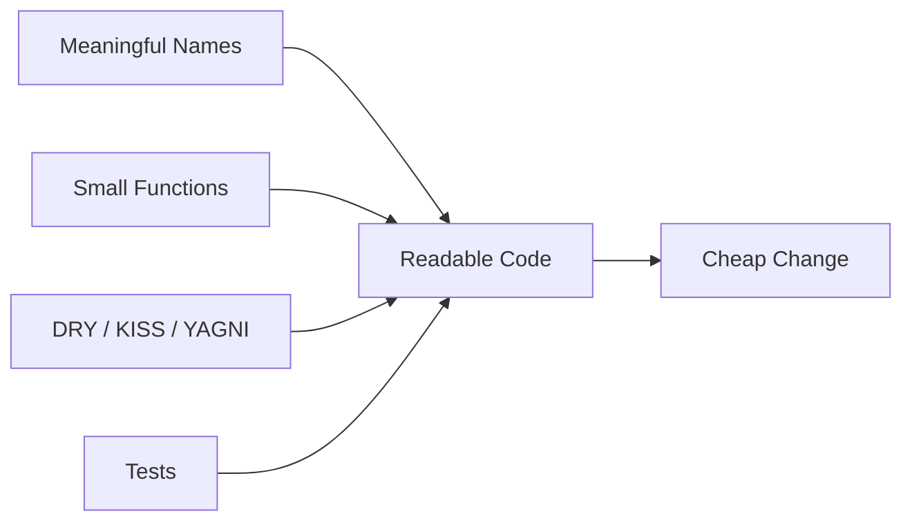

# What are clean code principles

---

## 🟢 Junior Level

**Clean code** is code that is easy to read, easy to change, and hard to break. Code is read far more often than it is written (often quoted as 10:1), so optimizing for the reader is optimizing for the team.



### Real-World Analogy
A recipe. "Mix stuff, heat, wait" is technically complete but useless. A clean recipe lists named ingredients, numbered steps, and one dish per recipe.

### The Core Principles
1. **Meaningful names** - reveal intent: `daysSinceLastLogin`, not `d`.
2. **Small functions that do one thing** - if you need "and" to describe it, split it.
3. **DRY (Don't Repeat Yourself)** - one authoritative place for each piece of knowledge.
4. **KISS (Keep It Simple)** - the simplest design that works.
5. **YAGNI (You Aren't Gonna Need It)** - do not build features "just in case".

### Before and After

```java
// Bad: what is 86400? what is p?
double calc(double p, int d) {
    if (d > 86400) return p * 0.9;
    return p;
}

// Good: intent is visible
private static final Duration LOYALTY_THRESHOLD = Duration.ofDays(1);

BigDecimal applyLoyaltyDiscount(BigDecimal price, Duration customerAge) {
    boolean isLoyal = customerAge.compareTo(LOYALTY_THRESHOLD) > 0;
    return isLoyal ? price.multiply(LOYALTY_DISCOUNT_RATE) : price;
}
```

### Naming Quick Rules
- Classes are nouns (`InvoiceGenerator`), methods are verbs (`calculateTotal`).
- Booleans read as questions: `isActive`, `hasPermission`.
- Avoid noise words (`Manager`, `Data`, `Info`, `Helper`) and abbreviations nobody agrees on.
- Use one word per concept: do not mix `fetch`, `get`, `retrieve` for the same idea.

---

## 🟡 Middle Level

### Functions
- Aim for **one level of abstraction** per function. Mixing `if (x)` with raw JDBC calls forces readers to switch mental gears.
- Limit parameters (0-3). More than three is a hint for a parameter object or a builder.
- Avoid **flag arguments**: `render(true)` tells nothing. Split into `renderForPrint()` and `renderForScreen()`.
- Avoid **side effects hidden in names**: `checkPassword` that also initializes a session is a lie.
- Prefer **command-query separation**: a method either changes state or returns information.

```java
// Parameter object plus a method that tells a story
record TransferRequest(AccountId from, AccountId to, Money amount) { }

void transfer(TransferRequest request) {
    Account source = accounts.load(request.from());
    Account target = accounts.load(request.to());
    source.withdraw(request.amount());
    target.deposit(request.amount());
    accounts.saveAll(source, target);
}
```

### Guard Clauses Over Nested Ifs

```java
Money shippingCost(Order order) {
    if (order.isEmpty()) return Money.ZERO;
    if (order.hasFreeShipping()) return Money.ZERO;
    return rates.forWeight(order.totalWeight());
}
```

### DRY Is About Knowledge, Not Text
Two code blocks that look the same but change for different reasons are **not** duplicates. Merging "VAT calculation for invoices" and "VAT calculation for display estimates" couples two lifecycles; when tax law changes one, you must fork the shared code. Rule of thumb: **tolerate duplication until the third occurrence (rule of three)**, and abstract only once the real shape is visible.

### YAGNI vs. Extensibility
Adding an `interface` with one implementation "for future flexibility" is often speculation. Add abstractions when there is a second implementation or a test seam need. Exception: boundaries (ports to external systems) deserve interfaces early (see [What is hexagonal architecture](05.%20What%20is%20hexagonal%20architecture.md)).

### Comments
Good comments explain **why**, not what. Replace "what" comments with better names.

```java
// Bad
// check if employee is eligible for benefits
if (e.type == 1 && e.months > 6) { }

// Good
if (employee.isEligibleForBenefits()) { }

// Acceptable why-comment
// Bank API rejects amounts with more than 2 decimals; round HALF_EVEN as per contract v3
```

### Error Handling
- Use exceptions, not return codes; do not return `null` for collections (return empty) or for "not found" (use `Optional`).
- Do not swallow exceptions: `catch (Exception e) { }` is a production incident waiting.
- Create exceptions with context: `new OrderNotFoundException(orderId)`.

### Common Mistakes
1. Over-decomposition: 40 one-line methods that must be read in sequence is not clean.
2. Abstracting after the first duplication (wrong abstraction is costlier than duplication).
3. Clever one-liners with nested streams that nobody can debug.
4. Treating style rules as dogma instead of automating them with Checkstyle/Spotless.

---

## 🔴 Senior Level

### Clean Code Is a Team Contract, Not a Personal Taste
At senior level the question is how to **scale consistent quality** across 30 developers.
- Automate: Spotless/google-java-format, Checkstyle, SpotBugs, Error Prone, Sonar quality gate.
- Document decisions in a short coding guideline (one page) and ADRs for contentious choices (see [How to document architecture with ADRs and the C4 model](10.%20How%20to%20document%20architecture%20with%20ADRs%20and%20the%20C4%20model.md)).
- Review for **design and readability**, not formatting, because tooling already handles formatting (see [What are code review best practices and how to mentor juniors](18.%20What%20are%20code%20review%20best%20practices%20and%20how%20to%20mentor%20juniors.md)).

### Expressive Modern Java
Use language features to make illegal states unrepresentable.

```java
sealed interface PaymentResult permits Approved, Declined, Pending { }
record Approved(String authCode) implements PaymentResult { }
record Declined(String reason) implements PaymentResult { }
record Pending(Duration retryAfter) implements PaymentResult { }

String message(PaymentResult result) {
    return switch (result) {
        case Approved a -> "Paid, auth " + a.authCode();
        case Declined d -> "Rejected: " + d.reason();
        case Pending p  -> "Retry in " + p.retryAfter();
    }; // compiler enforces exhaustiveness
}
```

### Primitive Obsession and Value Objects
`transfer(String, String, BigDecimal)` is easy to call with arguments swapped. Wrapping in `AccountId` and `Money` moves validation to construction time and removes an entire bug class (more in [What is Domain-Driven Design](04.%20What%20is%20Domain-Driven%20Design.md)).

```java
record Money(BigDecimal amount, Currency currency) {
    Money {
        Objects.requireNonNull(amount); Objects.requireNonNull(currency);
        if (amount.scale() > currency.getDefaultFractionDigits())
            throw new IllegalArgumentException("Too many decimals");
    }
    Money plus(Money o) {
        if (!currency.equals(o.currency)) throw new IllegalArgumentException("Currency mismatch");
        return new Money(amount.add(o.amount), currency);
    }
}
```

### Where Clean Code Dogma Hurts
- **Performance-critical paths:** allocation-heavy abstractions in hot loops can matter; measure with JMH before sacrificing readability, and isolate the optimized code with a clear comment and benchmark.
- **Premature DRY across services:** a shared "common" library used by 12 microservices becomes a distributed monolith lock-step upgrade (see [How to manage dependencies and choose between a library and a framework](17.%20How%20to%20manage%20dependencies%20and%20choose%20between%20a%20library%20and%20a%20framework.md)).
- **Boy-scout rule vs. scope creep:** leave code a little cleaner, but keep cleanup commits separate from behavioral commits so reviews and `git bisect` stay useful.

### Measuring Cleanliness Honestly
Cyclomatic complexity, cognitive complexity (Sonar), change coupling from `git log`, and the **time to first meaningful PR** of new hires are better signals than line counts. A useful experiment: ask a new teammate to explain a module after 15 minutes of reading; confusion points are your refactoring backlog.

### Leadership Angle
Clean code debates get heated. Seniors reduce friction by: agreeing criteria ("does it reduce time-to-understand?"), using examples from the real codebase, and avoiding rewriting working code to satisfy preference. Link cleanup to business outcomes: fewer defects in modules with high churn.

---

## 🎯 Interview Cheat Sheet

**30-second pitch:** Clean code minimizes the cost of change by optimizing for the reader: intention-revealing names, small focused functions, no needless duplication or speculation, and error handling that is explicit. DRY is about knowledge, not text; YAGNI and KISS keep designs honest; automation keeps the standard consistent across a team.

**Must-know bullets**
- Names reveal intent; one word per concept.
- Functions do one thing at one abstraction level; avoid flag args.
- Rule of three before abstracting; wrong abstraction costs more than duplication.
- Comments explain why; types and names explain what.
- Automate style; review design.

**Common follow-ups**
- When is duplication acceptable?
- How do you keep a team consistent without becoming the style police?
- How would you refactor a 500-line method?
- Clean code vs. performance?

**Red flags**
- "Self-documenting code means no comments ever."
- Abstracting everything into interfaces on day one.
- Rewriting code that works purely for style.

**Related topics**
- [How to refactor code and spot code smells](03.%20How%20to%20refactor%20code%20and%20spot%20code%20smells.md)
- [How to design for testability](16.%20How%20to%20design%20for%20testability.md)
- [How to manage technical debt](12.%20How%20to%20manage%20technical%20debt.md)
