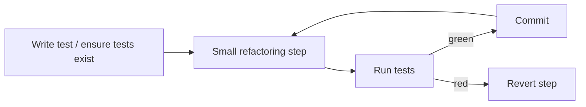
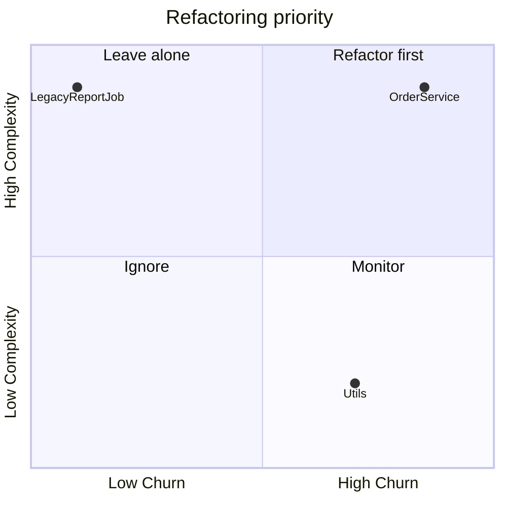

# How to refactor code and spot code smells

---

## 🟢 Junior Level

**Refactoring** is changing the internal structure of code **without changing its observable behavior**. A **code smell** is a surface symptom that hints at a deeper design problem. A smell is not a bug; the code works, but it is expensive to change.



### Real-World Analogy
Tidying a workshop while still delivering orders. You reorganize tool drawers (structure) but the customer still receives exactly the same finished chair (behavior). You do it in small steps, checking nothing got lost.

### Common Smells to Recognize
| Smell | Symptom |
|---|---|
| Long Method | Method needs scrolling; comments divide "sections" |
| Large Class | Class with many unrelated fields/methods |
| Duplicated Code | Same logic copy-pasted |
| Long Parameter List | 5+ parameters |
| Magic Numbers | `if (status == 3)` |
| Dead Code | Unused methods/branches |
| Feature Envy | Method uses another object's data more than its own |

### Minimal Example: Extract Method

```java
// Before
void printInvoice(Invoice invoice) {
    System.out.println("Invoice " + invoice.getId());
    double total = 0;
    for (Line l : invoice.getLines()) {
        total += l.getPrice() * l.getQty();
    }
    System.out.println("Total: " + total);
}

// After
void printInvoice(Invoice invoice) {
    printHeader(invoice);
    System.out.println("Total: " + total(invoice));
}

private void printHeader(Invoice invoice) {
    System.out.println("Invoice " + invoice.getId());
}

private double total(Invoice invoice) {
    return invoice.getLines().stream().mapToDouble(l -> l.getPrice() * l.getQty()).sum();
}
```

### Golden Rule
Never refactor without a safety net. If there are no tests, write a few **characterization tests** that pin down the current behavior first.

---

## 🟡 Middle Level

### Catalog of Everyday Refactorings
- **Extract Method / Extract Class** - shrink methods and split responsibilities.
- **Rename** - the cheapest and most valuable refactoring; use the IDE.
- **Replace Conditional with Polymorphism** - turns `switch` on type into strategy objects.
- **Introduce Parameter Object** - groups parameters that travel together.
- **Replace Magic Number with Constant/Enum.**
- **Move Method** - fix Feature Envy by putting behavior next to its data.
- **Replace Temp with Query**, **Inline Method**, **Encapsulate Collection**.

```java
// Smell: type switch spreads across the codebase
double fee(Account a) {
    switch (a.type()) {
        case BASIC:   return 5.0;
        case PREMIUM: return 2.0;
        case VIP:     return 0.0;
        default: throw new IllegalStateException();
    }
}

// Refactor: polymorphism via enum behavior
enum AccountType {
    BASIC(5.0), PREMIUM(2.0), VIP(0.0);
    private final double fee;
    AccountType(double fee) { this.fee = fee; }
    double fee() { return fee; }
}
```

### Bloaters, Couplers, Change Preventers
Fowler groups smells to help diagnose:
- **Bloaters:** Long Method, Large Class, Data Clumps, Primitive Obsession.
- **Change Preventers:** **Divergent Change** (one class changes for many reasons) and **Shotgun Surgery** (one change touches many classes).
- **Couplers:** Feature Envy, Inappropriate Intimacy, Message Chains (`a.getB().getC().getD()`).
- **Dispensables:** Dead Code, Speculative Generality, Duplicate Code.

### Characterization Test Example

```java
@Test
void legacyDiscountBehaviorIsPreserved() {
    // Values captured by running the legacy code, not from a spec
    assertEquals(new BigDecimal("90.00"), legacy.discount(new BigDecimal("100"), 7));
    assertEquals(new BigDecimal("100.00"), legacy.discount(new BigDecimal("100"), 0));
}
```

### Common Mistakes
1. Mixing refactoring and feature work in one commit.
2. "Big bang" rewrite branches that live for months and never merge.
3. Refactoring code that nobody touches (zero churn - no benefit).
4. Relying on IDE refactoring across reflection, Spring SpEL strings, or JPQL strings that tools cannot see.
5. Changing public API during a "refactoring" - that is a breaking change, not a refactor.

### When Not to Refactor
- Close to a release without tests.
- Code that will be deleted soon.
- When a rewrite of a tiny, well-understood module is genuinely cheaper.

---

## 🔴 Senior Level

### Refactoring Strategy at Scale
Prioritize with **hotspot analysis**: cross churn (how often a file changes in `git log`) with complexity. Files that are both complex and frequently changed are where refactoring pays back. Tools: CodeScene, `git log --format=format: --name-only | sort | uniq -c | sort -rn`, Sonar cognitive complexity.



### Safe Techniques for Risky Code
- **Branch by abstraction:** introduce an interface in front of the old code, build the new implementation behind it, switch with a feature flag, delete the old one.
- **Parallel run / shadow mode (Scientist pattern):** execute both old and new, return old, log differences.
- **Sprout Method / Sprout Class:** add new behavior in a new, tested unit and call it from the legacy code with minimal edits.
- **Seams (Michael Feathers):** find places where behavior can be altered without editing the code (constructor injection, subclass-and-override).

```java
interface PricingEngine { Money price(Cart cart); }

class LegacyPricing implements PricingEngine { /* untouched */ }
class NewPricing implements PricingEngine { /* tested rewrite */ }

class ShadowPricing implements PricingEngine {
    private final PricingEngine primary, candidate;
    private static final Logger log = LoggerFactory.getLogger(ShadowPricing.class);

    public Money price(Cart cart) {
        Money result = primary.price(cart);
        try {
            Money other = candidate.price(cart);
            if (!result.equals(other)) log.warn("Pricing mismatch cart={} old={} new={}", cart.id(), result, other);
        } catch (RuntimeException e) { log.warn("Candidate failed", e); }
        return result;
    }
}
```

### Automated Refactoring
**OpenRewrite** applies codemods across repositories: Java version upgrades, JUnit 4 to 5, Spring Boot migrations. This transforms refactoring from artisanal to repeatable (see [How to modernize a legacy Java system](22.%20How%20to%20modernize%20a%20legacy%20Java%20system.md)).

### Business Framing
Engineers lose arguments when they say "the code is ugly." Win them with data: "Changes in `OrderService` average 3.2 days and cause 40% of regressions; two weeks of extraction work reduces this." Embed refactoring in feature work (the **boy-scout rule**) and reserve explicit capacity for larger moves (see [How to manage technical debt](12.%20How%20to%20manage%20technical%20debt.md)).

### Edge Cases and Pitfalls
- **Database refactoring** needs expand/contract migrations (add column, dual-write, backfill, switch reads, drop) to support zero-downtime deploys; Flyway/Liquibase scripts must be backward compatible with the previous app version.
- **Concurrency:** extracting a method from a `synchronized` block can change locking scope and break invariants.
- **Serialization & JSON:** renaming a field changes the Jackson contract; guard with `@JsonProperty` or contract tests.
- **Performance:** polymorphism replaces inlined branches; verify with JMH when in hot paths.

### Leadership Practices
Make small refactoring PRs easy to approve (under 200 changed lines, no behavior change, labelled "refactor-only"). Pair on big structural changes. Track outcomes (cycle time, defect rate in the hotspot), not number of refactorings.

---

## 🎯 Interview Cheat Sheet

**30-second pitch:** Refactoring restructures code without changing behavior, in small test-protected steps, driven by smells like long methods, feature envy, and shotgun surgery. At scale, I target hotspots (high churn plus high complexity), use seams, branch by abstraction, and shadow runs for risky areas, and I justify the work using delivery metrics rather than taste.

**Must-know bullets**
- Tests first; characterization tests for legacy.
- Small steps, frequent commits, separate from feature work.
- Know Fowler's smell categories and standard refactorings.
- Hotspot analysis chooses where to invest.
- Database and API refactors need compatibility strategies.

**Common follow-ups**
- How do you refactor code with no tests?
- Refactor vs. rewrite - how do you decide?
- How do you convince a product owner to fund refactoring?
- What is branch by abstraction?

**Red flags**
- Big-bang rewrites.
- Refactoring without tests.
- Mixing behavior changes into "refactor" PRs.

**Related topics**
- [What are clean code principles](02.%20What%20are%20clean%20code%20principles.md)
- [How to manage technical debt](12.%20How%20to%20manage%20technical%20debt.md)
- [How to decompose a monolith with the strangler fig pattern](08.%20How%20to%20decompose%20a%20monolith%20with%20the%20strangler%20fig%20pattern.md)
