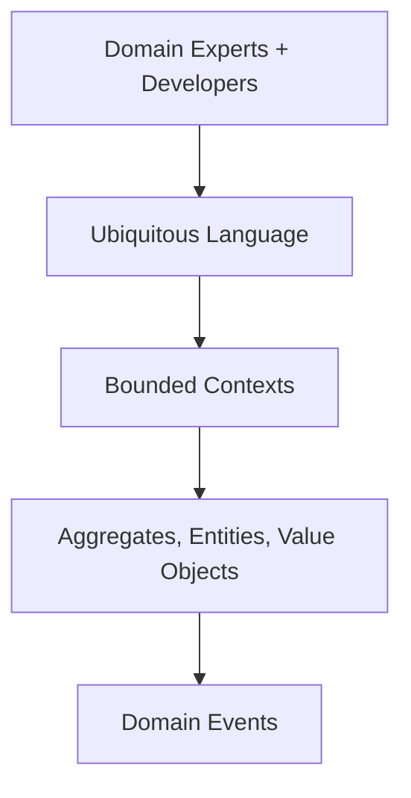
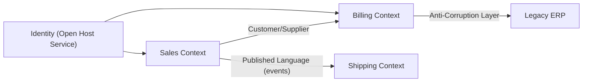

# What is Domain-Driven Design

---

## 🟢 Junior Level

**Domain-Driven Design (DDD)** is an approach to building software where the code mirrors the business domain, designed together with domain experts using a shared vocabulary. Eric Evans introduced it in 2003. It has two halves: **strategic design** (how to split a big problem into bounded contexts) and **tactical design** (building blocks inside a context: entities, value objects, aggregates, repositories, domain events).



### Real-World Analogy
A hospital. The word "patient" means one thing to the billing department (an account to charge) and another to the ward (a person to treat). Rather than forcing one giant "Patient" model on both, each department has its own model and vocabulary, and they exchange only what they need.

### Key Building Blocks
- **Ubiquitous Language:** the exact same terms in conversation, documents, and code (`Shipment.dispatch()`, not `Shipment.setStatus(2)`).
- **Entity:** has identity that persists over time (`Order` #1001), equality by ID.
- **Value Object:** no identity, defined by attributes, immutable (`Money`, `Address`).
- **Aggregate:** a cluster of objects treated as one consistency unit with a single **aggregate root**.
- **Repository:** collection-like access to aggregates.
- **Domain Event:** something meaningful that happened (`OrderPlaced`).
- **Bounded Context:** a boundary within which a model and its language are consistent.

### Minimal Example

```java
// Value object
public record Money(BigDecimal amount, String currency) {
    public Money plus(Money other) {
        if (!currency.equals(other.currency)) throw new IllegalArgumentException("Currency mismatch");
        return new Money(amount.add(other.amount), currency);
    }
}

// Entity + aggregate root
public class Order {
    private final OrderId id;
    private final List<OrderLine> lines = new ArrayList<>();
    private OrderStatus status = OrderStatus.DRAFT;

    public Order(OrderId id) { this.id = id; }

    public void addLine(ProductId product, int qty, Money price) {
        if (status != OrderStatus.DRAFT) throw new IllegalStateException("Order is not editable");
        lines.add(new OrderLine(product, qty, price));
    }

    public void place() {
        if (lines.isEmpty()) throw new IllegalStateException("Empty order");
        status = OrderStatus.PLACED;
    }
}
```

Notice there is behavior (`place()`), and invariants (no empty orders) are guarded in the model, not in a service.

---

## 🟡 Middle Level

### Entities vs. Value Objects
| | Entity | Value Object |
|---|---|---|
| Identity | By ID | By all attributes |
| Mutability | Mutable lifecycle | Immutable |
| Example | `Customer`, `Order` | `Money`, `EmailAddress`, `DateRange` |
| Java tool | Class, `equals` on id | `record` |

Prefer value objects: they are thread-safe, self-validating, and remove primitive obsession.

### Aggregates and Their Rules
An aggregate defines a **transactional consistency boundary**. Rules:
1. Reference other aggregates **by ID**, not by object reference.
2. Modify **one aggregate per transaction**; use eventual consistency (events) between aggregates.
3. Load and save the aggregate as a whole through the root's repository.
4. Keep aggregates small; large aggregates cause lock contention and slow loading.

```java
public class Order {
    private final CustomerId customerId; // by id, not Customer object
    ...
}

public interface OrderRepository { // lives in the domain package
    Optional<Order> findById(OrderId id);
    void save(Order order);
}
```

### Domain Events
Events record facts in the past tense. They decouple aggregates and modules.

```java
public record OrderPlaced(OrderId orderId, CustomerId customerId, Money total, Instant at) { }

@Service
class PlaceOrderHandler {
    private final OrderRepository orders;
    private final ApplicationEventPublisher events;

    @Transactional
    public void handle(PlaceOrder cmd) {
        Order order = orders.findById(cmd.orderId()).orElseThrow();
        order.place();
        orders.save(order);
        events.publishEvent(new OrderPlaced(order.id(), order.customerId(), order.total(), Instant.now()));
    }
}

@Component
class LoyaltyPoints {
    @TransactionalEventListener(phase = TransactionPhase.AFTER_COMMIT)
    void on(OrderPlaced event) { /* award points */ }
}
```

### Domain Service vs. Application Service
- **Domain service:** stateless domain logic that does not naturally fit an entity (`TransferFundsPolicy`).
- **Application service:** orchestration of a use case (load, call domain, save, publish); contains no business rules, owns the transaction.

### JPA Mapping Without Polluting the Domain
Simple projects annotate the domain class with JPA. Stricter projects keep a separate persistence model and map. Trade-off: purity vs. boilerplate. Value objects map with `@Embeddable`.

```java
@Embeddable
public record MoneyEmbeddable(BigDecimal amount, String currency) { }
```

### Common Mistakes
1. **Anemic domain model:** entities only hold data; services contain all logic.
2. **Applying DDD everywhere:** simple CRUD does not need aggregates.
3. **Giant aggregates** with half the database inside.
4. **Skipping domain experts:** tactical patterns without a ubiquitous language are cosmetic.
5. **Shared entity across contexts:** one `Customer` class for sales, billing, and support.

---

## 🔴 Senior Level

### Strategic Design in Depth
A large system has **subdomains**:
- **Core:** differentiates the business; invest your best people (pricing engine at a retailer).
- **Supporting:** necessary but not unique; build simply or customize.
- **Generic:** solved problems (identity, payments); buy or use open source (see [How to decide between build and buy](21.%20How%20to%20decide%20between%20build%20and%20buy.md)).

**Bounded contexts** are the solution-space boundaries; ideally each aligns to a team and often to a module or service. **Context mapping** describes relationships:



Patterns: Shared Kernel, Customer/Supplier, Conformist, **Anti-Corruption Layer (ACL)**, Open Host Service, Published Language, Separate Ways.

```java
// ACL: translate legacy ERP model into our own language
class ErpCustomerTranslator {
    Customer toDomain(ErpCustomerRecord r) {
        return new Customer(new CustomerId(r.getKunnr()),
            new PersonName(r.getName1(), r.getName2()),
            r.getSperr() == null || r.getSperr().isBlank() ? CustomerStatus.ACTIVE : CustomerStatus.BLOCKED);
    }
}
```

### Event Storming
A workshop technique: stick orange notes (domain events) on a wall in time order, then add commands, aggregates, policies, and hot spots (disagreements). It discovers boundaries fast and aligns developers and business. Boundaries typically emerge where the language changes or where events cross teams.

### Aggregate Design Heuristics (Vaughn Vernon)
- Design around **true invariants**, not data relationships.
- If two things must be consistent in a single transaction, they belong to one aggregate; otherwise use eventual consistency.
- Use optimistic locking (`@Version`) on the root to protect invariants:

```java
@Entity
public class OrderEntity {
    @Id private UUID id;
    @Version private long version;
}
```

### DDD and Architecture
DDD tactical models thrive in a hexagonal layout where the domain has no framework dependencies (see [What is hexagonal architecture](05.%20What%20is%20hexagonal%20architecture.md)). Bounded contexts map to Spring Modulith modules first and microservices later only if scaling or team autonomy demands it (see [What is Spring Modulith](09.%20What%20is%20Spring%20Modulith.md)). Cross-context integration via events raises consistency questions covered in [How to handle distributed data consistency](15.%20How%20to%20handle%20distributed%20data%20consistency.md).

### Organizational Dimension
Context boundaries are also **team** boundaries (Conway's law). Misaligned boundaries create endless coordination. Domain-owning teams should maintain the glossary of their context and publish contracts (see [How Conways law shapes API and contract ownership](13.%20How%20Conways%20law%20shapes%20API%20and%20contract%20ownership.md)).

### Pitfalls in Production
- **Event schema evolution:** events are contracts; version them and keep them additive.
- **Dual write:** saving the aggregate and publishing to Kafka separately can lose events; use the transactional outbox.
- **Reporting needs:** aggregates are poor for queries; use read models (CQRS) rather than bending the aggregate.
- **Over-modeling:** when the domain is a thin wrapper over a table, DDD ceremony costs more than it returns.

---

## 🎯 Interview Cheat Sheet

**30-second pitch:** DDD aligns software with the business via a ubiquitous language built with domain experts. Strategically it splits the system into bounded contexts and prioritizes core subdomains; tactically it models behavior with entities, immutable value objects, small aggregates guarding invariants, and domain events. It pays off in complex domains and is overkill for CRUD.

**Must-know bullets**
- Entity = identity; value object = attributes, immutable.
- Aggregate = consistency boundary; reference others by ID; one per transaction.
- Bounded context = language boundary; context map defines relationships.
- Domain events describe facts; version them.
- Core/supporting/generic subdomains drive build-vs-buy.

**Common follow-ups**
- How big should an aggregate be?
- Anemic vs. rich domain model?
- How do you handle consistency between aggregates?
- Where do bounded contexts map to microservices?

**Red flags**
- Equating DDD with "using repositories and entities".
- One shared `Customer` model enterprise-wide.
- Business rules in controllers.

**Related topics**
- [What is hexagonal architecture](05.%20What%20is%20hexagonal%20architecture.md)
- [What are the trade-offs of event-driven architecture](14.%20What%20are%20the%20trade-offs%20of%20event-driven%20architecture.md)
- [Modular monolith vs microservices vs serverless](07.%20Modular%20monolith%20vs%20microservices%20vs%20serverless.md)
