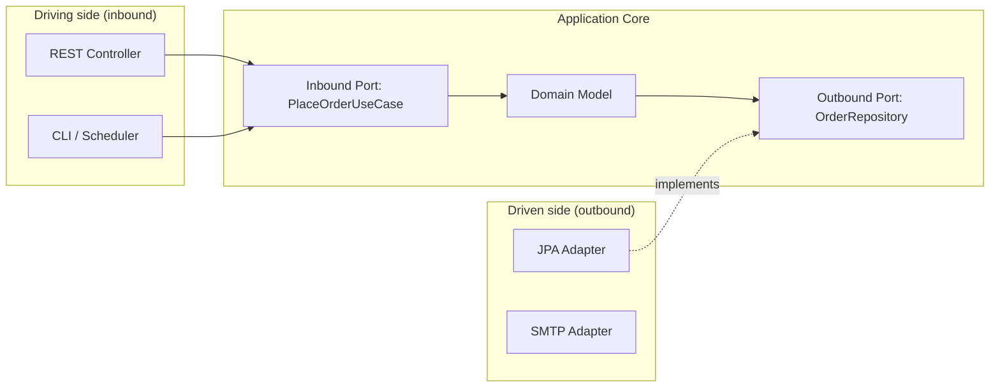

# What is hexagonal architecture

---

## 🟢 Junior Level

**Hexagonal architecture** (Ports and Adapters, Alistair Cockburn, 2005) puts the **business logic in the center** and isolates it from the outside world (web, database, message brokers, third-party APIs). The core talks to the outside only through **ports** (interfaces it owns); **adapters** implement those ports for concrete technologies.



### Real-World Analogy
A laptop with USB-C ports. The laptop (core) defines the port shape; a charger, monitor, or phone dock (adapters) plug in. Swapping a monitor never requires redesigning the motherboard.

### Key Terms
- **Port:** an interface owned by the core. *Inbound* (driving) = what the app offers (use cases); *outbound* (driven) = what the app needs (persistence, notifications).
- **Adapter:** technology-specific code implementing/calling a port (`JpaOrderRepository`, `OrderRestController`).
- **Dependency rule:** all source-code dependencies point **inward**, toward the core.

### Minimal Example

```java
// Inbound port
public interface PlaceOrderUseCase {
    OrderId place(PlaceOrderCommand command);
}

// Outbound port (owned by the core, in the domain package)
public interface OrderRepository {
    void save(Order order);
}

// Core implementation, knows nothing about Spring MVC or JPA
public class PlaceOrderService implements PlaceOrderUseCase {
    private final OrderRepository repository;
    public PlaceOrderService(OrderRepository repository) { this.repository = repository; }

    public OrderId place(PlaceOrderCommand command) {
        Order order = Order.create(command.customerId(), command.items());
        repository.save(order);
        return order.id();
    }
}

// Driven adapter
@Repository
class JpaOrderRepositoryAdapter implements OrderRepository {
    private final SpringDataOrderRepo jpa;
    JpaOrderRepositoryAdapter(SpringDataOrderRepo jpa) { this.jpa = jpa; }
    public void save(Order order) { jpa.save(OrderEntity.from(order)); }
}
```

---

## 🟡 Middle Level

### Package Structure

```text
com.shop.order
 ├── domain                    // entities, value objects, domain services, outbound ports
 │    ├── Order.java
 │    └── OrderRepository.java
 ├── application               // use cases (inbound ports + implementations)
 │    ├── PlaceOrderUseCase.java
 │    └── PlaceOrderService.java
 └── adapter
      ├── in
      │    └── web   OrderController, OrderRequest
      └── out
           ├── persistence  OrderEntity, JpaOrderRepositoryAdapter
           └── payment      StripePaymentAdapter
```

### Why It Helps
1. **Testability:** the core is tested with plain JUnit and in-memory fakes, no Spring context.
2. **Replaceability:** swap JDBC to MongoDB, REST to gRPC, Kafka to RabbitMQ with new adapters.
3. **Deferred decisions:** you can postpone database choices.
4. **Enforced boundaries:** frameworks stay at the edges.

### Testing the Core Without Infrastructure

```java
class InMemoryOrderRepository implements OrderRepository {
    final Map<OrderId, Order> store = new HashMap<>();
    public void save(Order order) { store.put(order.id(), order); }
}

class PlaceOrderServiceTest {
    @Test
    void placesOrder() {
        var repo = new InMemoryOrderRepository();
        var service = new PlaceOrderService(repo);

        OrderId id = service.place(new PlaceOrderCommand(new CustomerId("c1"), List.of(item("p1", 2))));

        assertTrue(repo.store.containsKey(id));
    }
}
```

### Wiring With Spring
Keep the core free of `@Component`; wire it in a configuration class that lives in the application's bootstrap package:

```java
@Configuration
class OrderConfig {
    @Bean
    PlaceOrderUseCase placeOrderUseCase(OrderRepository repository) {
        return new PlaceOrderService(repository);
    }
}
```

Many teams accept `@Service` and `@Transactional` on use-case classes as a pragmatic compromise; ArchUnit then forbids `org.springframework.web`, `jakarta.persistence`, and `org.springframework.data` in `..domain..`.

### Common Mistakes
1. **Ports that mirror the technology:** `OrderRepository extends JpaRepository` in the domain package defeats the purpose.
2. **Anemic core:** hexagonal structure with logic inside adapters.
3. **Leaking DTOs/entities across the port:** the web request object passed straight into the domain.
4. **Mapping fatigue** leading developers to skip mappers and reintroduce coupling.
5. **One interface per class by reflex**, including ones that will never have a second implementation.

### Trade-offs
| Benefit | Cost |
|---|---|
| Fast, isolated tests | More classes and mapping code |
| Technology independence | Extra indirection for newcomers |
| Clear boundaries | Over-engineering for simple CRUD |

---

## 🔴 Senior Level

### Driving vs. Driven Asymmetry
Inbound adapters **call** the core through use-case interfaces; outbound adapters are **called by** the core through ports the core defines. The core defines outbound ports in its own language (`PaymentGateway.charge(Money)`) - not in the vendor's (`StripeClient.createPaymentIntent`). This is the **Dependency Inversion Principle** at architectural scale (see the SOLID section for the principle itself).

### Transaction and Mapping Boundaries
Use-case methods are the transaction boundary. Persistence adapters map between the domain object and the persistence entity; mapping can be lazy-aware to prevent loading entire graphs.

```java
@Transactional
public class TransferMoneyService implements TransferMoneyUseCase {
    private final LoadAccountPort load;
    private final UpdateAccountPort update;

    public boolean transfer(TransferCommand cmd) {
        Account source = load.load(cmd.sourceId());
        Account target = load.load(cmd.targetId());
        if (!source.withdraw(cmd.amount())) return false;
        target.deposit(cmd.amount());
        update.update(source);
        update.update(target);
        return true;
    }
}
```

### Enforcing It
```java
@ArchTest
static final ArchRule domainIsFrameworkFree = noClasses().that().resideInAPackage("..domain..")
    .should().dependOnClassesThat().resideInAnyPackage(
        "org.springframework..", "jakarta.persistence..", "com.fasterxml.jackson..");

@ArchTest
static final ArchRule adaptersDoNotTalkToEachOther = noClasses().that().resideInAPackage("..adapter.in..")
    .should().dependOnClassesThat().resideInAPackage("..adapter.out..");
```

### Multi-Module Maven/Gradle
For strict enforcement, split Maven modules: `order-domain` (no dependencies), `order-application` (depends on domain), `order-adapter-*` (depends on application), `order-bootstrap` (wires everything). The compiler then prevents illegal dependencies - stronger than ArchUnit but heavier to maintain.

### Where It Goes Wrong in Real Projects
- **Event/outbox adapters:** publishing to Kafka is an outbound port (`DomainEventPublisher`); the transactional outbox adapter writes to a table in the same transaction, then a relay publishes (see [How to handle distributed data consistency](15.%20How%20to%20handle%20distributed%20data%20consistency.md)).
- **Query side:** forcing every read through domain objects is wasteful; allow read-model ports returning DTOs directly (CQRS-lite).
- **Cross-cutting security:** authorization of use cases belongs in the application layer (or method security), not only at the web adapter, because a CLI or message consumer is another entry point.
- **Team cost:** juniors may struggle with indirection; provide a template/archetype and one reference module.

### Relationship to Other Styles
Hexagonal, onion, and clean architecture share the same dependency rule with different vocabulary (see [What are clean architecture and onion architecture](06.%20What%20are%20clean%20architecture%20and%20onion%20architecture.md)). Within a modular monolith, each module can be a hexagon exposing a narrow public API (see [What is Spring Modulith](09.%20What%20is%20Spring%20Modulith.md)). An **anti-corruption layer** is simply an outbound adapter protecting your domain from a legacy model (see [What is Domain-Driven Design](04.%20What%20is%20Domain-Driven%20Design.md)).

### Decision Guide
Use hexagonal when: the domain has non-trivial rules, you integrate with many external systems, long lifetime (5+ years), or you expect technology change. Skip it for throwaway prototypes, thin CRUD admin panels, or glue services where a layered approach is cheaper (see [What is layered architecture](01.%20What%20is%20layered%20architecture.md)).

---

## 🎯 Interview Cheat Sheet

**30-second pitch:** Hexagonal architecture keeps business logic in a technology-free core that exposes inbound ports (use cases) and depends on outbound ports it defines itself. Adapters for HTTP, databases, and brokers plug into those ports, so dependencies always point inward. The result is a fast-testable, replaceable core at the cost of extra mapping and indirection.

**Must-know bullets**
- Ports = interfaces owned by the core; adapters = technology implementations.
- Dependency rule: everything points inward.
- Core tests need no Spring context or database.
- Do not let JPA entities or web DTOs cross the port.
- Enforce with ArchUnit or separate build modules.

**Common follow-ups**
- Driving vs driven adapters?
- How do transactions work with ports?
- Is it overkill for CRUD?
- How is it different from layered architecture?

**Red flags**
- Domain package importing `jakarta.persistence`.
- Port named after a vendor.
- Hexagonal folders with logic inside controllers.

**Related topics**
- [What is layered architecture](01.%20What%20is%20layered%20architecture.md)
- [How to design for testability](16.%20How%20to%20design%20for%20testability.md)
- [What are clean architecture and onion architecture](06.%20What%20are%20clean%20architecture%20and%20onion%20architecture.md)
