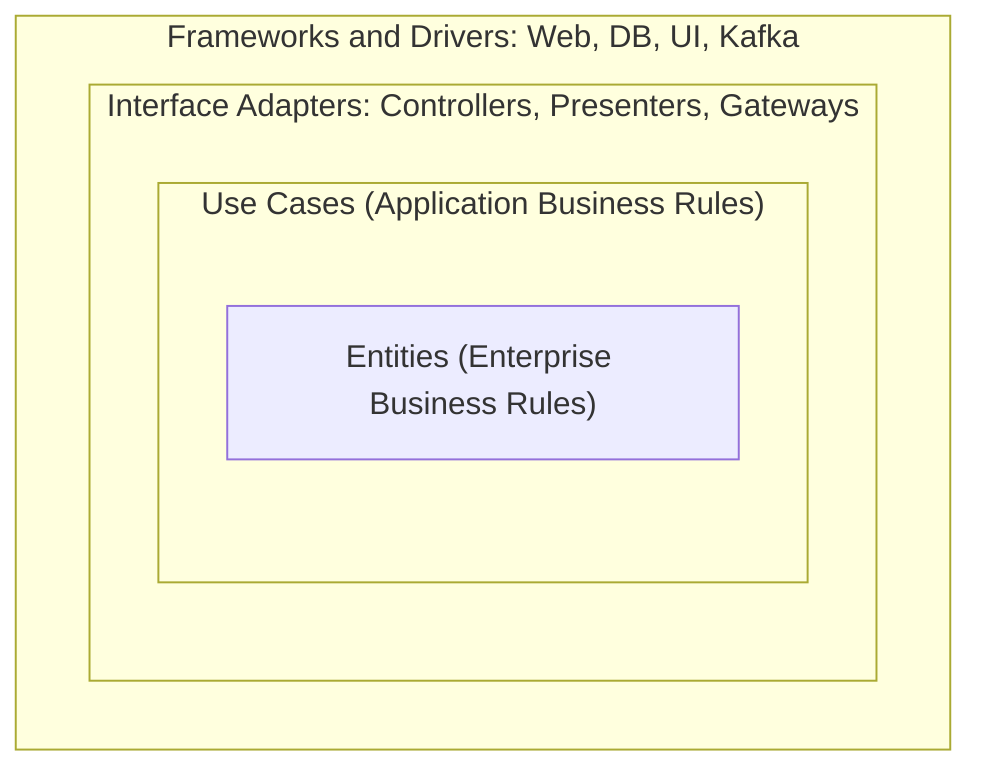

# What are clean architecture and onion architecture

---

## 🟢 Junior Level

**Clean Architecture** (Robert C. Martin, 2012) and **Onion Architecture** (Jeffrey Palermo, 2008) are two close relatives of hexagonal architecture. Both arrange code in **concentric circles** with business rules in the center and technology details on the outside. The one rule: **source-code dependencies point inward only**. Inner circles know nothing about outer ones.



### Real-World Analogy
An onion: you can peel the outer skin (framework, database) without damaging the heart (business rules). The heart does not know what the skin is made of.

### The Layers of Clean Architecture
1. **Entities:** core business objects and rules that would exist even without software.
2. **Use Cases:** application-specific operations ("Place Order", "Cancel Subscription") that orchestrate entities.
3. **Interface Adapters:** convert data between use cases and the outside (controllers, presenters, repository implementations).
4. **Frameworks and Drivers:** Spring, Hibernate, PostgreSQL, Kafka, the browser.

### Onion Architecture Layers
- **Domain Model** (center) -> **Domain Services** -> **Application Services** -> **Infrastructure/UI/Tests** (outer).

### Minimal Example

```java
// Entity (innermost)
public class Account {
    private long balance;
    public void withdraw(long amount) {
        if (amount > balance) throw new InsufficientFundsException();
        balance -= amount;
    }
}

// Use case with input/output boundaries
public interface WithdrawInput { void withdraw(String accountId, long amount); }
public interface AccountGateway { Account load(String id); void save(String id, Account a); }

public class WithdrawUseCase implements WithdrawInput {
    private final AccountGateway gateway;
    public WithdrawUseCase(AccountGateway gateway) { this.gateway = gateway; }

    public void withdraw(String accountId, long amount) {
        Account account = gateway.load(accountId);
        account.withdraw(amount);
        gateway.save(accountId, account);
    }
}
```

`AccountGateway` is declared in the inner circle and implemented in the outer one - **dependency inversion** in action.

---

## 🟡 Middle Level

### Comparing the Three Styles

| Aspect | Hexagonal | Onion | Clean |
|---|---|---|---|
| Author | Cockburn | Palermo | Martin |
| Shape | Hexagon, ports/adapters | Concentric rings | Concentric circles |
| Emphasis | Inbound vs outbound symmetry | Domain model at the center | Use cases as first-class citizens |
| Vocabulary | Port, Adapter | Domain/Application/Infrastructure services | Entity, Use Case, Interface Adapter |
| Core idea | Isolate from I/O | Dependencies inward | Dependencies inward |

They are variations of one idea; do not spend interview time arguing differences - explain the shared **dependency rule** and the vocabulary each uses (see [What is hexagonal architecture](05.%20What%20is%20hexagonal%20architecture.md)).

### Crossing Boundaries: Data and Control Flow
Control flows controller -> use case -> presenter, but dependencies point inward. To achieve this, the use case calls an **output boundary** interface that the presenter implements.

```java
public interface PlaceOrderOutput {
    void success(OrderId id);
    void outOfStock(ProductId product);
}

public class PlaceOrderInteractor {
    private final PlaceOrderOutput output; // implemented in the adapter ring

    void execute(PlaceOrderRequest request) {
        try { output.success(doPlace(request)); }
        catch (OutOfStockException e) { output.outOfStock(e.product()); }
    }
}
```

In Spring many teams simplify: return a result object from the use case and let the controller translate it.

```java
public sealed interface PlaceOrderResult {
    record Success(OrderId id) implements PlaceOrderResult { }
    record OutOfStock(ProductId product) implements PlaceOrderResult { }
}

@PostMapping("/orders")
ResponseEntity<?> place(@RequestBody PlaceOrderRequest r) {
    return switch (useCase.execute(r.toCommand())) {
        case PlaceOrderResult.Success s -> ResponseEntity.created(URI.create("/orders/" + s.id())).build();
        case PlaceOrderResult.OutOfStock o -> ResponseEntity.status(409).body(Map.of("product", o.product()));
    };
}
```

### Package Layout (Package by Component with Clean Boundaries)

```text
com.bank.account
 ├── entity        Account, Money
 ├── usecase       WithdrawUseCase, port.AccountGateway
 ├── adapter
 │    ├── web      AccountController
 │    └── persistence  JpaAccountGateway
 └── config        SpringWiring
```

### Common Mistakes
1. **Entities annotated with framework classes** (`@Entity`, `@JsonProperty`) while claiming purity. Decide consciously: pragmatic annotation of entities is fine if tests and rules stay framework-light.
2. **Use cases that are pass-through** to repositories, giving ceremony with zero logic.
3. **Excessive layering:** separate DTO per ring (five mappings per request) for a screen that lists names.
4. **Confusing "entity" meanings:** Clean's Entity is a business object, not necessarily a JPA `@Entity`.
5. **Use case classes that become god classes** with many methods; prefer one use case per class (`PlaceOrderUseCase`).

---

## 🔴 Senior Level

### Pragmatic Application to Spring Boot
Frameworks are details, but Spring Boot is also productive. A senior decides **which couplings are acceptable**:

| Coupling | Accept? | Reason |
|---|---|---|
| `@Service`/`@Transactional` in use cases | Usually yes | Cheap, well-understood, easy to remove |
| JPA annotations on domain classes | Sometimes | Saves a mapping layer; costs purity and risks lazy-loading leaks |
| Spring MVC types in use cases | No | Makes core untestable without web layer |
| Jackson in the domain | No | Couples the wire format to the model |

Make the decision explicit in an ADR (see [How to document architecture with ADRs and the C4 model](10.%20How%20to%20document%20architecture%20with%20ADRs%20and%20the%20C4%20model.md)).

### Vertical Slices as a Counterweight
Layer-heavy designs scatter a feature over many folders. **Vertical Slice Architecture** organizes by use case (command/handler plus all its layers inside), with core domain shared only where rules are reusable. Many mature teams combine: clean boundaries per module, slice-oriented organization inside each, and CQRS-style separation for reads.

### Enforcing the Dependency Rule

```java
@AnalyzeClasses(packages = "com.bank")
class CleanArchitectureTest {
    @ArchTest
    static final ArchRule onion = onionArchitecture()
        .domainModels("..entity..")
        .domainServices("..domain.service..")
        .applicationServices("..usecase..")
        .adapter("web", "..adapter.web..")
        .adapter("persistence", "..adapter.persistence..");
}
```
ArchUnit's `onionArchitecture()` API makes the rule executable; it will fail the build if an inner ring imports an outer one.

### Strategic Fit
- **Great fit:** long-lived, rule-heavy domains (banking, insurance, logistics) where the core outlives frameworks - many teams survived Struts -> Spring -> Spring Boot migrations because of an isolated core (see [How to modernize a legacy Java system](22.%20How%20to%20modernize%20a%20legacy%20Java%20system.md)).
- **Poor fit:** data pipelines, thin integration glue, short-lived campaign sites.

### Costs You Should Quantify
Count the mapping steps per request. A realistic budget: controller DTO -> command -> domain -> persistence entity. Beyond that, ask who benefits. Track onboarding time; if new hires need more than a week to trace "what happens when I click Pay", the layering is too deep.

### Evolution and Testing Strategy
- **Entities/use cases:** pure unit tests, milliseconds.
- **Adapters:** slice tests (`@WebMvcTest`, `@DataJpaTest`, Testcontainers).
- **Whole system:** a small number of end-to-end tests.
This yields the fast test pyramid described in [How to design for testability](16.%20How%20to%20design%20for%20testability.md).

### Leadership Perspective
Architectural purity is a means, not the goal. Introduce the structure gradually: start with the dependency rule enforced in CI for new code, leave legacy untouched (an **ArchUnit freeze** with a baseline `FreezingArchRule`), and expand as modules get refactored.

```java
@ArchTest
static final ArchRule frozen = FreezingArchRule.freeze(
    noClasses().that().resideInAPackage("..usecase..")
        .should().dependOnClassesThat().resideInAPackage("..adapter.."));
```

---

## 🎯 Interview Cheat Sheet

**30-second pitch:** Clean and onion architectures place entities and use cases in the center, with frameworks, UI, and databases at the outer rings. The dependency rule says source dependencies only point inward, achieved by dependency inversion through interfaces owned by the inner ring. They make the core testable and technology-independent, at the price of mapping and indirection, so use them for complex long-lived domains.

**Must-know bullets**
- One rule: dependencies point inward.
- Use cases are first-class; one class per use case.
- Output boundaries/results prevent the core from knowing the UI.
- Accept small framework couplings deliberately; document the decision.
- Enforce with ArchUnit `onionArchitecture()` and freeze legacy violations.

**Common follow-ups**
- Difference between clean, onion, and hexagonal?
- Are JPA annotations on domain objects acceptable?
- How do you avoid too many mappers?
- How does vertical slice architecture compare?

**Red flags**
- Treating diagrams as dogma; five layers for a CRUD list screen.
- Domain depends on Spring MVC classes.
- Cannot explain how dependency inversion makes the rule possible.

**Related topics**
- [What is hexagonal architecture](05.%20What%20is%20hexagonal%20architecture.md)
- [What is layered architecture](01.%20What%20is%20layered%20architecture.md)
- [How to design for testability](16.%20How%20to%20design%20for%20testability.md)
