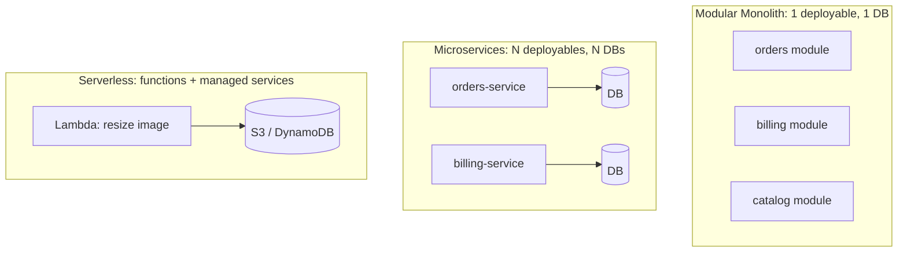

# Modular monolith vs microservices vs serverless

---

## 🟢 Junior Level

Three common ways to package and deploy a system:

- **Monolith:** the whole application is built and deployed as one unit. A **modular monolith** is a monolith whose code is split into well-separated modules with explicit public APIs.
- **Microservices:** many small services, each independently deployable, owning its own data, communicating over the network.
- **Serverless (FaaS):** you write functions (AWS Lambda, Azure Functions); the cloud provider runs them on demand and scales them, billing per invocation.



### Real-World Analogy
- **Monolith:** a single big shop under one roof - easy to walk between departments.
- **Modular monolith:** the same shop with clear departments and doors between them.
- **Microservices:** a shopping street of independent shops, each with its own owner, keys, and stock room; you need roads, signs, and a delivery system.
- **Serverless:** pop-up stalls that exist only when customers are present.

### Quick Comparison

| | Modular monolith | Microservices | Serverless |
|---|---|---|---|
| Deployment | One artifact | Many artifacts | Per function |
| Calls | In-process method calls | Network (HTTP/gRPC/events) | Events/HTTP triggers |
| Scaling | Whole app | Per service | Automatic per function |
| Ops complexity | Low | High | Medium (vendor-specific) |
| Team autonomy | Medium | High | Medium |

### Minimal Example of a Module Boundary

```java
// orders module exposes only this interface; everything else is package-private
package com.shop.orders;

public interface OrderApi {
    OrderSummary findOrder(long orderId);
}
```

```text
com.shop
 ├── orders    (public: OrderApi; internal: OrderService, OrderRepository)
 ├── billing   (public: BillingApi)
 └── catalog   (public: CatalogApi)
```

(Microservices fundamentals are covered in the Microservices section; this topic focuses on choosing between styles.)

---

## 🟡 Middle Level

### What Microservices Actually Cost
Moving from method calls to network calls introduces: latency, partial failure, retries and idempotency, distributed tracing, API versioning, contract testing, eventual consistency, per-service CI/CD, observability stacks, and service discovery/config. Fallacies of distributed computing apply: the network is **not** reliable, latency is **not** zero.

```java
// In a monolith
Price p = pricingApi.priceFor(sku);          // microseconds, cannot half-fail

// In microservices
Price p = pricingClient.priceFor(sku);       // timeouts, retries, circuit breaker, versioning, auth
```

### What Modular Monoliths Give You
- Single transaction across modules (when justified), simple debugging, one deployment, one CI pipeline.
- Boundaries enforced by compile-time/package visibility and tools like ArchUnit or Spring Modulith (see [What is Spring Modulith](09.%20What%20is%20Spring%20Modulith.md)).
- A cheap path to later extraction: a well-bounded module can become a service.

### Serverless: Strengths and Limits
**Strengths:** zero idle cost, elastic scale, no server patching, great for spiky/event-driven tasks (file processing, webhooks, scheduled jobs).
**Limits:** cold starts (JVM is notable; mitigate with SnapStart, GraalVM native image, Quarkus/Micronaut/Spring Cloud Function), execution time limits, vendor lock-in, harder local testing, connection management to relational databases (use pooling proxies).

```java
@Bean
public Function<S3Event, String> thumbnail() {
    return event -> imageService.createThumbnail(event.getRecords().get(0).getS3().getObject().getKey());
}
```

### Decision Factors

| Factor | Points toward |
|---|---|
| Small team (< 15 devs) | Modular monolith |
| Many autonomous teams, independent release cadence | Microservices |
| Very different scaling profiles per component | Microservices/serverless for the hot one |
| Spiky, event-triggered workloads | Serverless |
| Strong transactional consistency needs | Monolith |
| Unclear domain boundaries | Monolith (boundaries are cheap to move, services are not) |

### Common Mistakes
1. **Microservices first for a startup** with an undiscovered domain - premature decomposition.
2. **Distributed monolith:** services that must deploy together and share a database; all the cost, none of the benefit.
3. **Nano-services:** one function per endpoint with chatty calls.
4. **A monolith with no internal boundaries** - a big ball of mud that cannot be split later.
5. **Shared database** across services bypassing APIs.

---

## 🔴 Senior Level

### Frame the Decision as Trade-offs, Not Fashion
Architecture is the art of choosing costs. Use quality attributes (see [How to define non-functional requirements and run an ATAM](23.%20How%20to%20define%20non-functional%20requirements%20and%20run%20an%20ATAM.md)) and organizational constraints (see [How Conways law shapes API and contract ownership](13.%20How%20Conways%20law%20shapes%20API%20and%20contract%20ownership.md)):

- **Independent deployability** matters when teams block each other - a people problem. If one team of eight owns everything, microservices add overhead to solve nothing.
- **Independent scalability** matters only when components have genuinely different load profiles; scaling a monolith horizontally is often fine and cheaper.
- **Fault isolation:** a memory leak in the report generator should not take down checkout - possible in a monolith with bulkheads, but simpler with separate processes.
- **Technology heterogeneity:** a legitimate reason (ML in Python), but each runtime adds operational burden.

### The Fowler "Monolith First" and Evidence
Amazon Prime Video publicly moved a video-quality monitoring pipeline from distributed serverless components back to a monolithic process and cut infrastructure cost by about 90% - a reminder that serverless/microservices are tools, not destinations. Conversely, Shopify and others run very large **modular monoliths** successfully by enforcing boundaries.

### A Practical Migration Ladder

Do not skip B. Extract a module only when it passes a checklist: stable API, own data, clear owner team, a concrete reason (scale, release cadence, compliance, tech).

### Data Is the Hard Part
Extracting a service means extracting its tables. In a modular monolith, enforce this early: each module owns its schema; no cross-module joins; communication via public API or events.

```java
// Anti-pattern: cross-module SQL join
// select o.*, c.name from orders o join customers c on c.id = o.customer_id

// Better: ask the owning module, or keep a local read model fed by events
public interface CustomerApi { CustomerName nameOf(CustomerId id); }
```
Distributed transactions disappear into sagas and eventual consistency (see [How to handle distributed data consistency](15.%20How%20to%20handle%20distributed%20data%20consistency.md)).

### Cost Model
Estimate total cost, not just cloud bills: platform team size, on-call load, learning curve, pipeline count, observability ingestion, cross-AZ traffic. Microservices commonly need a **platform capability** (CI/CD templates, service mesh or gateway, secrets, tracing, dashboards) before the third or fourth service. If you cannot staff it, do not adopt it.

### Hybrid Reality
Most successful estates are hybrid: a modular monolith core, a few extracted services (search, notifications, ML scoring), and serverless glue (webhooks, scheduled tasks, file triggers). Standardize cross-cutting contracts (auth, observability, error format) so heterogeneity stays manageable.

### Reversibility Matters
Prefer decisions that are cheap to reverse (Bezos's two-way doors). Merging services back into a monolith, or splitting a module out, should both be feasible. Record the reasoning in an ADR with explicit revisit triggers: "revisit when team count exceeds 5 or p99 deploy conflicts exceed 2 per week" (see [How to document architecture with ADRs and the C4 model](10.%20How%20to%20document%20architecture%20with%20ADRs%20and%20the%20C4%20model.md)).

---

## 🎯 Interview Cheat Sheet

**30-second pitch:** I default to a modular monolith with enforced module boundaries and data ownership, because it keeps operations simple while preserving the option to extract services later. I move to microservices when team autonomy or genuinely different scaling/fault-isolation needs justify the operational tax, and I use serverless for spiky event-driven workloads. The choice follows team structure and quality attributes, not trends.

**Must-know bullets**
- Microservices solve organizational scaling more than technical scaling.
- Distributed monolith = worst of both worlds.
- Modular monolith needs enforced boundaries (ArchUnit/Modulith) and data ownership per module.
- Serverless on the JVM: manage cold starts (SnapStart, native image).
- Extract services along bounded contexts with their own data.

**Common follow-ups**
- When would you split a monolith?
- How do you prevent a modular monolith from decaying?
- Hidden costs of microservices?
- Cold start mitigation on the JVM?

**Red flags**
- Choosing microservices because "Netflix does".
- Shared database between services.
- No platform/observability investment before splitting.

**Related topics**
- [How to decompose a monolith with the strangler fig pattern](08.%20How%20to%20decompose%20a%20monolith%20with%20the%20strangler%20fig%20pattern.md)
- [What is Spring Modulith](09.%20What%20is%20Spring%20Modulith.md)
- [What are the trade-offs of event-driven architecture](14.%20What%20are%20the%20trade-offs%20of%20event-driven%20architecture.md)
