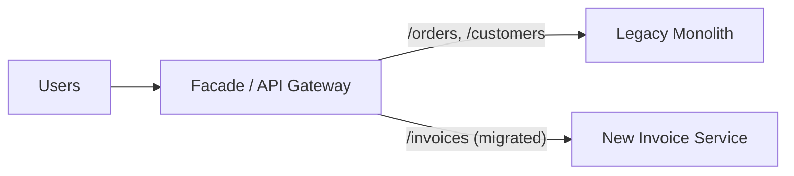
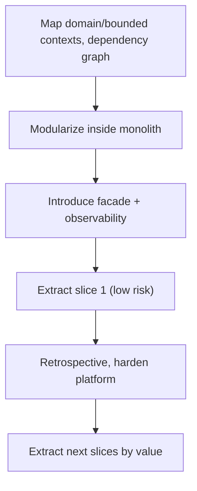

# How to decompose a monolith with the strangler fig pattern

---

## 🟢 Junior Level

The **Strangler Fig pattern** (Martin Fowler) replaces a legacy system **gradually**. You put a **facade/proxy** in front of the old system, build new functionality piece by piece in a new system, and route more and more traffic to the new parts until the old system can be switched off. It is named after strangler fig vines that grow around a tree and eventually replace it.



### Real-World Analogy
Renovating a hotel while guests stay. You rebuild one floor at a time and redirect guests to finished floors. The hotel never closes, whereas demolishing the whole building first (a big-bang rewrite) would leave guests homeless for years.

### Why Not a Big-Bang Rewrite?
- Takes long; the old system keeps changing so you chase a moving target.
- No value delivered until the end; high risk of cancellation.
- Hidden business rules in old code get lost.

### Steps in Plain Words
1. **Identify** a piece of functionality with clear edges (e.g., invoicing).
2. **Intercept**: put a proxy in front so all traffic passes through it.
3. **Build** the new implementation behind the proxy.
4. **Route** a small percentage to the new one, compare, and increase.
5. **Retire** the old code for that piece.

### Minimal Example: Routing in Spring Cloud Gateway

```java
@Bean
RouteLocator routes(RouteLocatorBuilder builder) {
    return builder.routes()
        .route("invoices-new", r -> r.path("/api/invoices/**")
            .uri("http://invoice-service:8080"))
        .route("legacy", r -> r.path("/**")
            .uri("http://legacy-monolith:8080"))
        .build();
}
```
The more specific route wins; everything else still goes to the legacy app.

---

## 🟡 Middle Level

### Choosing the First Slice
Pick candidates by scoring:
- **Business value / pain:** frequently changed or scaling-critical.
- **Low coupling:** few inbound/outbound dependencies and clear data ownership.
- **Testability:** existing behavior can be verified.
- **Risk:** start with something visible but not mission-critical (notifications, reporting, search) to learn the process.

Avoid starting with the core domain tangled in every table.

### Seams: Where to Cut
- **URL/API seam:** easiest; the facade routes by path.
- **Message seam:** legacy publishes events; the new service subscribes.
- **Database seam:** the hardest; see below.
- **UI seam:** micro-frontends or server-side includes replacing pages gradually.

### Branch by Abstraction Inside the Monolith
When the module is internal and has no network seam, introduce an interface, implement the new version, and toggle.

```java
public interface TaxCalculator { Money tax(Order order); }

@Component @ConditionalOnProperty(name = "tax.engine", havingValue = "legacy", matchIfMissing = true)
class LegacyTaxCalculator implements TaxCalculator { /* old code */ }

@Component @ConditionalOnProperty(name = "tax.engine", havingValue = "new")
class NewTaxCalculator implements TaxCalculator { /* extracted module/service client */ }
```

### Data Migration Patterns
1. **Shared database (temporary):** new service reads/writes the same tables. Quick, but couples schemas; treat as a stepping stone only.
2. **Database view/sync:** change data capture (Debezium) copies rows from the legacy DB into the new service's DB.
3. **Own data:** the new service owns its tables; the monolith calls its API or consumes its events.

```text
Legacy DB  --CDC (Debezium)-->  Kafka  --> New service DB (read model)
```

### Anti-Corruption Layer
The new service should not adopt the legacy model's quirks. Translate at the boundary (see [What is Domain-Driven Design](04.%20What%20is%20Domain-Driven%20Design.md)).

```java
@Component
class LegacyInvoiceTranslator {
    Invoice translate(LegacyInvoiceRow row) {
        return new Invoice(new InvoiceId(row.invNo()), toMoney(row.amtCents()),
            "X".equals(row.stat()) ? InvoiceStatus.CANCELLED : InvoiceStatus.OPEN);
    }
}
```

### Common Mistakes
1. **No facade** - clients call the new service directly, and you lose the ability to switch back.
2. **Splitting by technical layer** (a "data service") instead of by business capability.
3. **Leaving the old code alive forever** - "strangled" parts must be deleted or you maintain two systems.
4. **Underestimating data ownership**, resulting in a distributed monolith.
5. **No rollback plan** - always keep the route toggle reversible.

---

## 🔴 Senior Level

### Verifying Equivalence: Shadow Traffic and Parallel Runs
Before shifting real traffic, mirror it. The proxy sends the request to both systems, returns the legacy answer, and compares responses asynchronously.

```java
@Component
class ShadowFilter implements GlobalFilter {
    public Mono<Void> filter(ServerWebExchange ex, GatewayFilterChain chain) {
        mirror(ex.getRequest()); // fire-and-forget to new service, diff and log results
        return chain.filter(ex);
    }
}
```
Roll out progressively: 0% shadow -> 1% canary -> 10% -> 50% -> 100%, with automated rollback on error-rate or latency regression. Use feature flags (Unleash, LaunchDarkly, Spring Cloud features) or weighted routes.

```java
.route("invoices-canary", r -> r.path("/api/invoices/**").and().weight("invoices", 10).uri("http://invoice-service"))
.route("invoices-legacy", r -> r.path("/api/invoices/**").and().weight("invoices", 90).uri("http://legacy"))
```

### Untangling the Database
The monolith database is typically a web of foreign keys. Techniques:
- **Break foreign keys** into ID references; enforce integrity in application logic or events.
- **Split tables** (expand/contract): add the new table, dual-write, backfill, switch reads, remove old.
- **Synchronize back** to the legacy database temporarily if the monolith still needs the data (reverse CDC).
- Replace cross-service joins with API composition or local read models.
- Plan for the transitional state where two writers exist: pick one **system of record** per entity at any time.

### Sequencing and Governance

Modularize first. Often 80% of the benefit comes from clean internal modules; many teams stop there (see [What is Spring Modulith](09.%20What%20is%20Spring%20Modulith.md) and [Modular monolith vs microservices vs serverless](07.%20Modular%20monolith%20vs%20microservices%20vs%20serverless.md)). Use dependency analysis tools (jQAssistant, Structure101, ArchUnit, jdeps) to find the real graph, not the diagram from 2014.

### Organizational Considerations
- Staff a **dedicated migration team or rotating guild**, and publish a definition of "done": old code deleted, data migrated, dashboards moved, runbooks updated.
- Maintain **feature freeze discipline** on the legacy slice during migration; otherwise requirements fork.
- Show progress via a visible metric: % traffic migrated, number of legacy endpoints remaining, legacy LOC deleted.
- Fund it as a product, not a side project (see [How to manage technical debt](12.%20How%20to%20manage%20technical%20debt.md)).

### Risks and Mitigations
| Risk | Mitigation |
|---|---|
| Hidden behavior in legacy code | Characterization tests, shadow traffic, domain expert review |
| Performance regression due to network hops | Load test per slice, caching, coarse-grained APIs |
| Consistency during transition | Single owner per entity, outbox/CDC, idempotent consumers |
| Never-ending migration | Time-box, delete code, leadership sponsorship |
| Auth/session sharing | Centralize identity (OIDC/JWT) before extraction |

### Related Modernization Work
Strangling often coincides with platform upgrades (Java 8 to 21, Spring Boot 2 to 3). Treat them as separate tracks to avoid compounding risk (see [How to modernize a legacy Java system](23.%20How%20to%20modernize%20a%20legacy%20Java%20system.md)).

---

## 🎯 Interview Cheat Sheet

**30-second pitch:** Strangler fig migrates a monolith incrementally: put a facade in front, build one capability at a time in the new system, shift traffic gradually (shadow, canary, cutover), and delete the old code. The hardest part is data ownership, so I modularize inside the monolith first, use CDC or events for synchronization, and keep rollback switches until the slice is proven.

**Must-know bullets**
- Facade/gateway makes routing reversible.
- Choose first slices by value and low coupling.
- Data seam is the hardest; one system of record per entity.
- Shadow traffic and canary rollouts verify equivalence.
- Delete the legacy code or you maintain two systems.

**Common follow-ups**
- How do you handle shared database tables during extraction?
- What would you migrate first and why?
- How do you keep the monolith and new service consistent?
- When is a rewrite justified?

**Red flags**
- Big-bang rewrite plans with a two-year horizon.
- Direct client access to new services without a facade.
- Declaring victory with legacy code still running.

**Related topics**
- [Modular monolith vs microservices vs serverless](07.%20Modular%20monolith%20vs%20microservices%20vs%20serverless.md)
- [How to handle distributed data consistency](15.%20How%20to%20handle%20distributed%20data%20consistency.md)
- [How to modernize a legacy Java system](23.%20How%20to%20modernize%20a%20legacy%20Java%20system.md)
