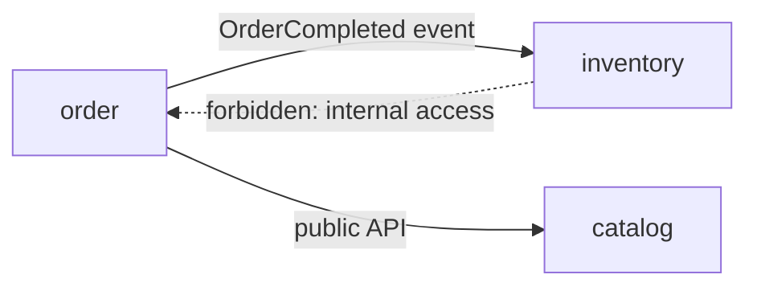

# What is Spring Modulith

---

## 🟢 Junior Level

**Spring Modulith** is a Spring project that helps you build **well-structured modular monoliths**. It treats each direct sub-package of your application's main package as an **application module**, verifies that modules respect each other's boundaries, supports event-based communication between them, lets you test modules in isolation, and generates documentation.



### Real-World Analogy
An apartment building. Each flat (module) has a front door (public API) and private rooms (internal packages). Neighbours can ring the bell, but cannot walk into your bedroom.

### Default Convention
With the main class in `com.shop`, each direct sub-package is a module:

```text
com.shop
 ├── ShopApplication.java
 ├── order
 │    ├── OrderManagement.java      <- public: part of the module API
 │    └── internal
 │         └── OrderRepository.java <- hidden from other modules
 ├── inventory
 │    └── InventoryManagement.java
 └── catalog
      └── Catalog.java
```

Types in the module's base package are its **API**. Types in sub-packages (`internal`) are **internal** and other modules must not reference them.

### Minimal Example

```xml
<dependency>
    <groupId>org.springframework.modulith</groupId>
    <artifactId>spring-modulith-starter-core</artifactId>
</dependency>
<dependency>
    <groupId>org.springframework.modulith</groupId>
    <artifactId>spring-modulith-starter-test</artifactId>
    <scope>test</scope>
</dependency>
```

```java
class ModularityTests {
    static final ApplicationModules modules = ApplicationModules.of(ShopApplication.class);

    @Test
    void verifiesModularStructure() {
        modules.verify(); // fails if a module touches another module's internals or there are cycles
    }
}
```

---

## 🟡 Middle Level

### What `verify()` Checks
1. **No cyclic dependencies** between modules.
2. **Only API types are referenced** across modules (no access to internal sub-packages).
3. **Declared allowed dependencies** (if you restrict them) are respected.

Restrict dependencies explicitly with `package-info.java`:

```java
@org.springframework.modulith.ApplicationModule(allowedDependencies = "catalog")
package com.shop.order;
```

Or use **named interfaces** to expose additional packages:

```java
@org.springframework.modulith.NamedInterface("spi")
package com.shop.order.spi;
```

### Event-Based Integration Between Modules
Rather than `OrderService` calling `InventoryService` directly (coupling order -> inventory), the order module publishes an event and inventory reacts.

```java
// order module
@Service
@RequiredArgsConstructor
public class OrderManagement {
    private final ApplicationEventPublisher events;
    private final OrderRepository orders;

    @Transactional
    public void complete(Order order) {
        orders.save(order.markCompleted());
        events.publishEvent(new OrderCompleted(order.getId()));
    }
}

// inventory module
@Component
class InventoryUpdater {
    @ApplicationModuleListener // async, transactional, after-commit
    void on(OrderCompleted event) {
        // reserve or decrement stock
    }
}
```

`@ApplicationModuleListener` is shorthand for `@Async @Transactional(propagation = REQUIRES_NEW) @TransactionalEventListener`.

### Event Publication Registry
With the `spring-modulith-starter-jpa` (or JDBC/Mongo) starter, publications are persisted in an `event_publication` table **in the same transaction** as the business change, and marked completed when listeners finish. Failed listeners can be **republished** on restart, giving at-least-once delivery without a broker (a built-in transactional outbox).

```java
@Bean
IncompleteEventPublications republish(IncompleteEventPublications publications) {
    return publications; // use publications.resubmitIncompletePublications(...) on startup / scheduler
}
```

Because delivery is at-least-once, listeners must be **idempotent**.

### Testing a Single Module

```java
@ApplicationModuleTest
class OrderModuleTests {
    @Test
    void completingAnOrderPublishesEvent(Scenario scenario, OrderManagement orders) {
        scenario.stimulate(() -> orders.complete(sampleOrder()))
                .andWaitForEventOfType(OrderCompleted.class)
                .toArrive();
    }
}
```
`@ApplicationModuleTest` boots only the module under test (and mocks others with `@MockitoBean`), making tests faster.

### Documentation Generation

```java
@Test
void writeDocumentation() {
    new Documenter(modules)
        .writeModulesAsPlantUml()          // C4/UML component diagram
        .writeIndividualModulesAsPlantUml();
}
```
Output diagrams come from the actual code, so they cannot drift (see [How to document architecture with ADRs and the C4 model](10.%20How%20to%20document%20architecture%20with%20ADRs%20and%20the%20C4%20model.md)).

### Common Mistakes
1. Not running `verify()` in CI, so boundaries erode silently.
2. Using a flat package layout (everything in `com.shop`), leaving no module to detect.
3. Module APIs that expose JPA entities, welding modules via their data model.
4. Non-idempotent event listeners.
5. Chatty synchronous cross-module calls that recreate a tangled graph.

---

## 🔴 Senior Level

### Positioning
Modulith is the enforcement and tooling layer for the "modular monolith first" strategy (see [Modular monolith vs microservices vs serverless](07.%20Modular%20monolith%20vs%20microservices%20vs%20serverless.md)). It makes boundaries a **build-time check**, which is what separates a modular monolith from a monolith with folders. It is also a decomposition tool: modules with their own data and event contracts can be extracted later (see [How to decompose a monolith with the strangler fig pattern](08.%20How%20to%20decompose%20a%20monolith%20with%20the%20strangler%20fig%20pattern.md)).

### Externalizing Events
Internal events can be forwarded to a broker without changing publishers:

```java
@Externalized("orders.completed::#{#this.orderId()}") // topic::routingKey (SpEL)
public record OrderCompleted(UUID orderId) { }
```
With `spring-modulith-events-kafka` (or AMQP, JMS, SNS/SQS), the registry guarantees the event is persisted first, then published - the **transactional outbox**, supplied for free (see [How to handle distributed data consistency](15.%20How%20to%20handle%20distributed%20data%20consistency.md)). Be mindful of event schema as public contract: events marked for externalization require versioning discipline.

### Data Ownership Inside the Monolith
Modulith validates **code** dependencies, not SQL. Enforce data boundaries yourself:
- One schema or table prefix per module; separate Flyway locations per module.
- No JPA associations across modules: store IDs (`CustomerId`), not `@ManyToOne` to another module's entity.
- Optionally use ArchUnit to block `JdbcTemplate` queries to foreign tables.

```java
@Entity
class OrderEntity {
    @Id UUID id;
    UUID customerId;      // reference by id only, customer module owns the data
}
```

### Observability
`spring-modulith-observability` creates tracing spans per module interaction, giving a service-map-like view of an in-process system. It also helps decide which modules are hot enough to extract.

### Limits and Judgement Calls
- Convention-based (package) boundaries; works with Java packages, not JPMS or multi-module Maven. For strict compile-time isolation you may add Maven modules on top.
- Async listeners use thread pools; consider ordering, back-pressure, and error handling (failed publications accumulate and need a cleanup/alerting policy).
- Event-driven coupling is still coupling - an event storm across ten modules is hard to reason about. Prefer direct API calls for queries and events for reactions (see [What are the trade-offs of event-driven architecture](14.%20What%20are%20the%20trade-offs%20of%20event-driven%20architecture.md)).
- Brownfield adoption: run `modules.forEach(System.out::println)` to inspect the discovered structure, then use a baseline of known violations and burn it down (similar to ArchUnit freezing).

### Adoption Plan for an Existing App
1. Add the dependency and print detected modules.
2. Move code into package-by-feature modules; resolve cycles via events or extracted APIs.
3. Turn on `verify()` in CI with accepted violations tracked.
4. Introduce events for cross-module reactions; enable the event registry.
5. Generate documentation and review it with domain experts to validate boundaries against bounded contexts (see [What is Domain-Driven Design](04.%20What%20is%20Domain-Driven%20Design.md)).

### Team Impact
Boundaries become a team contract. Assign module ownership (CODEOWNERS per package), require review from owners for API-package changes, and treat the module API like a public library: backward-compatible evolution, deprecation periods.

```text
# CODEOWNERS
/src/main/java/com/shop/order/*.java    @shop/order-team
/src/main/java/com/shop/inventory/*.java @shop/inventory-team
```

---

## 🎯 Interview Cheat Sheet

**30-second pitch:** Spring Modulith treats top-level packages as application modules, verifies in tests that modules don't touch each other's internals or form cycles, supports event-driven communication with a persistent event publication registry (an outbox), enables isolated module testing, and generates living documentation. It makes a modular monolith enforceable and keeps the door open to later extraction.

**Must-know bullets**
- Module = direct sub-package; base package = API, sub-packages = internal.
- `ApplicationModules.of(App.class).verify()` in CI.
- `@ApplicationModuleListener` for async transactional event handling.
- Event publication registry gives at-least-once delivery; listeners must be idempotent.
- `@ApplicationModuleTest` tests one module; `Documenter` generates diagrams.

**Common follow-ups**
- How does Modulith differ from ArchUnit?
- How do you keep data boundaries inside a monolith?
- How would you extract a module into a service?
- How do externalized events work?

**Red flags**
- Believing it enforces database boundaries automatically.
- Ignoring idempotency of listeners.
- Flat package structure but claiming "modular".

**Related topics**
- [Modular monolith vs microservices vs serverless](07.%20Modular%20monolith%20vs%20microservices%20vs%20serverless.md)
- [What is hexagonal architecture](05.%20What%20is%20hexagonal%20architecture.md)
- [What is evolutionary architecture and fitness functions](11.%20What%20is%20evolutionary%20architecture%20and%20fitness%20functions.md)
