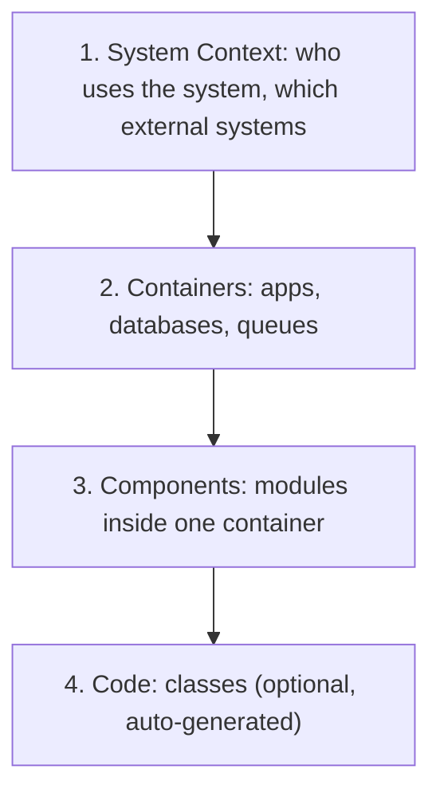
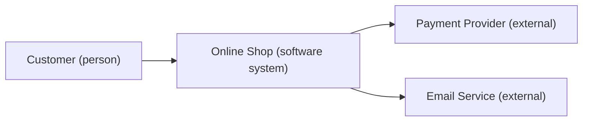

# How to document architecture with ADRs and the C4 model

---

## 🟢 Junior Level

Two lightweight tools keep architecture understandable:

- **ADR (Architecture Decision Record):** a short document (usually one page) recording **one significant decision**: the context, the options considered, the decision, and its consequences.
- **C4 model (Simon Brown):** a hierarchy of diagrams at four zoom levels: **Context, Containers, Components, Code**.



### Real-World Analogy
A city map: the country map (context), the city street map (containers), a building floor plan (components), and an electrical wiring sketch (code). ADRs are the city council's meeting minutes explaining **why** a bridge was built where it was.

### Why Document at All?
New teammates, auditors, and your future self ask "why is it like this?" Without records, teams repeat old debates or break assumptions nobody remembers.

### A Minimal ADR (Michael Nygard format)

```text
# ADR-007: Use PostgreSQL as the primary database

Status: Accepted (2026-03-02)

Context:
We need transactional consistency for orders and good JSON support.
The team has strong SQL experience. Expected load: 200 writes/s.

Decision:
We will use PostgreSQL 16 managed by the cloud provider.

Consequences:
+ ACID transactions, mature tooling, JSONB for flexible attributes
- Horizontal write scaling requires partitioning or sharding later
- We will not use MongoDB for order data
```

### A Simple C4 Context Diagram



---

## 🟡 Middle Level

### ADR Practices
- **One decision per ADR**, numbered sequentially, stored **in the repository** (`docs/adr/0007-use-postgresql.md`) so they are versioned and reviewed through pull requests.
- **Statuses:** Proposed -> Accepted -> Deprecated / **Superseded by ADR-0021**. Never delete or rewrite history; add a new ADR.
- **Write when:** the decision is expensive to reverse, affects several teams, or someone asks "why did we...?" twice.
- **Include alternatives** and why they were rejected; this is the most valuable part.
- **Keep it short:** 30 minutes to write.

```text
docs/adr
 ├── 0001-record-architecture-decisions.md
 ├── 0002-use-modular-monolith.md
 ├── 0007-use-postgresql.md
 └── 0021-adopt-kafka-for-integration-events.md   (supersedes 0012)
```

### Longer Template (MADR-style)

```text
# ADR-0021: Adopt Kafka for integration events
## Status
Accepted, supersedes ADR-0012
## Context and Problem Statement
## Decision Drivers
- Ordering per aggregate, replay ability, 5k msg/s peak, team knows Spring
## Considered Options
- RabbitMQ  - Kafka  - Database outbox + polling
## Decision Outcome
Kafka, because replay and partition ordering matter.
### Consequences
Good: replay, scalable consumers. Bad: operational cost, schema governance needed.
## Revisit when
Message volume stays below 100 msg/s for 12 months.
```

### The C4 Levels in Detail
1. **System Context:** one box for your system, people and external systems around it. Non-technical audiences can read it.
2. **Container:** a *container* is a separately runnable thing: Spring Boot app, SPA, database, message broker. Show technology and protocols on arrows.
3. **Component:** logical building blocks inside one container (controllers, services, modules). Spring Modulith can generate this.
4. **Code:** UML class diagrams - rarely hand-drawn; generated from code if needed.

Plus supplementary diagrams: **System Landscape**, **Dynamic** (a sequence of interactions), **Deployment** (nodes, clusters, regions).

### Diagrams as Code
Prefer text-based, version-controlled diagrams: **Structurizr DSL**, PlantUML with C4 library, or Mermaid.

```text
workspace {
  model {
    customer = person "Customer"
    shop = softwareSystem "Online Shop" {
      api = container "Order API" "Spring Boot" "Java 21"
      db  = container "Orders DB" "PostgreSQL" "Database"
    }
    customer -> api "Places orders via HTTPS"
    api -> db "Reads/writes" "JDBC"
  }
  views {
    container shop { include * autolayout lr }
  }
}
```

### Common Mistakes
1. **Diagram soup:** random boxes with undefined arrows and no legend. Every element needs a name, type, and technology; every arrow a label.
2. **ADRs written after the fact** by someone who was not there.
3. **ADRs without alternatives** - they become announcements.
4. **Documentation in a wiki that nobody updates;** keep it with the code.
5. **Mixing abstraction levels** in one diagram (database tables next to business actors).

---

## 🔴 Senior Level

### Documentation as an Architecture Capability
The goal is **shared understanding at the lowest maintenance cost**. Seniors design the documentation system:

- **Docs-as-code pipeline:** ADRs, Structurizr/Mermaid sources, and OpenAPI/AsyncAPI specs live in repos; CI renders them to a static site (MkDocs, Backstage TechDocs, Antora).
- **Generated where possible:** component views from Spring Modulith (`Documenter`), API docs from OpenAPI (springdoc), dependency graphs from build tools. Generated docs cannot go stale.
- **Hand-written where judgment is needed:** context, key decisions, quality attributes, trade-offs.

```java
@Test
void generateComponentDiagrams() {
    new Documenter(ApplicationModules.of(ShopApplication.class))
        .writeModulesAsPlantUml()
        .writeIndividualModulesAsPlantUml();
}
```

### Making ADRs Part of the Decision Process
- **RFC / design-doc flow for large changes:** author drafts, reviewers comment asynchronously for 3-5 days, then a synchronous meeting resolves open points, producing an ADR on merge. This scales architectural input without turning an architect into a bottleneck (the **Architecture Advice Process**: anyone may decide after seeking advice from affected people and experts).
- **Decision log hygiene:** index by tag (security, data, integration); link ADRs from code via comments or PR descriptions; review "Accepted" ADRs yearly for revisit triggers.
- **Link to fitness functions:** an ADR stating "modules do not depend on each other's internals" should be backed by an automated check (see [What is evolutionary architecture and fitness functions](11.%20What%20is%20evolutionary%20architecture%20and%20fitness%20functions.md)).

```java
// ADR-0002 enforced
@ArchTest
static final ArchRule adr0002 = noClasses().that().resideInAPackage("..order..")
    .should().dependOnClassesThat().resideInAPackage("..inventory.internal..");
```

### Choosing the Audience and Level
| Audience | Best artifact |
|---|---|
| Executives, product | C4 context, capability map |
| New engineers | Container diagram, onboarding guide, key ADRs |
| Operations/SRE | Deployment diagram, runbooks, dependency map |
| Auditors/security | Data flow diagrams, threat model, ADRs for security controls |
| Other teams | API specs, contract ownership docs (see [How Conways law shapes API and contract ownership](13.%20How%20Conways%20law%20shapes%20API%20and%20contract%20ownership.md)) |

### Pitfalls in Large Organizations
- **Architecture ivory tower:** documents written by architects nobody reads. Fix: documents authored by the teams that build the system; architects coach.
- **Over-documentation:** 200-page design docs. Fix: "just enough" - document decisions and interfaces, not every class.
- **ADR graveyard:** hundreds of unreferenced files. Fix: tags, status hygiene, reference from onboarding docs.
- **Sensitive content:** diagrams may reveal security details; control access, but do not hide decisions from the people who must follow them.
- **Retrospective ADRs for legacy systems** are valuable: record "inherited decisions" with *unknown rationale* honestly rather than inventing one.

### Linking to Quality Attributes
A good ADR cites the quality attributes driving the choice (latency, availability, modifiability) so trade-offs are explicit (see [How to define non-functional requirements and run an ATAM](24.%20How%20to%20define%20non-functional%20requirements%20and%20run%20an%20ATAM.md)). That turns "I prefer Kafka" into "we chose Kafka to meet replayability and 5k msg/s at the cost of operations complexity".

### Measuring Success
- New hires can draw the container diagram after week one.
- Mean time to find "why was X chosen?" falls below 10 minutes.
- Each significant incident postmortem references or amends an ADR when assumptions proved wrong (see [How to manage production incidents and run blameless postmortems](21.%20How%20to%20manage%20production%20incidents%20and%20run%20blameless%20postmortems.md)).

---

## 🎯 Interview Cheat Sheet

**30-second pitch:** I record significant architecture decisions as short ADRs in the repo - context, options, decision, consequences, revisit triggers - and describe the system with C4 diagrams at context, container, and component levels, kept as code and generated where possible. This keeps decisions discoverable, reviewable, and tied to automated checks.

**Must-know bullets**
- ADR = one decision, immutable history, superseded not edited.
- Alternatives and consequences are the valuable parts.
- C4: Context -> Container -> Component -> Code; label everything.
- Docs-as-code with Structurizr/Mermaid/PlantUML; generate what you can.
- Advice process scales decision-making beyond a central architect.

**Common follow-ups**
- What decisions deserve an ADR?
- How do you keep diagrams from going stale?
- How do you document a legacy system with unknown rationale?
- Who approves ADRs?

**Red flags**
- Wiki diagrams with no owner or date.
- ADRs that never list rejected options.
- "Architecture is documented in the code" with no higher-level view.

**Related topics**
- [What is evolutionary architecture and fitness functions](11.%20What%20is%20evolutionary%20architecture%20and%20fitness%20functions.md)
- [What is Spring Modulith](09.%20What%20is%20Spring%20Modulith.md)
- [How to lead technical discussions and resolve disagreements](20.%20How%20to%20lead%20technical%20discussions%20and%20resolve%20disagreements.md)
