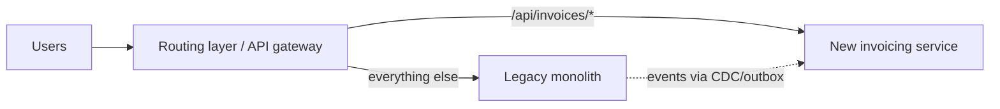

# How to modernize a legacy Java system

---

## 🟢 Junior Level

A typical legacy Java system: Java 8 (or older), an application server (WebLogic, WebSphere, JBoss), Spring 3/4 XML configuration or EJBs, a huge WAR, few tests, manual deployments, and a shared Oracle database used by several applications. It works and makes money — which is exactly why changing it is risky.

### Goals of modernization (be explicit)
* **Reduce risk** — unsupported Java/framework versions with CVEs, hardware/OS end of life.
* **Increase delivery speed** — faster builds, automated deployment, safer changes.
* **Lower costs** — licenses, infrastructure, operations.
* **Enable new capabilities** — cloud, scaling, new channels, integrations.

### The golden rule
**Don't do a big-bang rewrite.** Rewrites take longer than planned, chase a moving target (the old system keeps changing), and lose undocumented behavior. Modernize **incrementally**, delivering value along the way.

---

## 🟡 Middle Level

### A staged approach
1. **Understand and secure**: inventory (dependencies, integrations, batch jobs, data flows), add monitoring and logging, write characterization tests around critical flows.
2. **Upgrade in place** (often the biggest ROI): build tool (Ant → Maven/Gradle), Java 8 → 17/21, Spring 4 → 5 → 6 / Spring Boot, `javax` → `jakarta`, app server → embedded Tomcat/Jetty, configuration externalized. Tools: **OpenRewrite** recipes, `jdeps`, Spring Boot Migrator.
3. **Automate delivery**: CI pipeline, containerization, infrastructure as code, automated deployment with rollback.
4. **Modularize inside the monolith**: identify domains (DDD), enforce module boundaries (packages + ArchUnit/Spring Modulith), break cyclic dependencies.
5. **Extract services only where justified** with the **strangler fig** pattern: route specific functionality to a new service while the rest stays in the monolith.



### OpenRewrite example

```xml
<plugin>
  <groupId>org.openrewrite.maven</groupId>
  <artifactId>rewrite-maven-plugin</artifactId>
  <configuration>
    <activeRecipes>
      <recipe>org.openrewrite.java.migrate.UpgradeToJava21</recipe>
      <recipe>org.openrewrite.java.spring.boot3.UpgradeSpringBoot_3_3</recipe>
    </activeRecipes>
  </configuration>
  <dependencies>
    <dependency><groupId>org.openrewrite.recipe</groupId><artifactId>rewrite-spring</artifactId><version>${rewrite-spring.version}</version></dependency>
    <dependency><groupId>org.openrewrite.recipe</groupId><artifactId>rewrite-migrate-java</artifactId><version>${rewrite-migrate-java.version}</version></dependency>
  </dependencies>
</plugin>
```

`mvn rewrite:dryRun` shows the patch; `mvn rewrite:run` applies it. Recipes handle mechanical changes (imports, APIs, properties); humans handle the rest.

---

## 🔴 Senior Level

### Data is the hardest part
* A **shared database** used by multiple applications is the main obstacle to extraction. Steps: identify table ownership, route other apps' access through APIs or views, introduce **CDC** (Debezium) to feed new services, and only then split schemas.
* During transition, keep **one source of truth** per data element; synchronize with CDC/outbox, not dual writes from the app.
* Stored procedures and triggers in the legacy DB often contain business rules — document and test them before moving logic.

### Safe migration techniques
* **Branch by abstraction** inside the monolith for replacing components (persistence layer, reporting engine).
* **Parallel run / shadow traffic**: new implementation processes the same inputs; compare outputs; switch when discrepancies are understood (ideal for calculations — pricing, tax, interest).
* **Feature flags and canaries** for gradual cutover, with fast rollback.
* **Anti-corruption layer** between new services and legacy models so the new code doesn't inherit legacy concepts.

### Organizational aspects
* Fund modernization as **product work with milestones and measurable outcomes** (deploy frequency, lead time, incident rate, infra cost) rather than an open-ended "tech project".
* Keep delivering business features — modernization that freezes the roadmap for a year loses support. Prefer **"modernize the area you're changing anyway"**.
* Spread knowledge: legacy systems often depend on a few experts; pair them with others and document (C4 diagrams, ADRs for discovered decisions).
* Decide the **target architecture** deliberately: a modular monolith on Spring Boot 3 + Java 21 + containers often delivers most benefits; microservices only for parts with independent scaling or team-autonomy needs.

### Typical milestones (example)
1. Month 1–2: CI + characterization tests + monitoring; Maven build reproducible.
2. Month 3–5: Java 17/21, Spring Boot 3, embedded server, containerized; app server licenses retired.
3. Month 6–9: modules enforced; first domain (invoicing) extracted with strangler fig + CDC.
4. Ongoing: domain-by-domain extraction where justified; legacy shrinks; decommission plan for remaining parts.

---

## 🎯 Interview Cheat Sheet

**30-second pitch:** I modernize legacy Java incrementally, never with a big-bang rewrite: first understand and secure it with monitoring and characterization tests, then upgrade in place — build tool, Java, Spring Boot, jakarta, embedded server — using OpenRewrite, automate delivery and containerize, enforce module boundaries inside the monolith, and extract services only where justified using the strangler fig, CDC for data, anti-corruption layers and parallel runs. Data ownership in shared databases is the hardest part, and progress is measured with delivery and cost metrics.

**Must know:**
* Explicit modernization goals; no big-bang rewrite.
* Staged plan: secure → upgrade → automate → modularize → extract.
* OpenRewrite, jdeps, Spring Boot Migrator.
* Strangler fig, branch by abstraction, parallel runs, ACL.
* Shared DB decomposition with CDC; organizational funding and milestones.

**Common follow-ups:**
* Where would you start with a 15-year-old monolith?
* How do you extract a service from a shared database?
* Rewrite or refactor?

**Red flags:** two-year rewrites with no intermediate value; microservices as the goal itself; extracting services while sharing tables.

**Related:**
* [How to decompose a monolith with the strangler fig pattern](08.%20How%20to%20decompose%20a%20monolith%20with%20the%20strangler%20fig%20pattern.md)
* [How to manage technical debt](12.%20How%20to%20manage%20technical%20debt.md)
* [What are the common pitfalls when migrating to a newer Java version](../21.%20Java%20Language%20Evolution/17.%20What%20are%20the%20common%20pitfalls%20when%20migrating%20to%20a%20newer%20Java%20version.md)
* [Testing legacy code](../22.%20Testing/22.%20Testing%20legacy%20code.md)
