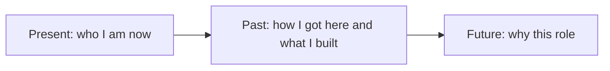

# Tell me about yourself

---

## 🟢 Junior Level

### What the interviewer is really testing
"Tell me about yourself" is not a request for your life story. The interviewer wants to know in about 90 seconds:
- Can you communicate clearly and structure your thoughts?
- Is your background relevant to a Java role?
- What are you proud of, and what are you looking for next?

Most junior candidates either recite their CV line by line or start with their childhood. Both waste the best opening slot of the interview.

### The Present → Past → Future structure



| Part | Time | Content |
|---|---|---|
| Present | 20 s | Current status, main stack (Java 17, Spring Boot, SQL) |
| Past | 45 s | 1-2 concrete projects or achievements with numbers |
| Future | 25 s | What you want to learn and why this company fits |

### Sample junior answer
> "I'm a recent Computer Science graduate who has spent the last year focused on backend development with Java and Spring Boot. During my internship at a logistics start-up I built a REST endpoint for shipment tracking, wrote JUnit tests that raised coverage of that module from 40% to 75%, and learned how to read production logs with the team's senior engineer. On the side I built a small expense tracker with Spring Data JPA and PostgreSQL, deployed in Docker. I'm now looking for a team where I can grow under experienced engineers, and your focus on payment systems is exactly the kind of domain where I want to learn about transactions and reliability."

### Real-world analogy
Think of it as the **trailer of a film**, not the whole film. It should make the viewer want to see more, and it should hint at the strongest scenes.

### Small example: a pitch skeleton

```text
Present : "I'm a <title> with <N> years of Java / Spring Boot experience."
Past    : "At <company> I <did X>, which resulted in <measurable result>."
Future  : "I'm looking for <growth area>, and <company> offers it because <reason>."
```

---

## 🟡 Middle Level

At 2-5 years, the pitch must show **ownership** rather than participation. "I worked on" becomes "I owned" or "I designed".

### Deeper example
> "I'm a Java backend developer with four years of experience, mostly on order-processing platforms. In my current team I own the checkout service: a Spring Boot application with Kafka and PostgreSQL handling about 3,000 orders per minute at peak. Last year I led the migration from synchronous REST calls to event-driven processing, which cut p99 latency from 1.8 s to 400 ms and removed a class of timeout incidents. Before that I worked at an outsourcing company where I learned to ship across many domains quickly. Now I'm looking to move to a product company where I can influence architecture, and your move toward microservices is where I could add value."

### Trade-offs when tailoring
| Choice | Benefit | Risk |
|---|---|---|
| Heavy on tech stack | Matches keyword filters | Sounds like a CV dump |
| Heavy on business impact | Memorable | May hide technical depth |
| Mentioning job-hopping reasons | Honesty | Can sound negative |

**Rule:** lead with impact, back it with the stack, and mention a reason for leaving only as a positive "looking for".

### Common mistakes
1. Talking for 4+ minutes - the interviewer loses interest.
2. Listing every technology ever touched ("Java, PHP, Perl, Angular...").
3. Badmouthing the previous employer.
4. Not tailoring the pitch to the job description.
5. Ending without a hook. A good close invites questions: "I can go deeper on the Kafka migration if that's useful."

---

## 🔴 Senior Level

For a senior or lead (8-12 years), the pitch is a **narrative of increasing scope**. The interviewer is checking whether you operate at the level you claim: technical depth, system thinking, people impact, and business awareness.

### Lead-level answer
> "I've spent twelve years in Java, and my work has gone through three phases. First, I was a strong individual contributor on trading back-ends where correctness and latency mattered. Then, as a tech lead for a team of seven, I moved us from a monolith to a modular architecture and introduced contract testing, which halved our regression cycle. Most recently, as a principal engineer, I work across four teams on platform decisions: Java 21 adoption, observability standards, and an internal Spring Boot starter used by 30 services. What I enjoy most is raising the effectiveness of a whole team, not only my own code. I'm looking for a role where I can set technical direction while staying hands-on, and your scale challenges fit that."

### What senior answers must contain
- **Scope**: number of teams, services, users, money, or engineers affected.
- **Decisions**: not just what you built, but what you chose *not* to build.
- **People**: mentoring, hiring, unblocking others.
- **Direction**: a clear reason for the next move that is not just money.

### Advanced: adapting to the audience

```java
// Pseudocode for how you tune the pitch to the interviewer
Interviewer who = interview.panel().first();
Pitch pitch = switch (who.role()) {
    case HIRING_MANAGER   -> Pitch.emphasize(IMPACT, LEADERSHIP);
    case TECH_LEAD        -> Pitch.emphasize(ARCHITECTURE, TRADE_OFFS);
    case HR               -> Pitch.emphasize(MOTIVATION, CULTURE_FIT);
    case PEER_ENGINEER    -> Pitch.emphasize(STACK, CODE_QUALITY);
};
```

### Red flags at senior level
- Still describing tasks rather than outcomes after 10 years.
- No mention of other people, which suggests a lone-wolf.
- Vague claims ("improved performance") without numbers.
- A different story from the CV, which damages trust.

---

## 🎯 Interview Cheat Sheet

### 30-second elevator pitch
"I'm a Java backend engineer; here is my current focus and scale, here is the one achievement I'm proudest of with a number, and here is why this role is the logical next step."

### Must-know bullets
- Keep it to **60-90 seconds**; practice aloud, not in your head.
- Structure: **Present → Past → Future**.
- Use **numbers**: latency, throughput, team size, revenue, coverage.
- Tailor 20% of it to the job description.
- End with a hook that invites a follow-up.

### Common follow-up questions
- "Which of those projects are you proudest of?"
- "Why are you leaving your current job?"
- "What would your colleagues say about you?"
- "Where do you see yourself in five years?"

### Red flags (things NOT to say)
- "Well, it's all on my CV."
- Complaints about your manager or employer.
- A chronological recitation from school onwards.
- "I'm just looking for any Java job."

### Related topics
- [Why do you want this role and what are your career expectations](02.%20Why%20do%20you%20want%20this%20role%20and%20what%20are%20your%20career%20expectations.md)
- [What is the STAR method](03.%20What%20is%20the%20STAR%20method.md)
- [What are your strengths and weaknesses](05.%20What%20are%20your%20strengths%20and%20weaknesses.md)
