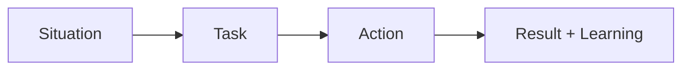

# What is the STAR method

---

## 🟢 Junior Level

### What the interviewer is really testing
Behavioral questions ("Tell me about a time when...") predict future behaviour from past behaviour. The STAR method is a **storytelling framework** that keeps your answer concrete, brief and focused on *your* contribution.

| Letter | Meaning | Share of the answer | Question it answers |
|---|---|---|---|
| **S** | Situation | ~15% | Where and when? What was the context? |
| **T** | Task | ~10% | What was my responsibility or goal? |
| **A** | Action | ~50% | What did *I* do, step by step? |
| **R** | Result | ~25% | What happened? Numbers? What did I learn? |



### Sample junior answer
**Question:** "Tell me about a time you solved a hard problem."

> **S:** "During my internship, our team's nightly report job sometimes failed with an OutOfMemoryError.
> **T:** My mentor asked me to find out why, since I was the newest and had time.
> **A:** I reproduced it locally with a bigger data set, took a heap dump, and opened it in Eclipse MAT. I saw that the code loaded 2 million rows into a `List` before processing. I rewrote it to read with a paged query and process in batches of 1,000, and I added a unit test with a large fake data set.
> **R:** The job's memory dropped from 2 GB to 150 MB, no failures in the following two months, and I learned to use a heap analyser."

### Real-world analogy
STAR is like a **news article**: the headline gives context, the body describes what happened, and the conclusion tells you why it matters.

### Prepare a story bank
You need only 5-6 good stories that can be reused for many questions:

```markdown
| Story | Reusable for |
|---|---|
| Fixed hard bug | problem solving, persistence, learning |
| Disagreed with teammate | conflict, communication |
| Missed deadline | failure, estimation, honesty |
| Learned new tech | adaptability, initiative |
| Helped a colleague | teamwork, mentoring |
```

---

## 🟡 Middle Level

### Deeper example with a trade-off
**Question:** "Describe a time you had to make a decision with incomplete information."

> **S:** "We had two weeks to add multi-currency support to the payment service, and requirements for rounding rules from finance weren't final.
> **T:** As the developer owning the module, I had to decide how to proceed without blocking the team.
> **A:** I isolated the rounding logic behind a `RoundingPolicy` interface, implemented the most common rule (HALF_EVEN) and documented the assumption in the ticket. I scheduled a 15-minute call with finance with two concrete examples and got a decision in two days. I also added contract tests so that changing the policy was a one-line change.
> **R:** Finance chose a different rule for two currencies, and we switched without rework. We shipped on time, and the pattern was reused for tax rules."

### Common STAR mistakes

| Mistake | Why it hurts | Fix |
|---|---|---|
| Saying "we" for everything | Interviewer can't see your contribution | Use "I" for your actions, "we" for outcomes |
| Long Situation | Loses attention | Two sentences maximum |
| No Result | Story feels unfinished | Always close with numbers or an observable change |
| Perfect hero story | Not credible | Include a mistake and what you learned |
| Hypothetical answer | "I would..." instead of "I did..." | Use real past events |

### STAR+L and STAR+I
Add **L (Learning)** or **I (Impact beyond the task)**. Interviewers love: "Since then, I always do X" - it shows growth.

---

## 🔴 Senior Level

### Lead-level use of STAR
At senior level, STAR stories must demonstrate **scope, influence and judgement**: ambiguous situations, trade-offs between options, stakeholders, and long-term consequences.

> **S:** "Our monolith deployment took four hours and happened monthly; three teams were blocked on each other, and attrition was rising.
> **T:** As tech lead I was asked to improve release frequency without a rewrite.
> **A:** I analysed deployment history and found 70% of conflicts came from two modules. I proposed a modular monolith with enforced boundaries using ArchUnit tests, plus feature flags for incomplete work. I got buy-in by running a two-week pilot with one team and sharing metrics with the other leads. I explicitly rejected a full microservices move because we lacked the operational maturity; I documented that in an ADR.
> **R:** Within six months we deployed weekly, then daily; lead time dropped from 21 to 3 days; two of the three teams later chose to extract a service on their own, with data to support it."

```java
// The ArchUnit rule that made the boundary enforceable - a concrete artefact to cite
@ArchTest
static final ArchRule orders_must_not_depend_on_billing_internals =
    noClasses().that().resideInAPackage("..orders..")
        .should().dependOnClassesThat().resideInAPackage("..billing.internal..");
```

### Advanced scenarios
- **Question about failure**: the strongest senior stories contain a decision that *did not* work out, and a systemic fix.
- **Questions about influence**: show how you convinced people with data, prototypes, and empathy, not hierarchy.
- **Time management**: 2 minutes for most stories; 3 for big leadership stories; always offer to go deeper.

### Red flags
- Every story ends with a flawless win.
- You cannot identify what you personally decided.
- The "Result" is only a feeling ("everyone was happy").
- The same story is reused for every question.
- Blaming others in the Situation.

---

## 🎯 Interview Cheat Sheet

### 30-second elevator pitch
"STAR means Situation, Task, Action, Result. I keep Situation and Task short, spend half the time on what *I* did, and close with measurable results and what I learned."

### Must-know bullets
- Prepare 5-6 stories in advance and map them to common themes.
- 60-120 seconds per story.
- Use "I" for your own actions.
- Quantify results: percent, time, money, incidents, satisfaction.
- Always include a learning or follow-up improvement.

### Common follow-up questions
- "What would you do differently?"
- "What was your specific role?"
- "How did the others react?"
- "How did you measure success?"

### Red flags (things NOT to say)
- "I would probably..." (hypothetical).
- "We did everything together."
- "It was nobody's fault, it just happened."
- Inventing a story: follow-ups will expose it.

### Related topics
- [Tell me about yourself](01.%20Tell%20me%20about%20yourself.md)
- [Describe your biggest technical achievement](04.%20Describe%20your%20biggest%20technical%20achievement.md)
- [How do you handle a production outage you caused](14.%20How%20do%20you%20handle%20a%20production%20outage%20you%20caused.md)
