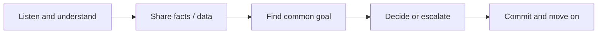

# How do you handle disagreement with a teammate or lead

---

## 🟢 Junior Level

### What the interviewer is really testing
- Do you **communicate respectfully** when you disagree?
- Can you separate **ideas from people**?
- Do you know when to **escalate** and when to **commit**?
- Are you coachable, or do you dig in?

### A simple process



### Sample junior answer (STAR)
> **S:** "In my first project, a senior colleague wanted to store user roles as a comma-separated string in one column. I thought a separate table was better.
> **T:** I needed to raise my concern without being disrespectful, since I was new.
> **A:** First I asked why he chose it, and learned he wanted a quick delivery. Then I showed him a small example where querying 'all admins' needed a `LIKE '%ADMIN%'`, which would also match 'SUPERADMIN'. I offered to implement the join table in half a day. He agreed to a quick test with me.
> **R:** We went with the join table, the delivery was delayed by only half a day, and he later asked for my opinion on other schema decisions. I learned to bring examples rather than opinions."

### Real-world analogy
Two people want to cross a river. They may disagree on the bridge or the boat, but they both want to **get across**. Focus on the destination.

### What junior candidates must show
- You asked questions first.
- You used **facts**, not feelings.
- You accepted the final decision gracefully, even if it wasn't yours.

---

## 🟡 Middle Level

### Deeper example
> **S:** "My team lead wanted to adopt a new message broker for a feature that I believed Kafka (already in use) could handle. Estimated cost for the new broker was three weeks plus ops overhead.
> **T:** As the feature owner I had to present a counter-proposal.
> **A:** I did not argue in the meeting. I wrote a one-page comparison with criteria we both agreed on (throughput, ordering, ops cost, team skill), ran a one-day spike with Kafka against our expected load, and shared the results. I also listed where the new broker was actually better, which was routing flexibility. The lead and I discussed it together and agreed to start with Kafka and revisit at a defined threshold.
> **R:** We saved three weeks and avoided a new operational dependency. The lead later said the one-pager approach was something he wanted the whole team to use."

### Decision matrix as a de-escalation tool

| Criterion | Weight | Option A (Kafka) | Option B (New broker) |
|---|---|---|---|
| Fits current load | 3 | 5 | 5 |
| Ops complexity | 3 | 4 | 2 |
| Team knowledge | 2 | 5 | 1 |
| Routing features | 1 | 2 | 5 |
| **Weighted score** | | **39** | **29** |

### Disagree and commit
When the decision goes against you, **say** it: "I still have a concern about X, but I support the decision and here's what I'll watch for." Then actually commit. Record the risk in the ADR so that you can revisit it with data.

### Common mistakes
- Arguing in public, in a PR thread, rather than in a direct conversation.
- Going over the lead's head before talking to them.
- Passive-aggressive compliance ("I told you so").
- "Winning" the argument but damaging the relationship.

---

## 🔴 Senior Level

### Lead-level answer
Senior-level conflict is often **structural**: competing priorities between teams, architecture ownership, or a lead whose decision is risky. The interviewer wants to see **principled flexibility**.

> **S:** "Two teams disagreed about who should own a shared customer-data module; one wanted a library, the other a service. Meetings had become heated and the roadmap slipped.
> **T:** As a senior engineer I was asked to mediate, with no authority over either team.
> **A:** I held separate 1:1 conversations to understand real needs: Team A needed low latency, Team B needed independent releases. I then facilitated a workshop around those needs, not the solutions, and wrote a short ADR with options, constraints, and a reversible first step: a library with a clear API boundary and a service extraction trigger once the call volume exceeded a defined threshold. I involved the engineering manager only to ratify.
> **R:** The deadlock ended in a week, both teams signed the ADR, and it was reused as a template for cross-team decisions."

### Levels of conflict handling

| Level | Technique |
|---|---|
| Personal | Direct, private conversation; assume good intent |
| Technical | Data, spike, ADR, decision criteria |
| Cross-team | Shared goals, neutral facilitator, reversible decisions |
| Ethical / safety | Escalate formally with documentation |

### Escalation checklist

```markdown
- [ ] I've talked to the person directly
- [ ] I've written down the facts and impact (not opinions)
- [ ] I've proposed at least one alternative
- [ ] I've told the person I will escalate and why
- [ ] I've presented the issue neutrally to the next level
```

### Red flags
- "I convinced him he was wrong" (a win-lose attitude).
- No example of **being wrong** yourself.
- Never disagreed with a lead: indicates passivity.
- Using politics or gossip.

---

## 🎯 Interview Cheat Sheet

### 30-second elevator pitch
"I listen first to understand the other person's goal, bring data or a quick prototype rather than opinions, look for the shared objective, and if the decision goes against me I disagree and commit, keeping the relationship intact."

### Must-know bullets
- Disagree **in private first**, then in the open with data.
- Prefer **spikes, benchmarks and ADRs** to arguments.
- Debate the **problem**, not the person.
- **Disagree and commit** after a decision.
- Escalate only after direct attempts, and transparently.

### Common follow-up questions
- "What if your lead was wrong and wouldn't listen?"
- "Tell me about a time you were wrong."
- "How did the relationship look afterwards?"
- "When would you escalate?"

### Red flags (things NOT to say)
- "I've never had a conflict."
- "I proved them wrong."
- "I just did it my way anyway."
- Blaming a colleague's character.

### Related topics
- [How do you give and receive code review feedback](07.%20How%20do%20you%20give%20and%20receive%20code%20review%20feedback.md)
- [How do you work with product managers QA DevOps and remote teams](15.%20How%20do%20you%20work%20with%20product%20managers%20QA%20DevOps%20and%20remote%20teams.md)
- [Mentoring juniors and leading without authority](17.%20Mentoring%20juniors%20and%20leading%20without%20authority.md)
