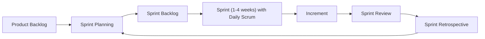

# Agile fundamentals Scrum roles events and artifacts

---

## 🟢 Junior Level

### What the interviewer is really testing
You will work in an Agile team almost certainly. The interviewer checks that you understand the **vocabulary and rhythm** of Scrum and why it exists, not just recite definitions.

### Agile in one paragraph
Agile (Agile Manifesto, 2001) values **individuals and interactions, working software, customer collaboration and responding to change** over processes, documentation, contracts and plans. It delivers value in small increments with fast feedback.

### Scrum at a glance



### Roles (accountabilities)
| Role | Responsibility |
|---|---|
| **Product Owner** | Maximises product value; owns and orders the Product Backlog |
| **Scrum Master** | Helps the team follow Scrum, removes impediments, coaches |
| **Developers** | Build a usable Increment each Sprint; self-managing (includes testers, DevOps) |

### Events
| Event | Purpose | Timebox (for a 1-month Sprint) |
|---|---|---|
| Sprint | Container for all work | 1 month max |
| Sprint Planning | Decide what and how | 8 h |
| Daily Scrum | Inspect progress, plan next 24 h | 15 min |
| Sprint Review | Inspect the Increment with stakeholders | 4 h |
| Retrospective | Improve how we work | 3 h |

### Artifacts and commitments
- **Product Backlog** → commitment: **Product Goal**.
- **Sprint Backlog** → commitment: **Sprint Goal**.
- **Increment** → commitment: **Definition of Done**.

### Sample junior answer
> "In my university project and internship we used two-week sprints. We planned stories in planning, had a 15-minute daily stand-up, demoed to the PO at the review, and discussed improvements in the retro. As a developer, I took tasks from the sprint backlog, updated my status, and raised blockers early in the daily."

### Real-world analogy
A sprint is like a **restaurant's weekly specials**: the owner (PO) chooses what is most valuable, the kitchen (team) decides how to cook it, and customers' feedback shapes next week's menu.

---

## 🟡 Middle Level

### Deeper understanding: why each event exists
Each event is an **inspect-and-adapt** opportunity: transparency → inspection → adaptation are the three pillars of empiricism.

### Common dysfunctions

| Anti-pattern | Symptom | Healthier approach |
|---|---|---|
| Daily as status report to a manager | Developers talk to the SM, not each other | Focus on the Sprint Goal and blockers |
| Sprint scope changes mid-sprint | Nothing finishes | Protect the Sprint Goal; negotiate scope with PO |
| Review = demo only, no feedback | No learning | Invite stakeholders, discuss what to do next |
| Retro with no actions | Same complaints each time | 1-2 owned, time-boxed actions |
| "Mini-waterfall" in sprint | Dev for 8 days, QA for 2 | Slice stories vertically; test continuously |
| Velocity as performance KPI | Inflated estimates | Use velocity only for forecasting |

### Deeper example (STAR)
> **S:** "Our team was carrying over 40% of stories each sprint.
> **T:** As a mid developer, I wanted to find the cause.
> **A:** I analysed two months of sprints: stories were too large and mid-sprint requests added about 20% unplanned work. I proposed a story-splitting guideline (max 3 days), a 15% capacity buffer for unplanned work, and a Sprint Goal that the PO helped defend.
> **R:** Carry-over dropped to 10% in three sprints and predictability improved."

### Common mistakes
- Treating Scrum as a set of rituals, not a feedback system.
- Confusing Scrum Master with project manager.
- Believing there is a "tester role" and "dev role" with no overlap.

---

## 🔴 Senior Level

### Lead-level answer
A senior engineer discusses **how Scrum interacts with engineering practice and organisation**. Without technical excellence, Agile degrades into "fragile" processes.

Key points:
- **Technical practices** that make Agile sustainable: CI/CD, automated tests, trunk-based development, feature flags, refactoring, and observability. Without them, the Definition of Done is aspirational.
- **Scaling**: multiple teams need alignment (shared Product Goal, joint refinement, API contracts, dependency boards) - Nexus, SAFe, LeSS, or just lightweight coordination. Choose by need, not fashion.
- **Metrics**: use flow metrics (lead time, cycle time, throughput, deployment frequency, change-failure rate - the DORA metrics) over velocity.
- **Cadence vs. continuous delivery**: sprints control planning, but code should be deployable at any time.

### Example: Sprint Goal and Definition of Done in a repo

```markdown
## Sprint 24 Goal
Customers can pay with saved cards in the EU checkout flow.

## Definition of Done (team-wide)
- [ ] Code reviewed by at least one peer
- [ ] Unit + integration tests pass in CI (coverage on changed lines >= 80%)
- [ ] No new critical Sonar issues
- [ ] API documented (OpenAPI) and changelog updated
- [ ] Feature behind a flag, deployed to staging
- [ ] Metrics and alerts added for new endpoints
```

### Advanced scenarios
- A **PO** who is unavailable: coach for proxy POs, clarify decision rights, make the backlog transparent.
- **Management** demands fixed scope and date: use the Sprint Goal for flexibility, release burn-up charts and probabilistic forecasts.
- **Regulated environments**: agile + audit trails via pull requests, automated evidence.
- **Agile adoption fatigue**: return to the principles, remove ceremonies that don't add value.

### Red flags
- Defending Scrum dogmatically, regardless of context.
- Not knowing the difference between Scrum and Agile.
- Thinking Agile means "no documentation" or "no planning".
- Seeing the Scrum Master as a secretary.

---

## 🎯 Interview Cheat Sheet

### 30-second elevator pitch
"Scrum is a lightweight framework for delivering a usable increment every sprint: a Product Owner orders the backlog, the Developers build it, the Scrum Master helps the team improve, and five events (Sprint, Planning, Daily, Review, Retro) provide inspect-and-adapt loops."

### Must-know bullets
- 3 roles, 5 events, 3 artifacts with 3 commitments.
- Empiricism: transparency, inspection, adaptation.
- The sprint goal gives focus and flexibility.
- Agile ≠ Scrum: Scrum is one framework.
- Good technical practices make Agile work.

### Common follow-up questions
- "What happens if the sprint goal becomes obsolete?" (PO can cancel the sprint.)
- "Who decides how much work goes into a sprint?" (Developers forecast.)
- "What do you do if the Scrum Master is also the manager?"
- "What is the difference between a sprint review and a retrospective?"

### Red flags (things NOT to say)
- "The Scrum Master assigns tasks."
- "Agile means we don't plan."
- "Daily stand-up is for the manager."
- "I just do my tickets."

### Related topics
- [Scrum vs Kanban](09.%20Scrum%20vs%20Kanban.md)
- [User stories acceptance criteria and Definition of Done](10.%20User%20stories%20acceptance%20criteria%20and%20Definition%20of%20Done.md)
- [Retrospectives and continuous improvement](16.%20Retrospectives%20and%20continuous%20improvement.md)
