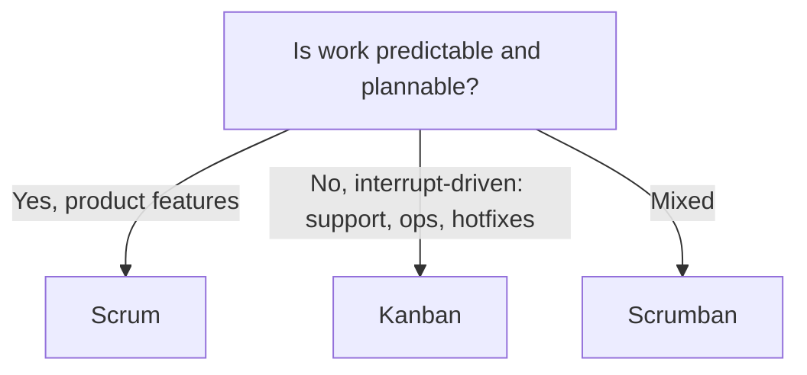

# Scrum vs Kanban

---

## 🟢 Junior Level

### What the interviewer is really testing
Do you understand that Scrum and Kanban are **different ways to manage flow of work**, and can you describe how your day-to-day would differ in each?

### Core difference

| Aspect | Scrum | Kanban |
|---|---|---|
| Cadence | Fixed-length sprints (1-4 weeks) | Continuous flow |
| Roles | PO, Scrum Master, Developers | No prescribed roles |
| Planning | Sprint planning | Pull when capacity is available |
| Limits | Sprint capacity (time-box) | **WIP limits** per column |
| Change mid-cycle | Discouraged inside a sprint | Allowed at any time (respecting WIP) |
| Metrics | Velocity, burndown | Lead time, cycle time, throughput |
| Delivery | End of sprint (increment) | Whenever an item is done |

### A Kanban board

```text
| Backlog | Analysis (2) | In Progress (3) | Code Review (2) | Testing (2) | Done |
|---------|--------------|-----------------|-----------------|-------------|------|
| Story G | Story F      | Story C         | Story B         |             | A    |
| Story H |              | Story D         |                 |             |      |
|         |              | Story E         |                 |             |      |
```
The number in brackets is the **WIP limit**: no new work is pulled into a full column until something moves on.

### Sample junior answer
> "In Scrum we planned a set of stories for a two-week sprint and reviewed at the end. In my internship support team we used Kanban: tickets came in unpredictably, so we pulled the next highest-priority bug when we had capacity, and limited in-progress items to three to avoid context switching. I preferred Kanban for support and Scrum for feature work."

### Real-world analogy
Scrum is a **train timetable**: departures every Monday with a fixed load. Kanban is a **taxi rank**: each cab leaves when a passenger arrives and the number of cabs waiting is limited.

---

## 🟡 Middle Level

### When to use which



### Trade-offs

| Scenario | Better fit | Why |
|---|---|---|
| New product, needs fast feedback and focus | Scrum | Sprint goal and review cadence |
| Platform / SRE team with incident work | Kanban | Work arrives randomly |
| Maintenance with many small tickets | Kanban | Flow efficiency matters |
| Team new to Agile | Scrum | Clear structure and rituals |
| Mature team with CD | Kanban or Scrumban | Cadence less necessary |

### Why WIP limits work
Little's Law: **Lead time = WIP / Throughput**. Reducing WIP shortens lead time without extra effort. Too many items "in progress" means multitasking, hidden queues and late discovery of problems.

### Deeper example
> **S:** "Our platform team used Scrum, but 40% of capacity was interrupts such as incident follow-ups and requests from other teams. Sprints constantly failed.
> **T:** I proposed to experiment with a different approach.
> **A:** We moved to Scrumban: a Kanban board with WIP limits, an 'expedite' lane with a limit of one, a weekly priority meeting instead of sprint planning, and a monthly retro. We tracked cycle time using the board's data.
> **R:** Median cycle time fell from 9 to 4 days and the team stopped missing 'commitments'."

### Common mistakes
- Using Kanban with **no WIP limits** (just a task board).
- Using Scrum as a **mini-waterfall**.
- Mixing in daily status meetings as a manager's control tool.
- Choosing by ideology instead of the nature of the work.

---

## 🔴 Senior Level

### Lead-level answer
A senior engineer evaluates the process by **outcomes and flow metrics**, not by loyalty to a framework:

- Measure **lead time, cycle time, throughput, WIP age, and escaped defects**.
- Use **cumulative flow diagrams** to spot bottlenecks (e.g. a growing "Code Review" band).
- Evolve the process: Scrum → Scrumban → Kanban as the team matures and its delivery pipeline improves.
- In multi-team contexts, align through **shared goals and dependency management**, not a uniform process. Teams can use different methods as long as interfaces and cadence for integration are clear.

### Example: flow-metrics query for a team dashboard

```java
// Computing median cycle time from tickets (Java 17+)
double medianCycleDays = tickets.stream()
    .filter(t -> t.doneAt() != null)
    .mapToLong(t -> Duration.between(t.startedAt(), t.doneAt()).toDays())
    .sorted()
    .boxed()
    .collect(Collectors.collectingAndThen(Collectors.toList(),
        l -> l.isEmpty() ? 0 : l.get(l.size() / 2)));
```

### Advanced scenarios
- **Management wants dates**: use Monte Carlo forecasting based on historical throughput: "85% probability of completing 12 items by 30 June."
- **Compliance** with fixed release windows: Kanban can coexist with scheduled releases using release trains.
- **Team resists change**: run a time-boxed experiment (4-6 weeks) with hypothesis and success metrics, then inspect.
- **Mixed teams** (dev, ops, data): Kanban visualises shared work well.

### Red flags
- "Scrum is better" or "Kanban is better" without context.
- No knowledge of WIP limits or flow metrics.
- Ignoring technical enablers such as CI/CD.
- Process changes without data or team consent.

---

## 🎯 Interview Cheat Sheet

### 30-second elevator pitch
"Scrum timeboxes work into sprints with defined roles and a sprint goal; Kanban visualises a continuous flow and limits work in progress. I choose Scrum for product development needing cadence and focus, Kanban for unpredictable flow work, and Scrumban when the team needs both."

### Must-know bullets
- Scrum: fixed cadence, roles, sprint goal, velocity.
- Kanban: continuous flow, WIP limits, lead and cycle time.
- Little's Law: lower WIP → shorter lead time.
- Scrumban mixes both.
- Choose by the nature of the work and the team's maturity.

### Common follow-up questions
- "Can you add work to a sprint after it starts?"
- "How do you decide on WIP limits?"
- "What would you do with urgent production bugs in Scrum?"
- "How do you estimate in Kanban?" (Often not: use right-sizing and cycle time.)

### Red flags (things NOT to say)
- "Kanban has no rules."
- "Scrum is just daily meetings."
- "We never limit WIP; developers are flexible."
- "Velocity measures productivity."

### Related topics
- [Agile fundamentals Scrum roles events and artifacts](08.%20Agile%20fundamentals%20Scrum%20roles%20events%20and%20artifacts.md)
- [Estimation and missed deadlines](13.%20Estimation%20and%20missed%20deadlines.md)
- [Retrospectives and continuous improvement](16.%20Retrospectives%20and%20continuous%20improvement.md)
