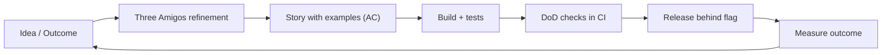

# User stories acceptance criteria and Definition of Done

---

## 🟢 Junior Level

### What the interviewer is really testing
Can you read a ticket, understand **what the user needs**, know when your work is **finished**, and ask good questions when the story is unclear?

### User story format

```text
As a <type of user>,
I want <goal / capability>,
so that <benefit / value>.
```

Example: *As a returning customer, I want to pay with a saved card, so that I can check out in one click.*

### INVEST: qualities of a good story
| Letter | Meaning |
|---|---|
| **I** | Independent |
| **N** | Negotiable |
| **V** | Valuable |
| **E** | Estimable |
| **S** | Small |
| **T** | Testable |

### Acceptance criteria (AC) in Given/When/Then

```text
Scenario: Pay with a saved card
  Given I am logged in and have a saved card ending 4242
  When I choose it at checkout and confirm
  Then the order is created with status PAID
  And I receive a confirmation email

Scenario: Saved card is expired
  Given my saved card expired last month
  When I try to pay with it
  Then I see "Card expired, please choose another" and no charge is made
```

### Definition of Done (DoD) vs Acceptance Criteria
| | Acceptance Criteria | Definition of Done |
|---|---|---|
| Scope | Per story | Whole team, every item |
| Question | "Does it do the right thing?" | "Is it built the right way and releasable?" |
| Example | "Expired cards are rejected" | "Tests pass, code reviewed, docs updated" |

### Sample junior answer
> "A user story describes value from the user's perspective, and acceptance criteria describe how we'll know it works. When I got a vague ticket, 'improve login', I asked the product owner what problem users had. It turned out to be 'password reset emails are slow', which changed the work completely."

### Real-world analogy
A story is a **restaurant order**: "a vegetarian meal for a guest with a nut allergy". The AC is the specific constraint ("no nuts"); the DoD is the kitchen's hygiene standard applied to every dish.

---

## 🟡 Middle Level

### From criteria to tests
Acceptance criteria should translate straight into automated tests:

```java
@Test
void expiredSavedCardIsRejectedAndNotCharged() {
    // Given
    var card = savedCard("4242", YearMonth.now().minusMonths(1));
    var order = orderWith(card);

    // When
    var result = checkout.pay(order, card.id());

    // Then
    assertThat(result.status()).isEqualTo(REJECTED);
    assertThat(result.message()).isEqualTo("Card expired, please choose another");
    verifyNoInteractions(paymentGateway);
}
```

### Splitting large stories
Split **vertically** (a thin slice through UI, API, DB), not horizontally (layer by layer).

| Bad split (horizontal) | Good split (vertical) |
|---|---|
| "Build DB tables" / "Build API" / "Build UI" | "Pay with saved card (happy path)" / "Handle expired card" / "Handle 3-D Secure" |

### A practical DoD for a Java team

```markdown
- [ ] Acceptance criteria verified (automated where possible)
- [ ] Unit and integration tests added; CI green
- [ ] Peer review approved; no unresolved blockers
- [ ] Static analysis (Sonar/SpotBugs) clean for new code
- [ ] Security checked: input validation, authz, no secrets in code
- [ ] Logging, metrics, and alerts for new behaviour
- [ ] API docs / ADR / runbook updated
- [ ] Deployed to staging and smoke-tested; feature flag configured
```

### Common mistakes
- **Technical tasks disguised as stories**: "Create a Kafka topic".
- ACs that describe implementation: "use Redis" instead of behaviour.
- A DoD that nobody follows, or that differs per developer.
- Stories with no "so that", so no one knows the value.
- Marking "done" while code is not deployed or tested.

### Deeper example
> **S:** "We often reopened stories after QA found missing edge cases.
> **T:** I suggested improving how we prepared stories.
> **A:** I introduced a 20-minute 'three amigos' session (PO, dev, QA) before refinement, with examples in Given/When/Then, and added an 'unhappy paths' prompt.
> **R:** Reopened stories fell by 60% in two sprints."

---

## 🔴 Senior Level

### Lead-level answer
Seniors treat stories as **conversations and hypotheses**, not contracts, and use DoD to protect long-term quality.

- **Outcome over output**: link stories to measurable outcomes (conversion, latency, cost). Challenge items with no clear value.
- **Specification by example / BDD**: living documentation (Cucumber or plain JUnit with expressive names) that business can read.
- **Non-functional requirements** belong in the DoD or as explicit ACs: performance (p95 < 300 ms), security, accessibility, observability, GDPR.
- **Definition of Ready (DoR)** as a team agreement, not a gate to block the PO.
- **Evolve the DoD** with the maturity of the team and incidents (every serious incident should add a DoD item or automated check).



### Advanced scenarios
- **Changing requirements mid-sprint**: negotiate scope against the Sprint Goal; split the story.
- **Cross-team stories**: break dependencies via contracts and stubs; avoid "dependent stories".
- **Technical debt**: capture as stories with user-facing risk ("reduce checkout failures caused by ...").
- **Pressure to skip DoD**: surface the risk and cost of skipping, and make the debt explicit; never silently cut quality.

### Red flags
- "Done means my code is merged."
- Treating DoD as a negotiable item per deadline.
- Writing long specifications without talking to users.
- Not tying work to outcomes.

---

## 🎯 Interview Cheat Sheet

### 30-second elevator pitch
"A user story captures who needs what and why. Acceptance criteria make it testable per story, usually Given/When/Then, while the Definition of Done is a team-wide quality checklist that makes an increment releasable. I split stories vertically, and automate criteria as tests."

### Must-know bullets
- Story = As a / I want / so that.
- INVEST for quality.
- AC per story; DoD for all stories; DoR for readiness.
- Vertical slicing, not layer splitting.
- NFRs belong in DoD or AC.

### Common follow-up questions
- "What do you do with a vague story?"
- "How do you handle a story that's too big?"
- "Who writes acceptance criteria?"
- "What is the difference between DoR and DoD?"

### Red flags (things NOT to say)
- "Tickets are just tasks; I don't care about the 'why'."
- "QA will find the edge cases."
- "Done is when I push."
- "DoD slows us down."

### Related topics
- [Agile fundamentals Scrum roles events and artifacts](08.%20Agile%20fundamentals%20Scrum%20roles%20events%20and%20artifacts.md)
- [How do you handle ambiguous requirements](11.%20How%20do%20you%20handle%20ambiguous%20requirements.md)
- [Estimation and missed deadlines](13.%20Estimation%20and%20missed%20deadlines.md)
